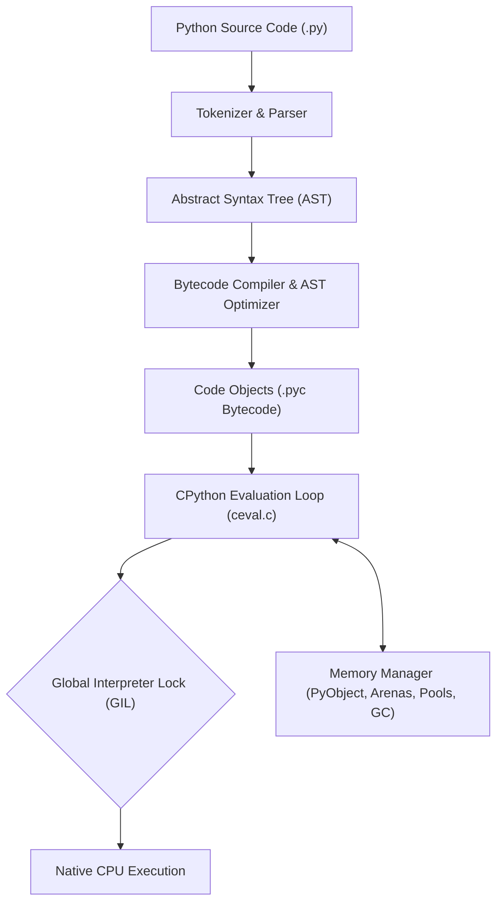

# 01. Python Core, Internals & Performance

Welcome to the comprehensive Python technical interview module. This section provides an exhaustive, production-grade question bank covering Python from first principles to CPython runtime mechanics, memory layout, concurrency models, and performance tuning.

---

## Module Syllabus & Topic Navigation

The Python interview content is organized across 8 focused, high-density files:

| File | Primary Focus Areas | Question Ranges |
|---|---|---|
| [**fundamentals.md**](fundamentals.md) | Syntax, variables, scopes (LEGB), control flow, expressions, builtins, error handling | `PY-BAS-001..025` `PY-INT-001..025` `PY-ADV-001..025` |
| [**data-types-and-collections.md**](data-types-and-collections.md) | Strings, numbers, lists, tuples, dicts, sets, `collections` (`deque`, `Counter`, `defaultdict`), comprehensions | `PY-BAS-026..050` `PY-INT-026..050` `PY-ADV-026..050` |
| [**oop.md**](oop.md) | Classes, instances, inheritance, MRO / C3 linearization, polymorphism, encapsulation, dunder methods, ABCs, dataclasses, descriptors | `PY-BAS-051..075` `PY-INT-051..075` `PY-ADV-051..075` |
| [**decorators-and-generators.md**](decorators-and-generators.md) | Closures, function/class decorators, `functools.wraps`, generators, `yield from`, coroutines, `itertools` | `PY-BAS-076..100` `PY-INT-076..100` `PY-ADV-076..100` |
| [**concurrency-and-parallelism.md**](concurrency-and-parallelism.md) | Threads, GIL, `threading`, `multiprocessing`, IPC, `asyncio` event loop, coroutines, tasks, `concurrent.futures` | `PY-BAS-101..125` `PY-INT-101..125` `PY-ADV-101..125` |
| [**memory-management.md**](memory-management.md) | `PyObject`, reference counting, cyclic garbage collection, generations, `sys.getrefcount`, `__slots__`, `weakref`, `tracemalloc` | `PY-BAS-126..150` `PY-INT-126..150` `PY-ADV-126..150` |
| [**internals-and-performance.md**](internals-and-performance.md) | CPython compiler, AST, bytecode, opcode dispatch (`ceval.c`), `dis` module, peephole optimizer, profiling (`cProfile`, `py-spy`) | `PY-BAS-151..175` `PY-INT-151..175` `PY-ADV-151..175` |
| [**advanced-python.md**](advanced-python.md) | Metaclasses, `__init_subclass__`, context managers, typing / generics / PEP 695, pattern matching, C extensions / CFFI | `PY-BAS-176..200` `PY-INT-176..200` `PY-ADV-176..200` |

---

## Question Count Breakdown

| Difficulty Level | Target Range | Status |
|---|---|---|
| **Basic Level** | `PY-BAS-001` through `PY-BAS-200` (200 Questions) | Active Bank |
| **Intermediate Level** | `PY-INT-001` through `PY-INT-200` (200 Questions) | Active Bank |
| **Advanced Level** | `PY-ADV-001` through `PY-ADV-200` (200 Questions) | Active Bank |
| **Total Python Questions** | **600 Questions** | **600 Total Questions** |

---

## Architectural Deep-Dive: CPython Execution Model

When preparing for Senior Python interviews, keep this execution pipeline in mind:

---

## How to Study This Module

1. **For Phone Screens**: Review the **One-Line Answer** and **Interview Tip** in each question card.
2. **For Coding & Logic Rounds**: Test the snippets in the **Practical Example** sections locally in Python 3.10+.
3. **For Senior / Staff Rounds**: Read the **Internal Working** and **Real-World Use Case** sections to discuss trade-offs, GIL contention, memory layouts, and CPython bytecode dispatch.
