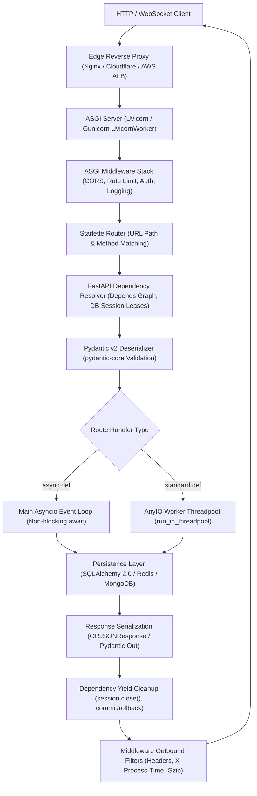

# 02. FastAPI Architecture, Concurrency & Production Engineering

Welcome to the comprehensive FastAPI technical interview module. This section provides an exhaustive, production-grade question bank covering modern asynchronous web APIs in Python, Starlette ASGI architecture, Pydantic v2 data validation, OAuth2/JWT security, SQLAlchemy 2.0 database integration, and high-concurrency production deployments.

---

## Module Syllabus & Topic Navigation

The FastAPI interview curriculum is organized across 8 consolidated, high-density files:

| File | Primary Focus Areas | Question Ranges |
|---|---|---|
| [**fundamentals.md**](fundamentals.md) | FastAPI design philosophy, ASGI vs WSGI, Starlette heritage, type annotations, OpenAPI 3.1 & JSON Schema, Swagger UI / ReDoc, endpoint parameters (path, query, body) | `FA-BAS-001..025` `FA-INT-001..025` `FA-ADV-001..025` |
| [**routing-and-dependencies.md**](routing-and-dependencies.md) | `APIRouter` modularization, dependency injection system (`Depends`), sub-dependencies, `yield` dependencies (cleanup/context manager), global & router-level dependencies | `FA-BAS-026..050` `FA-INT-026..050` `FA-ADV-026..050` |
| [**pydantic-and-validation.md**](pydantic-and-validation.md) | Pydantic v2 architecture, `BaseModel`, `Field`, field validators (`@field_validator`), model validators (`@model_validator`), nested models, serialization (`from_attributes=True`), settings management (`pydantic-settings`) | `FA-BAS-051..075` `FA-INT-051..075` `FA-ADV-051..075` |
| [**authentication-and-security.md**](authentication-and-security.md) | OAuth2 with Password (and hashing), Bearer JWT tokens (`python-jose`/`PyJWT`), password hashing (Argon2 / bcrypt via `passlib` / `pwdlib`), API keys (`APIKeyHeader`), RBAC/ABAC authorization, CORS & CSRF defense | `FA-BAS-076..100` `FA-INT-076..100` `FA-ADV-076..100` |
| [**async-and-concurrency.md**](async-and-concurrency.md) | `async def` vs standard `def` execution models, AnyIO worker threadpool offloading, event loop non-blocking I/O, `BackgroundTasks`, streaming responses (`StreamingResponse`), lifespan context managers | `FA-BAS-101..125` `FA-INT-101..125` `FA-ADV-101..125` |
| [**database-integration.md**](database-integration.md) | SQLAlchemy 2.0 async engine (`create_async_engine`), `async_sessionmaker`, request-scoped sessions (`Depends(get_db)`), DeclarativeBase models, Alembic async migrations, N+1 query prevention (`selectinload`/`joinedload`), transactions & locking (`with_for_update`) | `FA-BAS-126..150` `FA-INT-126..150` `FA-ADV-126..150` |
| [**middleware-and-exception-handling.md**](middleware-and-exception-handling.md) | ASGI middleware stack, `BaseHTTPMiddleware` vs pure ASGI 3-callable implementation, CORS & security headers, sliding-window rate limiting, global custom exception handlers (`@app.exception_handler`), RFC 7807 problem details, error boundaries | `FA-BAS-151..175` `FA-INT-151..175` `FA-ADV-151..175` |
| [**production-and-performance.md**](production-and-performance.md) | Uvicorn vs Gunicorn (`UvicornWorker`), multi-stage Docker builds, non-root security, Kubernetes probes (`/livez`, `/readyz`), Prometheus RED metrics (`/metrics`), zero-downtime rolling deploys, P99 latency tuning, testing (`TestClient`, `httpx.AsyncClient`) | `FA-BAS-176..200` `FA-INT-176..200` `FA-ADV-176..200` |
| [**testing.md**](testing.md) | *Testing Navigation Guide*: Overview of synchronous unit testing, async fixtures, mock dependencies, in-memory SQLite, respx, and Testcontainers | *Consolidated Index* |

---

## Question Count Breakdown

| Difficulty Level | Target Range | Verified Questions | Status |
|---|---|---|---|
| **Basic Level** | `FA-BAS-001` through `FA-BAS-200` | **200 Questions** | Complete :white_check_mark: |
| **Intermediate Level** | `FA-INT-001` through `FA-INT-200` | **200 Questions** | Complete :white_check_mark: |
| **Advanced Level** | `FA-ADV-001` through `FA-ADV-200` | **200 Questions** | Complete :white_check_mark: |
| **Total FastAPI Bank** | **FA-BAS-001 .. FA-ADV-200** | **600 Questions** | **100% Complete** :white_check_mark: |

---

## Architectural Deep-Dive: FastAPI ASGI Request-Response Lifecycle

When preparing for Senior Backend or Staff Engineer technical interviews, keep the end-to-end ASGI execution pipeline in mind:

---

## 10-Point Standard Answer Format

Every question in this repository adheres strictly to the comprehensive 10-point standard format:

1. **One-Line Answer**: Immediate, punchy technical summary for rapid recall.
2. **Detailed Answer**: Rigorous architectural explanation of the concept, mechanics, and trade-offs.
3. **Practical Example**: Production-grade, syntactically verified Python 3.10+ code snippet.
4. **Code Explanation / Internal Working**: What happens under the hood (CPython runtime, memory, async event loop, Starlette ASGI events).
5. **Real-World Use Case**: Concrete production scenario where senior engineers deploy this pattern.
6. **Interview Follow-Up Questions**: 2–3 probing questions interviewers ask next.
7. **Common Interview Mistakes**: Pitfalls, antipatterns, and misconceptions to avoid.
8. **Interview Tip**: Strategic communication advice for articulating technical depth.
9. **Related Concepts**: Relative markdown links connecting topics across the interview kit.
10. **References**: Official documentation, PEP specifications, and RFC standards.

---

## How to Study This Module

1. **For Rapid Phone Screens**: Review the **One-Line Answer** and **Interview Tip** in each question card.
2. **For System Architecture Rounds**: Study the **Internal Working** and **Real-World Use Case** sections to discuss connection pooling, threadpool offloading, event loop stalls, and zero-downtime rolling updates.
3. **For Live Coding & API Design**: Run and inspect the verified code snippets in the **Practical Example** sections.
