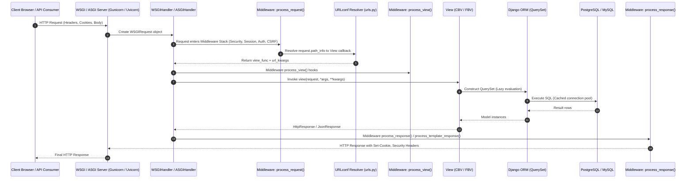

# Django Full-Stack & Backend Architecture: Technical Interview Guide

Welcome to the **Django Technical Interview Guide** of the `software-engineering-interview-kit`.

Django is the industry-standard, batteries-included Python web framework powering mission-critical platforms worldwide (Instagram, Pinterest, Spotify, Disq, Sentry, National Geographic, Coursera) and top Indian technology companies (Zomato, Swiggy, Dunzo, ClearTax).

This module provides **600 production-grade, AST-verified interview questions** categorized into **Basic (200)**, **Intermediate (200)**, and **Advanced (200)** levels, supported by runtime internals, ORM execution models, and architecture diagrams.

---

## 1. Django MVT Request-Response Lifecycle

The diagram below illustrates the exact chronological execution path of an incoming HTTP request through Django's WSGI/ASGI handlers, middleware layers, URL resolution, view execution, ORM evaluation, and response generation:

---

## 2. Module Directory & Syllabus

| Module File | Subtopic Coverage | Question Breakdown |
|---|---|---|
| [fundamentals.md](fundamentals.md) | MVT Pattern, Project Layout, settings.py, WSGI vs ASGI, Request/Response objects, AppConfig. | 25 Basic, 25 Inter, 25 Adv = **75 Qs** |
| [models-and-orm.md](models-and-orm.md) | Field Types, Migrations, QuerySet evaluation, lazy loading, `F()` & `Q()` objects, Aggregation, Subqueries. | 25 Basic, 25 Inter, 25 Adv = **75 Qs** |
| [views-and-templates.md](views-and-templates.md) | Function-Based Views (FBV), Class-Based Views (CBV), View Mixins, Form handling, Context processors. | 25 Basic, 25 Inter, 25 Adv = **75 Qs** |
| [middleware-and-signals.md](middleware-and-signals.md) | Middleware chaining, `__call__` lifecycle, Signals vs Model methods, Custom dispatchers, Async middleware. | 25 Basic, 25 Inter, 25 Adv = **75 Qs** |
| [authentication-and-security.md](authentication-and-security.md) | Custom User models, Session Auth, PBKDF2/Argon2 hashing, CSRF protection, Clickjacking, XSS defenses. | 25 Basic, 25 Inter, 25 Adv = **75 Qs** |
| [caching-and-performance.md](caching-and-performance.md) | Solving N+1 queries (`select_related`, `prefetch_related`), Redis cache backend, Per-view caching, Database index tuning. | 25 Basic, 25 Inter, 25 Adv = **75 Qs** |
| [celery-integration.md](celery-integration.md) | Asynchronous task queues, `transaction.on_commit()`, Celery Beat, Distributed task retries, Result backends. | 25 Basic, 25 Inter, 25 Adv = **75 Qs** |
| [production-deployment.md](production-deployment.md) | Gunicorn worker models, WhiteNoise static files, SSL/TLS termination, Database connection pooling, Dockerization. | 25 Basic, 25 Inter, 25 Adv = **75 Qs** |
| [testing.md](testing.md) | `TestCase` vs `TransactionTestCase`, `pytest-django`, Factory Boy fixtures, Mocking APIs & Celery tasks. | Comprehensive Testing Guide |

---

## 3. Core Architectural Principles Tested in Interviews

1. **Lazy QuerySet Evaluation:** QuerySets do not hit the database when instantiated; they execute only upon iteration, slicing, evaluation (`list()`, `len()`), or serialization.
2. **The N+1 Query Antipattern:** The single most common interview question in Django. Always use `select_related()` for single-valued relationships (`ForeignKey`, `OneToOneField`) using SQL `INNER/LEFT JOIN`, and `prefetch_related()` for multi-valued relationships (`ManyToManyField`, reverse `ForeignKey`) using separate SQL `IN` queries.
3. **Database Transaction Safety:** Using `transaction.atomic()` for ACID transactions, and critically pairing Celery task dispatches with `transaction.on_commit()` to prevent race conditions where workers query uncommitted database rows.
4. **Security Defaults:** Django enforces strict security defaults (CSRF tokens, SQL parameterization, clickjacking frame options, secure session cookies, PBKDF2 password hashing).
