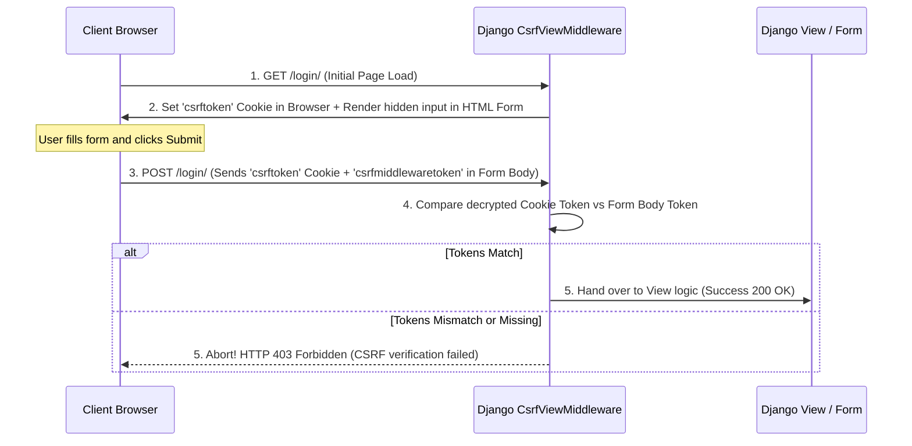

# Django Authentication & Web Security Guide

## Module Overview
This module covers **Django Session Authentication**, **CSRF Protection (Double Submit Cookie Pattern)**, cryptographic password hashing (Argon2 / PBKDF2), and SQL Injection prevention.

---

## Visual Architecture: Django CSRF Token Verification Flow



---

## Questions & Comprehensive Solutions

### DJ-SEC-001: How does CSRF (Cross-Site Request Forgery) Protection work in Django?

**Difficulty:** Intermediate  
**Topic:** Web Application Security

#### 1. Simple Explanation
Imagine an attacker tricks you into clicking a link `evil-website.com/transfer-money`. If you are logged into your bank in another tab, your browser automatically attaches your bank login cookies to that request, transferring money without your knowledge. This is a **CSRF Attack**.  
Django stops this by requiring a secret, unpredictable **CSRF Token** on every form submission. Even if the attacker tricks your browser into sending your cookies, the attacker cannot guess the secret token value, so Django rejects the attack.

#### 2. One-Line Interview Answer
Django protects against CSRF using the **Synchronizer Token / Masked Double-Submit Cookie Pattern**, where incoming `POST`/`PUT`/`DELETE` requests must include a secret token matching the masked session CSRF cookie.

#### 3. Why GET requests do NOT need CSRF tokens:
According to HTTP standards, `GET` requests must be **Safe** (read-only) and should never alter database state. CSRF protection is strictly enforced on state-changing HTTP methods (`POST`, `PUT`, `DELETE`, `PATCH`).

---

### DJ-SEC-002: How does Django securely store passwords?

**Difficulty:** Intermediate  
**Topic:** Cryptography & Hashing

#### Detailed Technical Explanation:
1. **Never Plaintext, Never Symmetric Encryption:** Django uses one-way **Cryptographic Hash Functions**.
2. **Default Hasher:** `PBKDF2PasswordHasher` with SHA-256 and **720,000 hash iterations** (automatically tuned upward in Django updates to resist GPU brute-force attacks).
3. **Recommended High-Security Hasher:** `Argon2` (winner of the Password Hashing Competition), which resists specialized GPU/ASIC attacks by requiring significant memory space.
4. **Per-User Salt:** Every password generates a unique cryptographically secure random salt, preventing pre-computed **Rainbow Table attacks**.
5. **Format in Database:**
   ```text
   algorithm$iterations$salt$hash
   pbkdf2_sha256$720000$randomSaltString$computedHashString...
   ```

---

### DJ-SEC-003: How does the Django ORM prevent SQL Injection?

**One-Line Answer:**  
The Django ORM prevents SQL injection by default through **parameterized queries**, separating the SQL command structure from user input values at the database driver level (`psycopg2`/`psycopg3`).

```python
# SAFE: Parameterized Query (Values are escaped as parameters, not concatenated)
users = User.objects.filter(username=user_input)

# DANGEROUS ANTI-PATTERN: String Formatting in Raw SQL (Vulnerable to SQL Injection!)
# Never do this:
User.objects.raw(f"SELECT * FROM auth_user WHERE username = '{user_input}'")

# SAFE RAW SQL: Use parameter passing
User.objects.raw("SELECT * FROM auth_user WHERE username = %s", [user_input])
```
