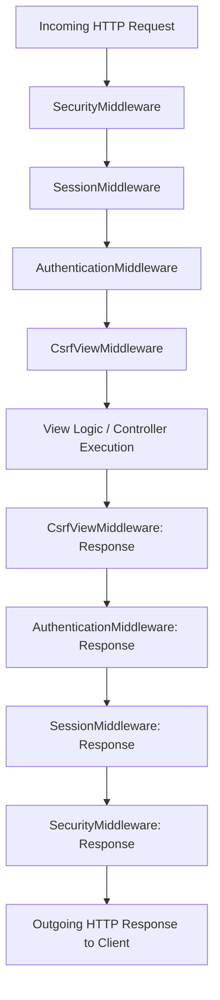

# Django Middleware & Signals Deep-Dive Guide

## Module Overview
This module covers **Django Middleware Lifecycles**, execution order, custom middleware implementation, **Django Signals (`pre_save`, `post_save`, `m2m_changed`)**, and why signals can become an architectural anti-pattern in high-throughput production systems.

---

## Visual Architecture: Django Request-Response Middleware Execution Onion



---

## Questions & Comprehensive Solutions

### DJ-MID-001: How does Django Middleware execute and how do you write custom middleware?

**Difficulty:** Intermediate  
**Topic:** Django Architecture

#### 1. Simple Explanation
Think of Django Middleware like layers of an onion. When a request comes in from a user, it passes through the outer layers to reach the center (the View). Once the View creates a response, that response passes back out through the same layers in reverse order before reaching the user.

#### 2. One-Line Interview Answer
**Django Middleware** is a framework of hooks into Django’s request/response processing that globally intercepts, inspects, and modifies requests before views execute and responses before they are returned to clients.

#### 3. Execution Order Rule:
- **Request Phase:** Top to bottom as listed in `settings.MIDDLEWARE`.
- **Response Phase:** Bottom to top in exact reverse order.

#### 4. Practical Python Implementation: Execution Time & Correlation ID Middleware

```python
import time
import uuid
import logging

logger = logging.getLogger(__name__)

class PerformanceAndTraceMiddleware:
    def __init__(self, get_response):
        self.get_response = get_response

    def __call__(self, request):
        # 1. Incoming Request Hook (Executes BEFORE View)
        start_time = time.perf_counter()
        request_id = request.headers.get("X-Request-ID", str(uuid.uuid4()))
        request.request_id = request_id

        # 2. Hand off to the next middleware or View
        response = self.get_response(request)

        # 3. Outgoing Response Hook (Executes AFTER View)
        duration_ms = (time.perf_counter() - start_time) * 1000
        response["X-Request-ID"] = request_id
        response["X-Response-Time-MS"] = f"{duration_ms:.2f}"

        if duration_ms > 500:
            logger.warning(f"SLOW REQUEST: {request.path} took {duration_ms:.2f}ms [Trace: {request_id}]")

        return response
```

---

### DJ-SIG-002: What are Django Signals and why are they considered dangerous in production?

**Difficulty:** Advanced  
**Topic:** Django Design Patterns & Signals

#### 1. Simple Explanation
Signals are Django's internal event announcer. When something happens in one model (like saving an order), Django shouts *"An order was just saved!"*, and other parts of your code that are listening (receivers) can automatically take action (like updating an inventory count).

#### 2. Why Signals are Dangerous in Production (Anti-Patterns):
1. **Implicit Hidden Execution:** Signals execute implicitly behind the scenes. A developer calling `order.save()` has no idea that 4 separate signals are silently updating other tables, sending emails, and triggering external HTTP calls.
2. **Synchronous Execution & Blocking:** By default, Django signals are **100% synchronous**. If a `post_save` signal makes an external API call to SendGrid or Stripe, the entire HTTP request freezes until that network call finishes.
3. **Skipped by Bulk Operations:** Django signals **do NOT trigger** during `bulk_create()` or `QuerySet.update()`, leading to subtle data inconsistency bugs where some records trigger side effects and bulk records do not!
4. **Transaction Rollback Hazards:** If a `post_save` signal triggers an email, but the database transaction subsequently rolls back, the user receives an email confirmation for an order that never succeeded in the database!

#### 3. Production Best Practice: `transaction.on_commit()`
Never trigger critical side effects inside raw `post_save` signals. Instead, execute them only after the database transaction has successfully committed:

```python
from django.db import transaction
from django.db.models.signals import post_save
from django.dispatch import receiver
from .models import Order
from .tasks import send_order_confirmation_task

@receiver(post_save, sender=Order)
def order_saved_handler(sender, instance, created, **kwargs):
    if created:
        # Schedule Celery task ONLY after PostgreSQL transaction commits successfully!
        transaction.on_commit(
            lambda: send_order_confirmation_task.delay(instance.id)
        )
```
