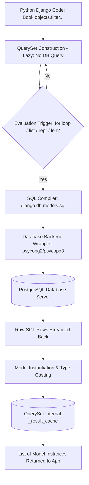
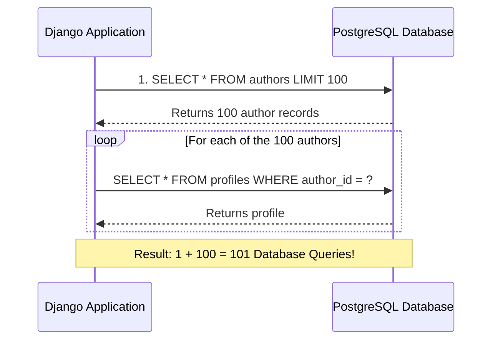

# Django Models & ORM Deep-Dive Guide

## Module Overview
This module covers the internal workings of the **Django Object-Relational Mapper (ORM)**, **QuerySet Lazy Evaluation**, the **N+1 Query Problem**, **`select_related` vs `prefetch_related`**, and database optimization patterns required for senior backend engineering roles.

---

## Architecture: Django ORM Query Execution Lifecycle



---

## Core Questions & Comprehensive Solutions

### DJ-ORM-001: What are Django QuerySets and how does Lazy Evaluation work?

**One-Line Answer:**  
A **Django QuerySet** is a collection of database queries representing objects; it is **lazy**, meaning constructing, chaining, and filtering a QuerySet does *not* execute SQL until the QuerySet is explicitly evaluated.

**When is a QuerySet evaluated?**
- Iteration (`for item in queryset:`)
- Slicing with a step (`queryset[::2]`)
- Explicit conversion to Python collections (`list(queryset)`, `len(queryset)`, `bool(queryset)`)
- Serialization / evaluation in templates
- Calling `repr()` in the Python REPL

**Code Demonstration:**
```python
# NO database hit occurs here:
books = Book.objects.filter(is_published=True).order_by("-created_at")
books = books.filter(category="Computer Science")

# DATABASE HIT OCCURS HERE (single optimized SQL query):
for book in books:
    print(book.title)

# SECOND ITERATION REUSES INTERNAL CACHE (zero additional DB hits):
for book in books:
    print(book.price)
```

---

### DJ-ORM-002: What is the N+1 Query Problem and how do you diagnose it?

**One-Line Answer:**  
The **N+1 Query Problem** occurs when an application executes 1 initial SQL query to fetch a parent dataset of $N$ rows, and then executes $N$ separate subsequent SQL queries inside a loop to fetch related child foreign-key records, causing severe database latency degradation.

**The N+1 Anti-Pattern:**



**Diagnosing N+1 in Django:**
1. **Django Debug Toolbar (Local Dev):** Highlights duplicate identical SQL queries in red.
2. **`django.test.utils.CaptureQueriesContext`:** Write automated unit tests enforcing query limits:
   ```python
   def test_author_list_query_count(self):
       with self.assertNumQueries(2): # Fails if N+1 query problem exists!
           response = self.client.get("/api/authors/")
   ```
3. **`django-silk` or APM Tracing (Production):** Flags endpoints executing hundreds of queries per request.

---

### DJ-ORM-003: `select_related` vs `prefetch_related`

**Comparison Table:**

| Feature | `select_related` | `prefetch_related` |
| :--- | :--- | :--- |
| **Relationship Types** | Single-valued: `ForeignKey`, `OneToOneField` | Multi-valued: `ManyToManyField`, reverse `ForeignKey` (`author.books.all()`) |
| **SQL Strategy** | Single SQL query using **SQL `JOIN`** (`INNER JOIN` / `LEFT OUTER JOIN`) | **Two separate SQL queries**, joined in Python memory using `id IN (...)` |
| **Database Overhead** | Can create wide rows if joined tables have many columns | Executes 2 queries but keeps returned rows compact |
| **Caching** | Caches the related model instance on the parent object | Caches the related QuerySet in parent's internal cache |

**Code Example:**

```python
# 1. select_related for ForeignKey (1 SQL query with JOIN)
# SQL: SELECT book.*, author.* FROM book INNER JOIN author ON book.author_id = author.id
books = Book.objects.select_related("author").all()
for b in books:
    print(b.author.name) # Zero extra queries!

# 2. prefetch_related for ManyToMany or Reverse FK (2 SQL queries)
# Query 1: SELECT * FROM author;
# Query 2: SELECT * FROM book WHERE author_id IN (1, 2, 3, ...);
authors = Author.objects.prefetch_related("books").all()
for a in authors:
    for b in a.books.all(): # Zero extra queries!
        print(b.title)
```

---

### DJ-ORM-004: How do you handle atomic database transactions in Django?

**One-Line Answer:**  
Wrap database operations requiring all-or-nothing guarantees in `transaction.atomic()` context managers or decorators, ensuring rollbacks occur automatically if any exception is raised.

```python
from django.db import transaction

def transfer_funds(sender_id: int, recipient_id: int, amount: float):
    with transaction.atomic():
        # Pessimistic row locking to prevent concurrent balance modifications
        sender = Wallet.objects.select_for_update().get(id=sender_id)
        recipient = Wallet.objects.select_for_update().get(id=recipient_id)

        if sender.balance < amount:
            raise InsufficientFundsError("Insufficient balance")

        sender.balance -= amount
        recipient.balance += amount
        sender.save()
        recipient.save()

        # Execute post-commit side-effects (e.g., notification email) ONLY after commit succeeds
        transaction.on_commit(lambda: send_transfer_email(sender.user.email, amount))
```

---

### DJ-ORM-005: Bulk Database Operations (`bulk_create`, `bulk_update`)

**Best Practice:**
Never call `save()` inside a loop for thousands of records. Use batch operations:

```python
# BAD: Executes 10,000 separate INSERT queries
for data in user_records:
    User.objects.create(**data)

# GOOD: Executes a single batch INSERT query in chunks of 1000
new_users = [User(**data) for data in user_records]
User.objects.bulk_create(new_users, batch_size=1000)

# Batch updates:
for user in users:
    user.is_verified = True
User.objects.bulk_update(users, fields=["is_verified"], batch_size=1000)
```
