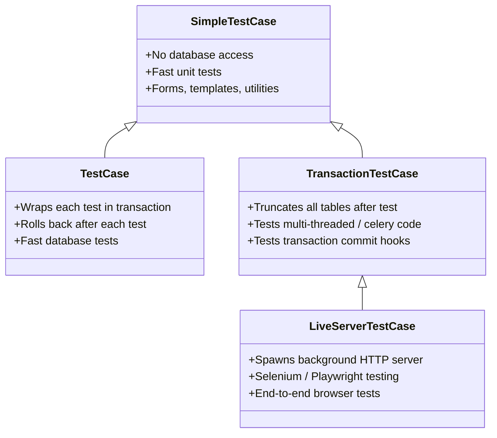

# Django Testing & Quality Assurance: Comprehensive Interview Guide

Testing is a core competency evaluated in mid-level and senior Django backend engineering interviews. This guide covers Django's testing hierarchy, database isolation mechanisms, `pytest-django` integration, mocking strategies, and performance benchmarking.

---

## 1. Django Test Class Hierarchy

Django provides a specialized hierarchy of test classes derived from Python's standard `unittest.TestCase`:



### Key Differences & Interview Comparison

| Test Class | Database Access | Cleanup Mechanism | Speed | Use Case |
|---|---|---|---|---|
| `SimpleTestCase` | Disallowed (raises exception) | None | Fastest | Pure functions, form validations, template tags, serializers. |
| `TestCase` | Allowed | `ROLLBACK` to savepoint | Fast | 95% of standard database tests (models, views, queries). |
| `TransactionTestCase` | Allowed | Table truncation / flush | Slower | Testing `transaction.atomic()`, `transaction.on_commit()`, multi-threading. |
| `LiveServerTestCase` | Allowed | Table truncation / flush | Slowest | End-to-end browser integration tests with live HTTP socket. |

---

## 2. Why `TestCase` is Faster Than `TransactionTestCase`

In `django.test.TestCase`:
1. Django begins an outer database transaction at the start of the test class.
2. At the start of each individual test method, Django establishes a **Savepoint** (`SAVEPOINT "django_test_1"`).
3. The test executes inserts, updates, and deletes.
4. At the end of the test method, Django issues a `ROLLBACK TO SAVEPOINT "django_test_1"`.
5. Because no data is actually committed to disk, test cleanup takes microseconds.

In `TransactionTestCase`:
1. Test commits actual transactions to the database.
2. At the end of the test, Django executes `TRUNCATE TABLE` or `DELETE FROM` across every single database table in the project.
3. This adds substantial disk I/O, making `TransactionTestCase` 10x–50x slower.

---

## 3. Testing Celery Tasks & `transaction.on_commit()`

A classic production bug occurs when a Celery task is dispatched before the database transaction commits:

```python
# PRODUCTION VULNERABILITY: Worker runs before DB commits!
def create_order(request):
    with transaction.atomic():
        order = Order.objects.create(user=request.user, amount=500)
        # BUG: Celery worker might query DB before transaction commits -> Order.DoesNotExist!
        process_payment.delay(order.id)
```

### The Correct Implementation
```python
from django.db import transaction

def create_order(request):
    with transaction.atomic():
        order = Order.objects.create(user=request.user, amount=500)
        # SAFE: Dispatches only after successful outer transaction commit
        transaction.on_commit(lambda: process_payment.delay(order.id))
```

### How to Test `on_commit` Hooks
In unit tests, `TestCase` does not commit transactions. To test `on_commit` callbacks, use `captureOnCommitCallbacks`:

```python
from django.test import TestCase
from unittest.mock import patch

class OrderCreationTest(TestCase):
    @patch("myapp.tasks.process_payment.delay")
    def test_order_creation_triggers_payment_task(self, mock_delay):
        with self.captureOnCommitCallbacks(execute=True):
            response = self.client.post("/api/orders/", {"amount": 500})
            self.assertEqual(response.status_code, 201)

        # Verified: delay() was called because callbacks were explicitly executed
        mock_delay.assert_called_once()
```

---

## 4. Modern Testing with `pytest-django`

Industry standard repositories favor `pytest-django` for its expressive fixtures and concise assertions:

```python
import pytest
from django.contrib.auth import get_user_model
from myapp.models import Order

User = get_user_model()

@pytest.fixture
def test_user(db):
    """Fixture providing a persisted test user."""
    return User.objects.create_user(username="testuser", password="secretpassword123")

@pytest.mark.django_db
def test_user_order_count(test_user):
    """Test using pytest-django db marker."""
    Order.objects.create(user=test_user, total_inr=1500.00)
    assert test_user.orders.count() == 1
```

---

## 5. Factory Boy & Faker vs JSON Fixtures

Interviewers frequently ask: *"Why are JSON database fixtures discouraged in Django testing?"*

- **Fragility:** If a model schema changes (e.g. adding a non-nullable column), all static JSON fixtures break and must be manually updated.
- **Maintenance Nightmare:** Large fixtures introduce hidden dependencies across tests.
- **Factory Boy Solution:** Generates dynamic, valid model instances programmatically with randomized Faker data, specifying only the fields relevant to the specific test:

```python
import factory
from factory.django import DjangoModelFactory
from myapp.models import Customer

class CustomerFactory(DjangoModelFactory):
    class Meta:
        model = Customer

    name = factory.Faker("name")
    email = factory.Faker("email")
    phone = factory.Faker("phone_number")
    is_active = True
```
