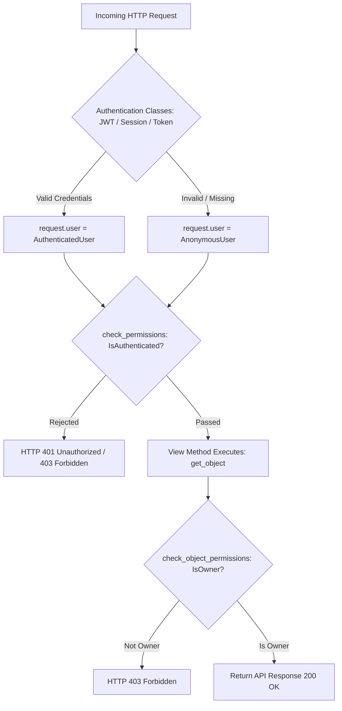

# DRF Authentication, Permissions & Security Guide

## Module Overview
This guide covers **Authentication Schemes (Session, Token, JWT)**, **Permission Classes**, and **Custom Object-Level Permissions** in Django REST Framework.

---

## Visual Flow: DRF Request Authentication & Permission Enforcement



---

## Questions & Comprehensive Solutions

### DRF-SEC-001: Authentication vs Authorization (Permissions) in DRF

**One-Line Answer:**  
**Authentication** verifies *who you are* (identity), while **Authorization (Permissions)** decides *what you are allowed to do* (access rights).

#### Comparison Table:

| Aspect | Authentication (`authentication_classes`) | Authorization (`permission_classes`) |
| :--- | :--- | :--- |
| **Purpose** | Resolves the identity of `request.user` | Grants or denies access to the endpoint |
| **Status Codes** | Fails with **HTTP 401 Unauthorized** (if credentials invalid) | Fails with **HTTP 403 Forbidden** (user is known, but lacks rights) |
| **Examples** | `JWTAuthentication`, `TokenAuthentication`, `SessionAuthentication` | `IsAuthenticated`, `IsAdminUser`, `IsOwnerOrReadOnly` |

---

### DRF-SEC-002: How do you create Custom Object-Level Permissions in DRF?

**Difficulty:** Intermediate  
**Topic:** API Security

#### Real-World Scenario:
In a blogging or e-commerce platform, any authenticated user can read an article or product (`GET`), but **only the author or owner** should be allowed to edit (`PUT`) or delete (`DELETE`) it.

#### Python Implementation:

```python
from rest_framework import permissions

class IsOwnerOrReadOnly(permissions.BasePermission):
    """
    Custom permission to only allow owners of an object to edit or delete it.
    """
    def has_permission(self, request, view):
        # Global permission: Allow read for anyone, require login for writes
        if request.method in permissions.SAFE_METHODS: # GET, HEAD, OPTIONS
            return True
        return request.user and request.user.is_authenticated

    def has_object_permission(self, request, view, obj):
        # Read permissions are allowed to any request
        if request.method in permissions.SAFE_METHODS:
            return True

        # Write permissions are only allowed to the owner of the object
        # (Assumes the model has an 'owner' or 'user' field)
        return obj.user == request.user
```

**Applying to a ViewSet:**
```python
class ArticleViewSet(viewsets.ModelViewSet):
    queryset = Article.objects.all()
    serializer_class = ArticleSerializer
    permission_classes = [IsOwnerOrReadOnly]
```
