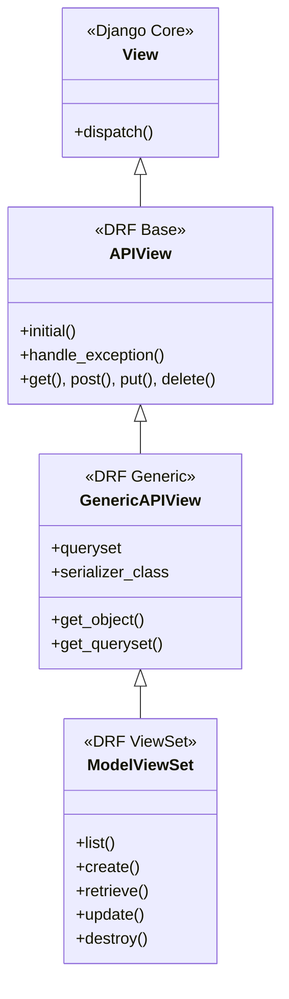

# DRF Views, ViewSets & Routers Interview Guide

## Module Overview
This module covers **APIView**, **GenericAPIView & Mixins**, **ModelViewSet**, **Routers**, and custom action routing in Django REST Framework.

---

## Visual Hierarchy: DRF View Class Inheritance Spectrum



---

## Questions & Comprehensive Solutions

### DRF-VIW-001: APIView vs GenericAPIView vs ModelViewSet

**Difficulty:** Intermediate  
**Topic:** DRF View Architectures

**Comparison Matrix:**

| Feature | `APIView` | `GenericAPIView` + Mixins | `ModelViewSet` |
| :--- | :--- | :--- | :--- |
| **Control Level** | Maximum manual control | Moderate abstraction | Highest convention & automation |
| **Method Mapping** | Direct HTTP verbs (`get()`, `post()`) | Verb mixins (`ListModelMixin`, etc.) | Semantic actions (`list()`, `create()`, `retrieve()`, `update()`, `destroy()`) |
| **Routing** | Standard Django `path()` | Standard Django `path()` | Automatic URL generation via `DefaultRouter` |
| **Code Length** | High (50+ lines for full CRUD) | Medium (20 lines) | Ultra-compact (5 lines for complete REST CRUD) |
| **Best Used For** | Complex non-CRUD logic, third-party webhook receivers, aggregations | Standard endpoints needing custom hook overrides | Standard database model CRUD APIs |

#### Code Examples

**1. ModelViewSet with Router (Cleanest Production CRUD):**

```python
from rest_framework import viewsets, permissions, status
from rest_framework.decorators import action
from rest_framework.response import Response
from .models import Order
from .serializers import OrderSerializer

class OrderViewSet(viewsets.ModelViewSet):
    """
    Provides default CRUD:
    GET /orders/          -> list()
    POST /orders/         -> create()
    GET /orders/{id}/     -> retrieve()
    PUT/PATCH /orders/{id}/ -> update()
    DELETE /orders/{id}/  -> destroy()
    """
    serializer_class = OrderSerializer
    permission_classes = [permissions.IsAuthenticated]

    def get_queryset(self):
        # Multi-tenant isolation: Users can only see their own orders!
        return Order.objects.filter(user=self.request.user).order_by("-created_at")

    @action(detail=True, methods=['post'], url_path='cancel')
    def cancel_order(self, request, pk=None):
        """Custom endpoint: POST /orders/{id}/cancel/"""
        order = self.get_object()
        if order.status == "DELIVERED":
            return Response(
                {"error": "Delivered orders cannot be cancelled."},
                status=status.HTTP_400_BAD_REQUEST
            )
        order.status = "CANCELLED"
        order.save()
        return Response({"status": "Order successfully cancelled."})
```

**2. Automatic URL Router:**

```python
from rest_framework.routers import DefaultRouter
from django.urls import path, include

router = DefaultRouter()
router.register(r'orders', OrderViewSet, basename='order')

urlpatterns = [
    path('api/v1/', include(router.urls)),
]
```
