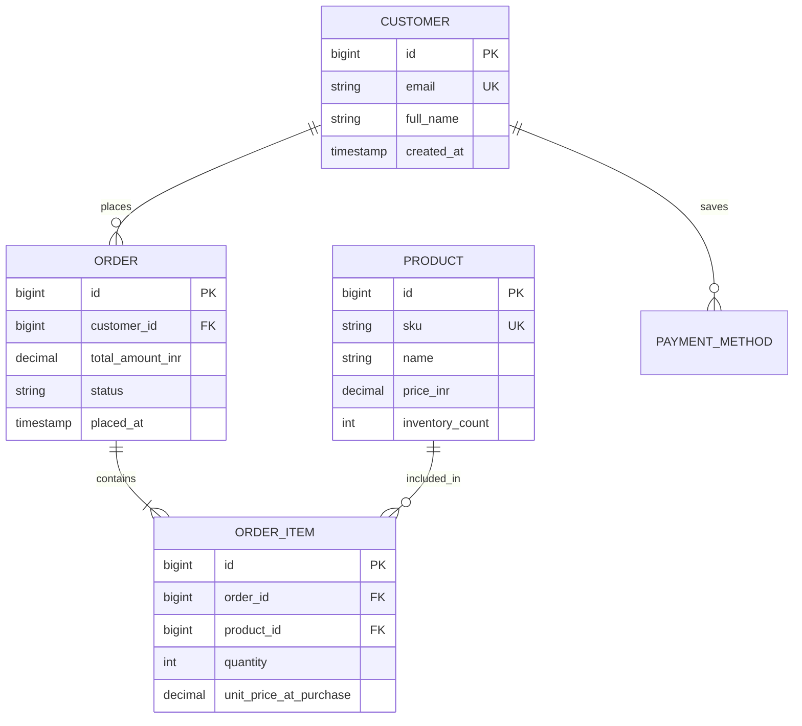
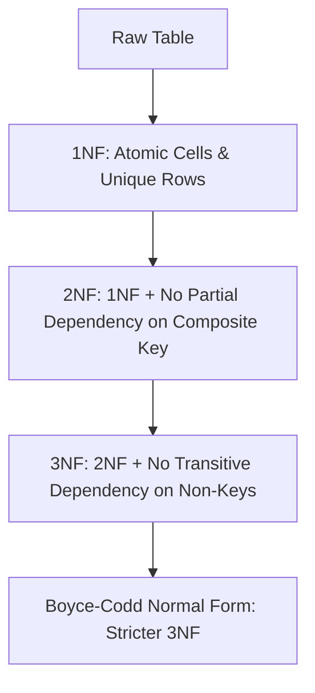

# Relational Database Design, Normalization & ER Modeling Guide

## Module Overview
This module covers **Entity-Relationship (ER) Modeling**, **Database Normalization (1NF, 2NF, 3NF, BCNF)**, **Surrogate vs Natural Keys (UUIDv7 vs BIGSERIAL)**, and intentional **Denormalization** for read-heavy systems.

---

## Visual Architecture: E-Commerce Entity-Relationship (ER) Diagram

---

## Questions & Comprehensive Solutions

### DBD-BAS-001: What is Database Normalization and explain 1NF, 2NF, and 3NF?

**Difficulty:** Basic  
**Topic:** Database Schema Design

#### 1. Simple Explanation
**Normalization** is the systematic process of organizing tables and columns to eliminate redundant duplicate data and avoid **Update, Insert, and Delete Anomalies**.

#### 2. The Normal Forms Explained Simply:

1. **First Normal Form (1NF):**
   - Every column must contain **atomic (indivisible) single values** (no comma-separated lists like `phone_numbers = "123, 456"`).
   - Each record must have a unique identifier (Primary Key).
2. **Second Normal Form (2NF):**
   - Must be in 1NF.
   - All non-key columns must depend on the **entire Primary Key**, not just part of a composite primary key (No partial dependencies).
3. **Third Normal Form (3NF):**
   - Must be in 2NF.
   - No non-key column may depend on another non-key column (No **transitive dependencies**).
   - *Example:* In an `Orders` table, storing `customer_city` when `customer_id` already exists violates 3NF; city belongs in the `Customers` table!

---

### DBD-INT-002: Normalization vs Denormalization in Production

**Comparison Table:**

| Dimension | Normalized Database (3NF) | Denormalized Database |
| :--- | :--- | :--- |
| **Write Performance** | ⚡ Fast (data is updated in exactly one place) | Slower (updates must write to multiple redundant columns) |
| **Read Performance** | Slower for complex views (requires many `JOIN`s) | ⚡ Fast (data is pre-joined; zero or few `JOIN`s) |
| **Data Redundancy** | Zero redundancy; lowest storage footprint | Deliberate redundancy; higher disk storage |
| **Data Integrity Risk**| Zero risk of contradictory data | Risk of data drift if background updates fail |
| **Best Used For** | **OLTP (Online Transaction Processing)**: Banking, checkout | **OLAP (Analytics)**, Reporting dashboards, Read-heavy feeds |

---

### DBD-INT-003: Primary Key Choices: `BIGSERIAL` (Auto-increment) vs `UUIDv4` vs `UUIDv7`

**Comparison Table:**

| Key Type | Structure | Index Performance | Security / Enumeration Risk | Best Used For |
| :--- | :--- | :--- | :--- | :--- |
| **`BIGINT / BIGSERIAL`** | 8 bytes, sequential integer | ⚡ Maximum speed (B+Tree appends sequentially to rightmost leaf) | 🔴 High: Predictable (`/users/101` $\rightarrow$ `/users/102`) | Internal tables, join tables |
| **`UUIDv4`** | 16 bytes, completely random | 🔴 Terrible: Random insertion causes massive B+Tree page splits | 🟢 Secure: Unpredictable, non-enumerable | Distributed multi-datacenter generation |
| **`UUIDv7` (Modern Standard)** | 16 bytes, **time-ordered** timestamp prefix + random suffix | ⚡ High: Naturally sequential for B+Trees with zero page splits! | 🟢 Secure: Non-enumerable, safe for public APIs | **Production Recommended for public IDs** |
