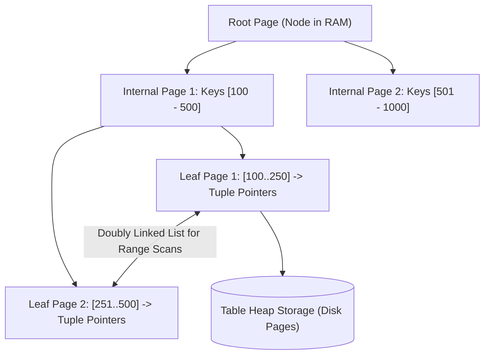
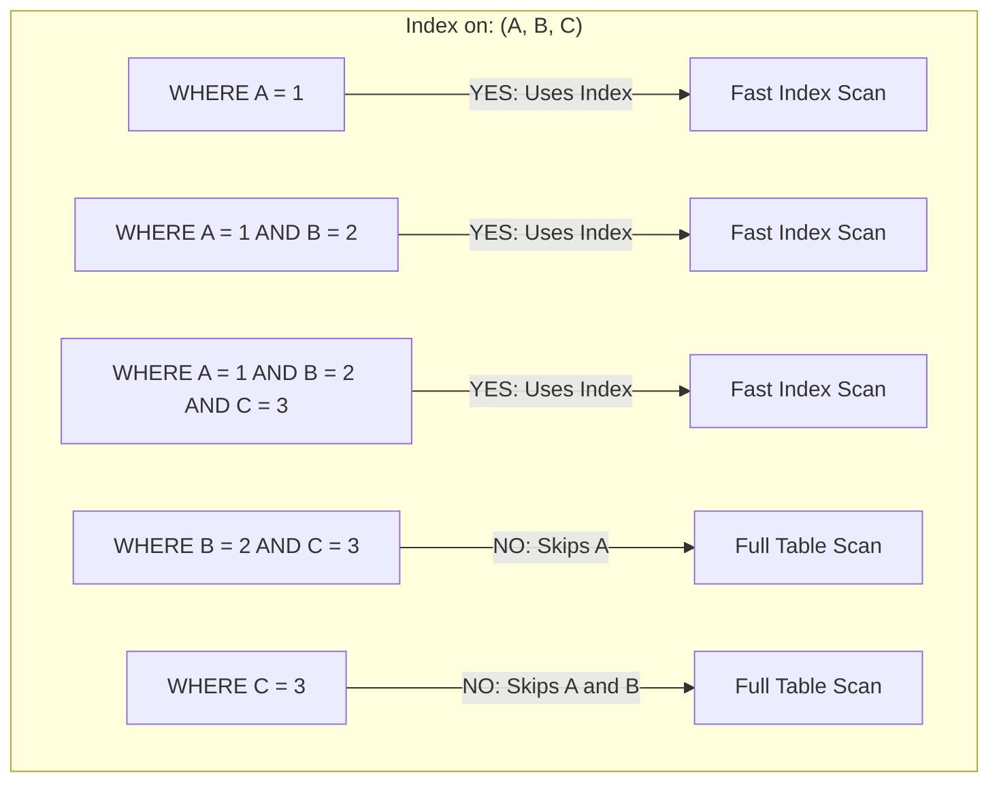

# Database Indexing & Query Optimization Deep-Dive Guide

## Module Overview
This module covers database engine internals, **B-Tree & B+Tree index structures**, **Composite Indexes**, **`EXPLAIN ANALYZE` Query Plans**, **Index Selectivity**, and **PostgreSQL / MySQL performance tuning**.

---

## Architecture: B+Tree Index Anatomy & Disk Page Lookup



---

## Core Questions & Comprehensive Solutions

### DB-OPT-001: How do B-Trees and B+Trees work internally?

**One-Line Answer:**  
A **B+Tree** is a self-balancing, multi-way search tree data structure where all actual data row pointers are stored exclusively in the bottom **leaf nodes**, while internal nodes store only routing keys, and all leaf nodes are connected via a **doubly linked list** to enable ultra-fast sequential range scans ($O(\log N)$ point lookups, $O(K)$ sequential scans).

**B-Tree vs B+Tree Comparison:**

| Dimension | B-Tree | B+Tree (Standard for DB Indexes) |
| :--- | :--- | :--- |
| **Data Pointer Location** | Stored in both internal nodes and leaf nodes | Stored **only in leaf nodes** |
| **Fan-out & Height** | Smaller fan-out (data pointers take space in internal nodes), taller tree | **Huge fan-out** (internal nodes hold only keys), shorter tree (typically 3–4 levels for millions of rows) |
| **Range Queries** | Requires tree traversals ($O(K \log N)$) | Traverses to first leaf, then follows **linked list pointers** across leaves ($O(K)$ sequential I/O) |
| **Used By** | Specialized engines, file systems | PostgreSQL (nbtree), MySQL InnoDB, SQLite, Oracle |

---

### DB-OPT-002: What are Composite Indexes and the Leftmost Prefix Rule?

**One-Line Answer:**  
A **composite index** indexes multiple columns in a specific order (e.g., `CREATE INDEX idx_user ON orders (country, status, created_at)`). Under the **Leftmost Prefix Rule**, the index can only accelerate queries filtering from left to right without skipping leading columns.



<u>Interview Tip:</u> Explain column order strategy:
1. Place **high-equality columns** first (e.g., `tenant_id`, `status`).
2. Place **range-query columns** (`created_at >= '2026-01-01'`) **last**, because once a range operator ($<, >, \text{BETWEEN}$) is applied on column $X$, subsequent columns in the composite index cannot be used for binary index searching.

---

### DB-OPT-003: How do you read and interpret an `EXPLAIN ANALYZE` query plan?

**Execution Stages:**
- `EXPLAIN`: Outputs the query optimizer's estimated cost without running the query.
- `EXPLAIN ANALYZE`: Actually **executes** the SQL query and displays real runtime execution statistics (actual time, actual rows, buffer hits).

**Common Scan Types in PostgreSQL:**

| Scan Type | Performance | Mechanism |
| :--- | :--- | :--- |
| **Index Only Scan** | ⚡ Fastest ($< 1\text{ ms}$) | The index contains all requested columns; zero disk heap lookups needed. |
| **Index Scan** | 🟢 Fast | Traverses B+Tree to find row IDs (TIDs), then fetches table pages from disk heap. |
| **Bitmap Index Scan** | 🟡 Medium | Scans index, builds an in-memory bitmap of pages to visit, and visits pages in sequential disk order. |
| **Seq Scan (Sequential Scan)** | 🔴 Slow ($O(N)$) | Reads every disk page of the entire table from start to finish. |

**Code Example:**
```sql
EXPLAIN (ANALYZE, BUFFERS) 
SELECT id, user_id, total_amount 
FROM orders 
WHERE user_id = 49201 AND status = 'COMPLETED';
```
*Look for:*
1. **`actual rows` vs `rows=...`**: Large deviations indicate stale table statistics (run `ANALYZE orders;`).
2. **`Buffers: shared hit=... read=...`**: `read` indicates disk I/O; `hit` indicates retrieved from PostgreSQL memory cache (`shared_buffers`).

---

### DB-OPT-004: What is Index Selectivity and why does the optimizer sometimes ignore an index?

**Formula:**
$$\text{Selectivity} = \frac{\text{Number of Distinct Values (Cardinality)}}{\text{Total Rows}}$$

- **High Selectivity (Near 1.0):** Columns like `user_id`, `email`, or `uuid`. An index lookup finds 1 row instantly $\rightarrow$ Optimizer always chooses the index.
- **Low Selectivity (Near 0.0):** Columns like `is_active` (boolean: True/False) or `gender` (M/F). If $90\%$ of rows have `is_active = true`, the optimizer knows that following index pointers for $90\%$ of rows causes random disk I/O; a sequential table scan is substantially faster!

---

### DB-OPT-005: Covering Indexes (Index-Only Scans) with `INCLUDE`

**One-Line Answer:**  
A **covering index** stores additional non-key payload columns in the leaf nodes of the index using the `INCLUDE` clause, allowing queries to be answered purely from the index without reading table heap blocks.

```sql
-- Standard index: Requires visiting the table to read 'total_amount'
CREATE INDEX idx_orders_user ON orders (user_id);

-- Covering Index: Allows complete Index-Only Scan
CREATE INDEX idx_orders_covering ON orders (user_id) INCLUDE (total_amount, status);

-- This query runs 10x faster with ZERO heap page accesses:
SELECT total_amount, status FROM orders WHERE user_id = 1042;
```

---

### DB-OPT-006: Partial (Filtered) Indexes

**Optimization for Large Tables:**
Instead of indexing all 50 million rows, index only the $1\%$ of rows that your queries actually care about:

```sql
-- Index ONLY unprocessed orders (saves 99% index storage and write overhead)
CREATE INDEX idx_unprocessed_orders ON orders (created_at) 
WHERE status = 'PENDING';
```
