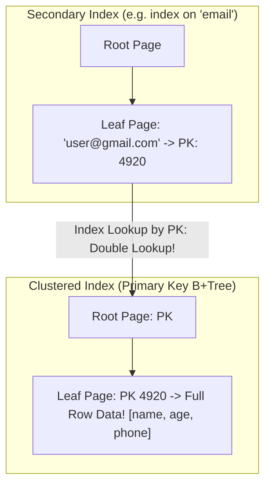

# MySQL Architecture, InnoDB Storage Engine & Locking Guide

## Module Overview
This module covers **MySQL Architecture**, the **InnoDB Storage Engine**, **Clustered vs Secondary Indexes**, and Next-Key row locks.

---

## Visual Architecture: InnoDB Clustered Index vs Secondary Index

---

## Questions & Comprehensive Solutions

### MYSQL-BAS-001: InnoDB vs MyISAM Comparison

**Comparison Table:**

| Feature | InnoDB (Modern Default) | MyISAM (Legacy Engine) |
| :--- | :--- | :--- |
| **Transactions (ACID)** | :white_check_mark: **Full ACID Support** | ❌ None |
| **Locking Granularity** | **Row-Level Locking** | **Table-Level Locking** (writes lock the entire table!) |
| **Crash Recovery** | Automatic via **Redo Logs** | Prone to corruption; requires manual `REPAIR TABLE` |
| **Foreign Keys** | Supported with cascade constraints | Not enforced |
| **Clustered Indexes** | Primary key is the clustered index | Data stored in heap file |

---

### MYSQL-INT-002: What is a Double Lookup (Index Seek)?
When searching by a secondary index (`WHERE email = '...'`):
1. InnoDB traverses the secondary index B+Tree to find the matching entry.
2. The leaf of a secondary index stores the **Primary Key (`id`)**, not row pointers!
3. InnoDB must perform a **second B+Tree traversal** on the Clustered Index using `id` to fetch the actual columns.
4. *Fix:* Use **Covering Indexes** (`CREATE INDEX idx_email_name ON users(email, name)`) so all requested columns are found in the first traversal.
