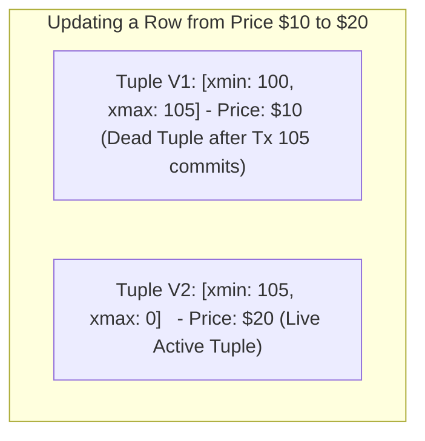

# PostgreSQL Internals, MVCC & Database Administration Guide

## Module Overview
This module covers **PostgreSQL Internals**, **Multi-Version Concurrency Control (MVCC)**, **Dead Tuples & VACUUM**, **Write-Ahead Logging (WAL)**, and **PgBouncer Connection Pooling**.

---

## Visual Architecture: PostgreSQL Process Model & Memory Hierarchy

```mermaid
flowchart TD
    Client1[Backend App Server 1] --> Postmaster[PostgreSQL Postmaster Process: Port 5432]
    Client2[Backend App Server 2] --> Postmaster
    
    Postmaster -->|fork() on connect| Backend1[Backend Server Process 1]
    Postmaster -->|fork() on connect| Backend2[Backend Server Process 2]
    
    subgraph Shared_Memory["PostgreSQL Shared Memory (RAM)"]
        SharedBuffers["Shared Buffers (Table & Index Pages Cache)"]
        WALBuffers["WAL Buffers (Write-Ahead Log Buffer)"]
        LockMgr["Lock Manager (Row & Table Locks)"]
    end
    
    Backend1 <--> SharedBuffers
    Backend2 <--> SharedBuffers
    
    subgraph Disk_Storage["Persistent Storage (NVMe / SSD)"]
        WALFiles[("WAL Segments (pg_wal)")]
        DataHeap[("Table Heap Data Files (base/)")]
    end
    
    WALBuffers -->|fsync() on COMMIT| WALFiles
    SharedBuffers -.->|Checkpointer Process| DataHeap
```

---

## Questions & Comprehensive Solutions

### PG-INT-001: How does MVCC (Multi-Version Concurrency Control) work in PostgreSQL?

**Difficulty:** Intermediate  
**Topic:** Database Concurrency Internals

#### 1. Simple Explanation
In old databases, when someone was writing to a table, readers had to wait; and when someone was reading, writers had to wait.  
**MVCC** changes this rule: **"Readers never block writers, and writers never block readers."**  
When you update a row in PostgreSQL, it does *not* overwrite the existing row on disk. Instead, it leaves the old row in place and writes a **brand-new version (tuple)** of the row next to it. Older transactions continue reading the old version, while newer transactions see the new version!

#### 2. Under-the-Hood: `xmin` and `xmax` System Columns
Every row in a PostgreSQL table invisibly stores hidden header metadata:
- **`xmin`:** The Transaction ID (`txid`) that created/inserted this row version.
- **`xmax`:** The Transaction ID that deleted or updated this row version (0 if active).



When Transaction 105 updates the row:
1. It writes `xmax = 105` on the old tuple (marking it deleted).
2. It inserts a new tuple with `xmin = 105` and `xmax = 0` (marking it active).

---

### PG-INT-002: What is Table Bloat and why is `VACUUM` / `AUTOVACUUM` necessary?

**Difficulty:** Advanced  
**Topic:** PostgreSQL Maintenance

#### 1. What are Dead Tuples?
Because `UPDATE` and `DELETE` leave old versions behind, those old rows become **Dead Tuples** as soon as no active transactions need to see them anymore. These dead tuples continue taking up space inside table and index pages on disk. This wasted disk space is called **Table Bloat**.

#### 2. What `VACUUM` Does:
1. Scans table pages and marks space occupied by dead tuples as **reusable** for future `INSERT`s.
2. Updates table statistics for the query planner (`ANALYZE`).
3. Freezes old transaction IDs to prevent **Transaction ID Wraparound Failure** (which halts the database if unmaintained).

> **Production Note:** Standard `VACUUM` reclaims space for future inserts inside the same table, but does **not** return disk space to the Operating System. Reclaiming physical disk space requires `VACUUM FULL` (which acquires an exclusive write lock on the entire table) or the zero-downtime tool **`pg_repack`**.

---

### PG-ADV-003: Why is PgBouncer Connection Pooling mandatory in production?

**One-Line Answer:**  
Because PostgreSQL uses a **process-based model** (forking a dedicated ~10MB OS process per connection), direct connections collapse at $\sim 300-500$ clients due to CPU context switching; **PgBouncer** multiplexes thousands of incoming client requests over a small, bounded pool of active database connections.

```mermaid
flowchart LR
    App[5,000 Concurrent Web Requests] --> PgBouncer[PgBouncer (Transaction Pooling)]
    PgBouncer -->|Reuses 40 Dedicated Connections| Postgres[(PostgreSQL Server)]
```

#### PgBouncer Pooling Modes:
1. **Session Pooling:** Connection is assigned to client for the entire session lifetime (releases on disconnect).
2. **Transaction Pooling (Recommended):** Connection is assigned **only during an active SQL transaction** and returned to the pool immediately upon `COMMIT` or `ROLLBACK`. Allows 10,000 clients to share 50 PostgreSQL connections!
3. **Statement Pooling:** Connection is returned after every single SQL statement (does not support multi-statement transactions).
