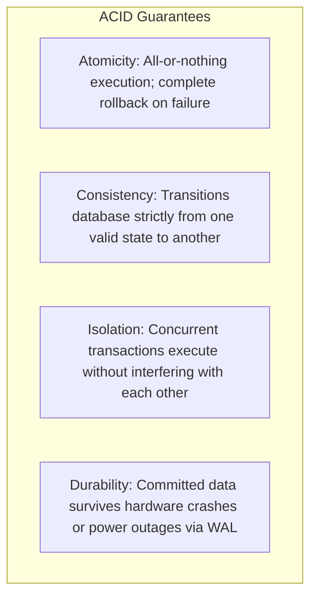
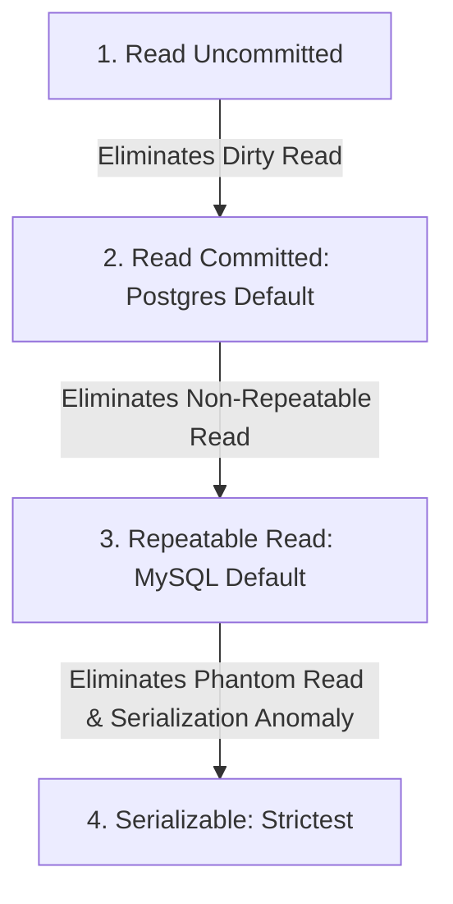
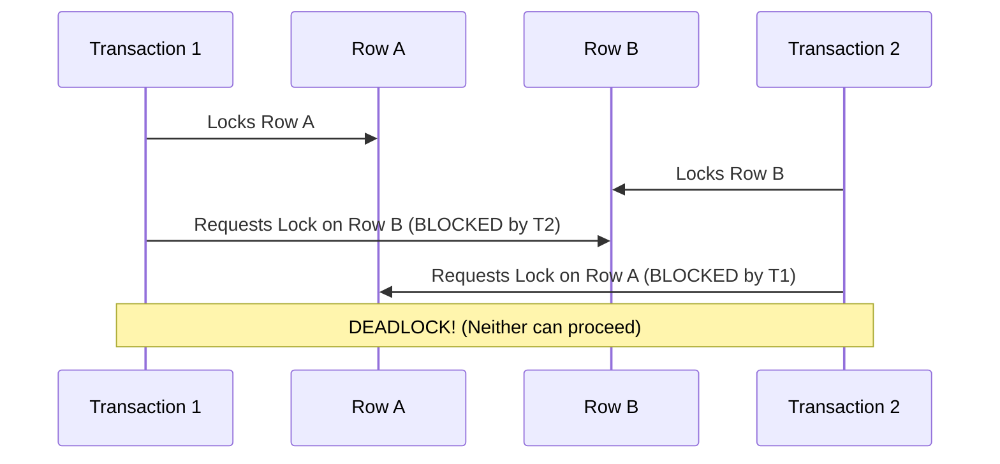

# Database Transactions, Isolation Levels & Concurrency Guide

## Module Overview
This module covers **ACID Guarantees**, **SQL Transaction Isolation Levels**, **Read Anomalies (Dirty, Non-Repeatable, Phantom)**, and **Database Deadlock Prevention**.

---

## Visual Summary: ACID Guarantees

---

## Questions & Comprehensive Solutions

### TXN-BAS-001: What are the 4 SQL Transaction Isolation Levels and Read Anomalies?

**The 4 Standard Isolation Levels (from lowest to highest):**

#### Read Anomalies Matrix:

| Isolation Level | Dirty Read | Non-Repeatable Read | Phantom Read | Serialization Anomaly |
| :--- | :---: | :---: | :---: | :---: |
| **Read Uncommitted** | ❌ Allowed | ❌ Allowed | ❌ Allowed | ❌ Allowed |
| **Read Committed** | :white_check_mark: Prevented | ❌ Allowed | ❌ Allowed | ❌ Allowed |
| **Repeatable Read** | :white_check_mark: Prevented | :white_check_mark: Prevented | :white_check_mark: Prevented* | ❌ Allowed |
| **Serializable** | :white_check_mark: Prevented | :white_check_mark: Prevented | :white_check_mark: Prevented | :white_check_mark: Prevented |

*\*Note: In PostgreSQL and MySQL InnoDB (via Next-Key Locks), Repeatable Read also prevents Phantom Reads in practice!*

#### Definitions of Anomalies:
1. **Dirty Read:** Transaction A reads data modified by Transaction B *before* B commits. If B rolls back, Transaction A read garbage data that never officially existed.
2. **Non-Repeatable Read:** Transaction A reads row $X$. Transaction B updates row $X$ and commits. Transaction A reads row $X$ again and sees different values.
3. **Phantom Read:** Transaction A queries all rows with `WHERE age > 30` (returns 5 rows). Transaction B inserts a new person with `age = 35` and commits. Transaction A queries again and sees 6 rows (a new "phantom" row appeared).

---

### TXN-ADV-002: What causes Database Deadlocks and how do you prevent them?

**One-Line Answer:**  
A **Deadlock** is a circular dependency where Transaction 1 holds a lock on Resource A and waits for Resource B, while Transaction 2 holds a lock on Resource B and waits for Resource A; neither can proceed.

#### Top 3 Deadlock Prevention Rules:
1. **Consistent Lock Ordering:** Always acquire locks on multiple tables or rows in the **exact same deterministic order** (e.g. sorted by primary key ID: `WHERE id IN (10, 20) ORDER BY id ASC`). If all transactions lock Row A before Row B, circular wait is mathematically impossible!
2. **Short Transaction Life:** Keep transactions as brief as possible; never make external HTTP API calls or heavy CPU computations inside a database transaction block.
3. **Deadlock Detection Timeout:** PostgreSQL automatically runs a background deadlock detector (`deadlock_timeout = 1s`). When a circular graph is discovered, PostgreSQL terminates one transaction with an error (`40P01: deadlock_detected`), allowing the other to complete.
