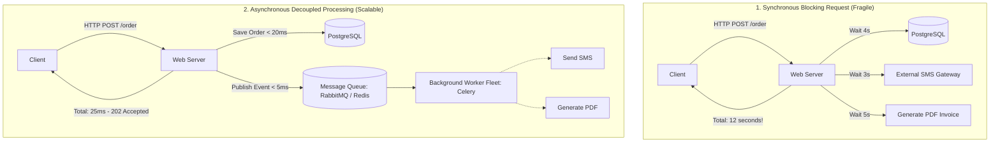

# Background Processing & Event-Driven Architecture Guide

## Module Overview
This guide covers architectural patterns for **asynchronous background processing**, **event-driven design**, **worker autoscaling (KEDA)**, and handling extreme traffic spikes in production web systems.

---

## Architectural Comparison: Synchronous vs Asynchronous Processing



---

## Core Questions & Comprehensive Solutions

### BKG-BAS-001: When should an operation be offloaded to a background task?

**Difficulty:** Basic  
**Topic:** Architectural Decision Making

#### Decision Framework: The Rule of 200ms
Any operation that meets one of the following criteria should **never** run synchronously inside an HTTP request handler:
1. **Third-Party Network Calls:** Sending emails (SendGrid/SES), SMS OTPs (Twilio), push notifications (Firebase), or calling external bank APIs where latency is uncontrollable.
2. **CPU-Intensive Tasks:** Image resizing, video transcoding, PDF generation, or calculating machine learning inferences.
3. **Heavy I/O & Batch Operations:** Importing a CSV file with 50,000 rows, exporting financial reports, or bulk updating search indexes.
4. **Non-Critical Side Effects:** Logging audit analytics, updating recommendation engines, or sending Slack alerts to internal teams.

---

### BKG-INT-002: How do you autoscale background workers based on queue depth?

**Difficulty:** Intermediate  
**Topic:** DevOps & Cloud Scaling

#### 1. Why CPU-Based Autoscaling Fails for Workers
Standard Kubernetes HPA (Horizontal Pod Autoscaler) scales based on CPU utilization. However, a queue with 500,000 pending tasks might have workers whose CPU is low because they are waiting on network I/O. As a result, the cluster never scales up, and queue lag grows uncontrollably.

#### 2. The Solution: KEDA (Kubernetes Event-driven Autoscaling)
**KEDA** monitors the queue directly (measuring message count in RabbitMQ or list length in Redis).
- If Queue Length = 0 $\rightarrow$ Scale workers down to 1 or 0 (saving cloud costs).
- If Queue Length > 1,000 $\rightarrow$ Rapidly scale worker pods from 2 to 50.

```yaml
apiVersion: keda.sh/v1alpha1
kind: ScaledObject
metadata:
  name: celery-worker-scaler
spec:
  scaleTargetRef:
    name: celery-worker-deployment
  minReplicaCount: 1
  maxReplicaCount: 30
  triggers:
  - type: rabbitmq
    metadata:
      protocol: amqp
      queueName: celery
      mode: QueueLength
      value: "50" # Scale up 1 worker for every 50 pending messages
```
