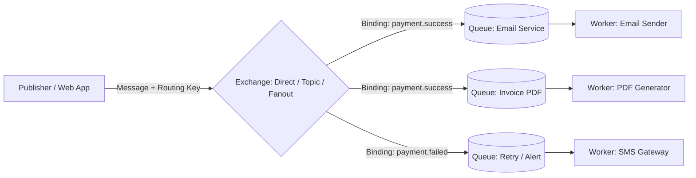
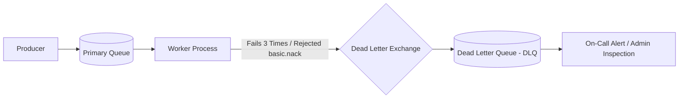

# RabbitMQ & Enterprise Message Brokering Interview Guide

## Module Overview
This guide covers **RabbitMQ**, an enterprise message broker implementing the **Advanced Message Queuing Protocol (AMQP 0-9-1)**, explaining Exchanges, Queues, Routing Keys, and Dead-Letter Exchanges.

---

## Visual Architecture: RabbitMQ Exchange & Queue Routing Topology



---

## Questions & Comprehensive Solutions

### RMQ-BAS-001: What is RabbitMQ and how does AMQP messaging work?

**Difficulty:** Basic  
**Topic:** Message Queuing Fundamentals

#### 1. Simple Explanation
RabbitMQ is like a digital post office. When your application wants to send a message to another service, it does not connect directly to that service. Instead, it drops the message into RabbitMQ. RabbitMQ sorts the letter, puts it into the right mailbox (Queue), and safely holds it until the recipient service comes to pick it up.

#### 2. Easy Real-World Example
Imagine a restaurant kitchen:
- The waiter does not run to every individual chef. The waiter pins the order ticket onto a carousel board (Exchange).
- The carousel board routes salad tickets to the salad counter queue, soup tickets to the soup queue, and grill tickets to the barbecue queue.
- If the grill chef is busy, the tickets sit safely in the queue until the chef finishes the previous dish.

#### 3. One-Line Interview Answer
**RabbitMQ** is an open-source, highly reliable message broker that routes, buffers, and persists asynchronous messages between distributed software components using the AMQP protocol.

#### 4. Detailed Technical Explanation: The Core AMQP Concepts
Unlike simple queues where publishers push directly into a queue, RabbitMQ introduces an abstraction layer called an **Exchange**:
1. **Producer:** The application sending messages. A producer *never* pushes directly to a queue; it publishes to an Exchange with a **Routing Key**.
2. **Exchange:** A routing router that inspects the message routing key and delivers copies to bound queues based on matching rules.
3. **Queue:** A FIFO buffer in memory/disk that holds messages until consumed.
4. **Binding:** The link or rule that connects an Exchange to a Queue (e.g. *"Deliver messages with routing key `order.created` to `fulfillment_queue`"*).
5. **Consumer:** The worker application that receives and processes messages from the queue.

#### 5. Types of RabbitMQ Exchanges

| Exchange Type | Routing Logic | Typical Real-World Use Case |
| :--- | :--- | :--- |
| **Direct Exchange** | Matches exact routing key (`order.paid` matches only `order.paid`) | Point-to-point task routing |
| **Fanout Exchange** | Ignores routing keys; broadcasts every message to **all** bound queues | Pub/Sub notifications (e.g., user signup triggers Email + SMS + Analytics queues simultaneously) |
| **Topic Exchange** | Pattern matching with wildcards: `*` (exactly one word) and `#` (zero or more words) | Log aggregation (e.g. `audit.*.critical` or `orders.#`) |
| **Headers Exchange**| Routes based on message header attributes rather than routing keys | Specialized metadata-based dispatch |

#### 6. Practical Python Producer & Consumer (using `pika`)

```python
import pika
import json

# 1. Connect to RabbitMQ Server
connection = pika.BlockingConnection(pika.ConnectionParameters("localhost"))
channel = connection.channel()

# 2. Declare a durable Direct Exchange and Queue
channel.exchange_declare(exchange="orders_exchange", exchange_type="direct", durable=True)
channel.queue_declare(queue="payment_processing_queue", durable=True)

# 3. Bind Queue to Exchange with Routing Key
channel.queue_bind(
    exchange="orders_exchange",
    queue="payment_processing_queue",
    routing_key="payment.process"
)

# 4. Publish a Persistent Message
message = {"order_id": "ORD-4491", "amount_inr": 2999.00}
channel.basic_publish(
    exchange="orders_exchange",
    routing_key="payment.process",
    body=json.dumps(message),
    properties=pika.BasicProperties(
        delivery_mode=pika.DeliveryMode.Persistent # Ensure message survives broker restart
    )
)
print("Message published successfully!")
connection.close()
```

---

### RMQ-INT-002: RabbitMQ vs Redis as a Message Broker

**Comparison Table:**

| Feature | RabbitMQ | Redis (List / Pub-Sub / Streams) |
| :--- | :--- | :--- |
| **Primary Architecture** | Dedicated message broker (Erlang) | In-memory key-value data store (C) |
| **Routing Complexity** | High: Direct, Topic (wildcards), Fanout exchanges | Low: Fixed channel names or list keys |
| **Delivery Guarantees** | High: Message ACKs, durable queues, clustering | Moderate: In-memory with optional disk snapshots |
| **Dead-Letter Handling**| Native Dead Letter Exchanges (DLX) | Requires custom application logic |
| **Resource Overhead** | Higher RAM/CPU footprint, separate cluster | Lightweight; often reuses existing Redis cache instance |
| **Best Used For** | Critical financial transactions, complex routing | Fast ephemeral tasks, simple background queues |

---

### RMQ-ADV-003: What is a Dead Letter Exchange (DLX) and Poison Pill Handling?

**Difficulty:** Advanced  
**Topic:** Failure Handling & Fault Tolerance



#### 1. What is a Poison Pill Message?
A **Poison Pill** is a malformed message (e.g., corrupt JSON, dividing by zero) that causes worker processes to crash every time they attempt to process it. Without safeguards, the worker crashes, the broker requeues the message, the worker restarts, consumes it again, and crashes in an infinite loop.

#### 2. The Solution: Dead Letter Exchange (DLX)
When declaring the primary queue, configure `x-dead-letter-exchange`:
1. If a message is rejected with `basic.nack(requeue=False)` or exceeds `x-message-ttl`, RabbitMQ automatically routes the failed message to the **Dead Letter Queue (DLQ)**.
2. The primary queue continues processing healthy messages smoothly without stalling.
3. Engineers inspect the DLQ, fix the bug, and replay the dead letters.
