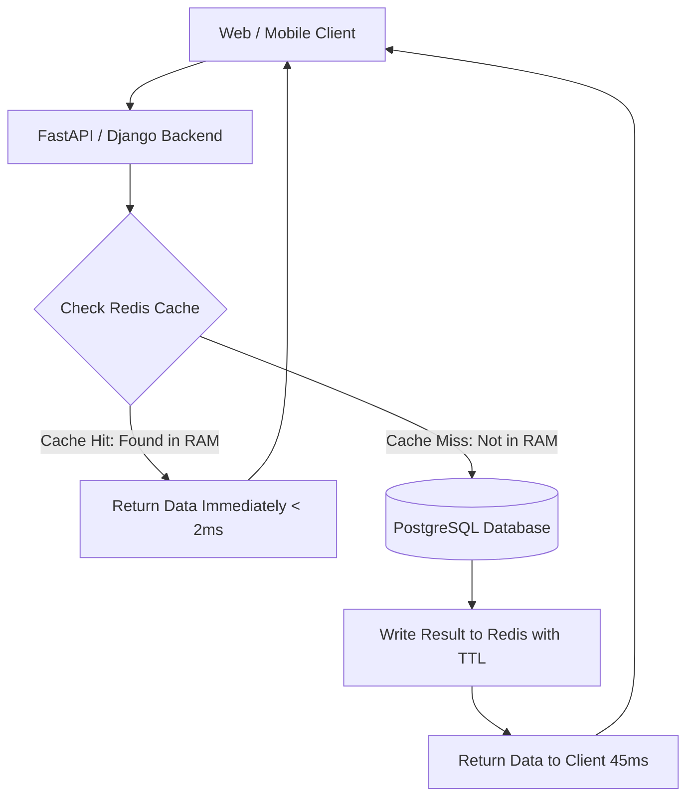
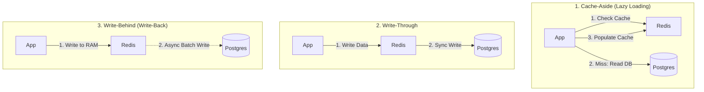
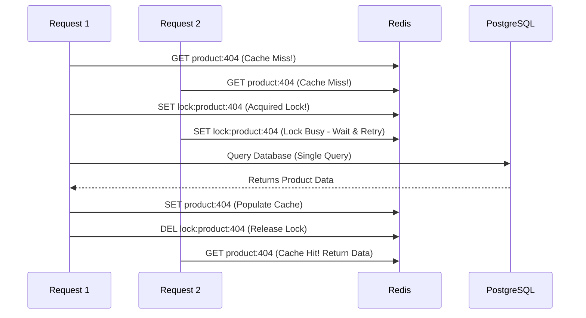

# Redis & In-Memory Caching Interview Guide

## Module Overview
This guide covers **Redis**, the industry-standard in-memory data store used for fast caching, distributed locks, session management, and real-time pub/sub messaging.

---

## Visual Architecture: Redis In-Memory Storage & Cache Lookup



---

## Questions & Comprehensive Solutions

### REDIS-BAS-001: What is Redis and why is it so fast?

**Difficulty:** Basic  
**Topic:** In-Memory Caching

#### 1. Simple Explanation
Redis is a super-fast tool that stores data in the computer's **RAM (Random Access Memory)** instead of writing it to a slow hard drive or SSD. Because reading from RAM is thousands of times faster than reading from a disk, applications use Redis to save and fetch frequently needed information in milliseconds.

#### 2. Easy Real-World Example
Imagine you are studying in a library:
- A traditional database (like PostgreSQL) is like walking to a bookshelf in the basement, finding the book, and reading the page. It takes a few minutes.
- **Redis** is like keeping a small notebook open directly on your desk with the 5 most important facts written down. You can glance at it instantly in 1 second.

#### 3. One-Line Interview Answer
**Redis** is an open-source, in-memory key-value data structure store used primarily as a database, cache, message broker, and streaming engine.

#### 4. Detailed Technical Explanation
Redis achieves sub-millisecond latency through four core architectural choices:
1. **In-Memory Storage:** All primary read and write operations execute directly in volatile system RAM without disk seek penalties.
2. **Single-Threaded Event Loop:** Redis uses an event-driven, non-blocking I/O multiplexer (like `epoll` or `kqueue`) on a single core for command processing. This completely eliminates thread synchronization, mutex locks, and CPU context-switching overhead.
3. **Optimized Low-Level C Data Structures:** Redis does not just store raw strings; it uses highly tuned internal structures like SDS (Simple Dynamic Strings), Skiplists, ZipLists, and IntSets to minimize memory fragmentation.
4. **Non-Blocking Disk Persistence:** Disk saving (RDB snapshots or AOF logs) is offloaded to background child processes created via OS `fork()`, ensuring background saves never block main client request handling.

#### 5. Practical Python Implementation

```python
import redis

# Connect to local Redis instance (port 6379 is standard)
client = redis.Redis(
    host="localhost",
    port=6379,
    decode_responses=True # Automatically decodes bytes to Python strings
)

# 1. Set a key with an automatic 60-second expiration (TTL)
client.set("user:101:profile", "Numan", ex=60)

# 2. Get the value
cached_user = client.get("user:101:profile")
print(f"Cached User: {cached_user}") # Output: Numan

# 3. Check remaining Time-To-Live in seconds
ttl_remaining = client.ttl("user:101:profile")
print(f"Remaining TTL: {ttl_remaining} seconds")
```

#### 6. Code Explanation
- `redis.Redis(...)`: Creates a connection pool to the Redis server.
- `decode_responses=True`: Ensures Redis returns Python `str` instead of raw `bytes` (e.g. `b'Numan'`).
- `client.set(..., ex=60)`: Writes key `"user:101:profile"` and instructs Redis to automatically delete it after 60 seconds to prevent stale data.
- `client.get(...)`: Performs an $O(1)$ memory hash table lookup to retrieve the value.

#### 7. Internal Working & Memory Lookup
Redis stores keys inside a global hash table (`dict`). When `GET key` is received:
1. Redis hashes the key string using the SipHash algorithm.
2. It locates the bucket index in the primary hash table.
3. If hash collision occurs, it follows the linked list in the bucket.
4. If the key has an expired timestamp, it deletes the key (passive expiration) and returns `nil`.

#### 8. Real-World Use Cases
- **Session Store:** Storing user login tokens and shopping cart items.
- **API Response Caching:** Storing popular product listings on e-commerce platforms (Flipkart/Amazon).
- **Leaderboards:** Real-time gaming rankings using Redis **Sorted Sets (`ZSET`)**.
- **Rate Limiting:** Blocking users who make more than 100 requests per minute using `INCR` and `EXPIRE`.

#### 9. Common Mistakes to Avoid
- *Mistake:* Storing massive 100MB files or blobs inside Redis. Redis is designed for small key-value items (< 10KB); large keys stall the single-threaded event loop.
- *Mistake:* Forgetting to set a **TTL (Time To Live)** on cached keys, eventually causing Redis to run out of RAM and crash (Out of Memory - OOM).

#### 10. Interview Follow-Up Questions
1. *Q: Since Redis is single-threaded, how does it take advantage of multi-core servers?*  
   *A:* Run multiple independent Redis server instances on different ports (e.g., 6379, 6380) and use Redis Cluster or consistent hashing to partition data across cores.
2. *Q: What happens when Redis memory gets completely full?*  
   *A:* Redis invokes its configured `maxmemory-policy` (e.g., `allkeys-lru` to evict least recently used keys, or `volatile-ttl` to evict keys with shortest remaining TTL).

#### 11. Interview Tip
Always mention the **single-threaded event loop** and explain that Redis avoids race conditions on single keys because commands like `INCR`, `HSET`, and `LPUSH` are naturally **atomic**.

---

### REDIS-BAS-002: What are the main Redis Data Structures?

**Difficulty:** Basic  
**Topic:** Redis Fundamentals

#### 1. Simple Explanation
Unlike simple key-value systems that only store plain text strings, Redis is a **Data Structure Server**. You can store lists, maps, sets, and sorted rankings directly in Redis memory without needing to write custom parsing code in your Python app.

#### 2. Comparison Table

| Data Structure | Typical Use Case | Python Example Method | Complexity |
| :--- | :--- | :--- | :--- |
| **String** | Caching JSON, HTML, integer counters | `client.set()`, `client.incr()` | $O(1)$ |
| **List** | Job queues, recent activity timelines | `client.lpush()`, `client.rpop()` | $O(1)$ push/pop |
| **Hash** | Storing user profile objects (fields & values) | `client.hset()`, `client.hget()` | $O(1)$ field lookup |
| **Set** | Unique tags, friend circles, deduplication | `client.sadd()`, `client.sismember()` | $O(1)$ membership check |
| **Sorted Set (ZSet)**| Live leaderboards, priority queues | `client.zadd()`, `client.zrange()` | $O(\log N)$ score insertion |

---

### REDIS-INT-003: What is Cache Invalidation and what are common caching strategies?

**Difficulty:** Intermediate  
**Topic:** Caching Architectures



#### Detailed Breakdown of Strategies:

1. **Cache-Aside (Most Common in Web APIs):**
   - The application checks Redis first.
   - If found (**Cache Hit**), return data immediately.
   - If not found (**Cache Miss**), fetch from PostgreSQL, write to Redis with a TTL, and return.
   - *Advantage:* Resilient. If Redis goes down, the application continues functioning by querying the database directly.

2. **Write-Through:**
   - Application writes to the cache, and the cache synchronously writes to the database before confirming success.
   - *Advantage:* Cache is never stale.

3. **Write-Behind (Write-Back):**
   - Application writes directly to Redis RAM and returns immediately ($< 2\text{ ms}$). A background worker batches these updates and writes them to PostgreSQL asynchronously every 5 seconds.
   - *Use Case:* High-throughput view counter (YouTube views, Instagram likes) where losing a few counts during a server crash is acceptable for $100\times$ write throughput.

---

### REDIS-ADV-004: What is the Cache Stampede (Thundering Herd) problem and how do you solve it?

**Difficulty:** Advanced  
**Topic:** Distributed Systems & Reliability

#### 1. Simple Explanation
Imagine a popular celebrity post is cached for 1 million users. Suddenly, at 10:00:00 PM, the cache key expires. Within that exact millisecond, 50,000 incoming requests discover the cache is empty and all simultaneously hit the PostgreSQL database to recompute the same data. The database CPU hits 100% and crashes. This is a **Cache Stampede**.

#### 2. The Solution: Distributed Mutex Locking (Redis Lock)



#### Python Implementation with Mutex Lock:

```python
import time
import redis

client = redis.Redis(host="localhost", port=6379, decode_responses=True)

def get_product_data(product_id: int):
    cache_key = f"product:{product_id}"
    lock_key = f"lock:{cache_key}"

    # 1. Check Cache
    data = client.get(cache_key)
    if data:
        return data

    # 2. Acquire Distributed Lock (SETNX with 5-second auto-expiry)
    acquired = client.set(lock_key, "locked", nx=True, ex=5)
    if acquired:
        try:
            # Re-check cache inside lock (Double-Checked Locking)
            data = client.get(cache_key)
            if not data:
                # Query Database (simulated expensive query)
                data = f"Product Details for {product_id} from PostgreSQL"
                client.set(cache_key, data, ex=300) # Cache for 5 mins
            return data
        finally:
            client.delete(lock_key) # Always release lock
    else:
        # Another worker is already fetching the data; sleep briefly and retry
        time.sleep(0.05)
        return get_product_data(product_id)
```
