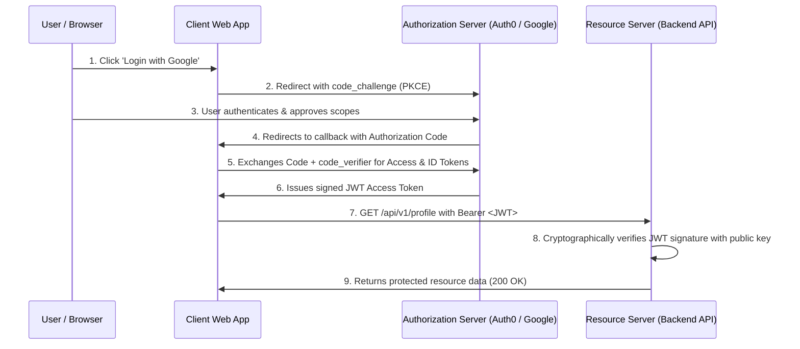

# API Security, OAuth2 & JWT Protection Guide

## Module Overview
This guide covers **OAuth2 Grants**, **JWT Anatomy and Security Pitfalls**, and API gateway authorization.

---

## Visual Flow: OAuth2 Authorization Code Grant with PKCE

---

## JWT Security Pitfalls & Protections

1. **The `alg: "none"` Attack:** Always enforce strict cryptographic verification on the backend; reject tokens specifying `none` or mismatched HMAC/RSA algorithms.
2. **Token Revocation (Blacklisting):** Because JWTs are stateless, they cannot be natively revoked before expiration. Use Redis to maintain a **token revocation blacklist** indexed by `jti` (JWT ID claim) checked on sensitive operations.
