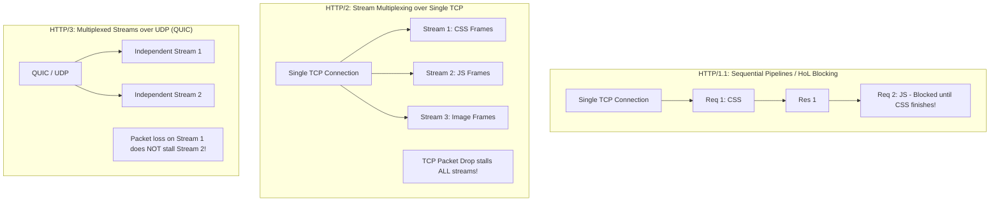
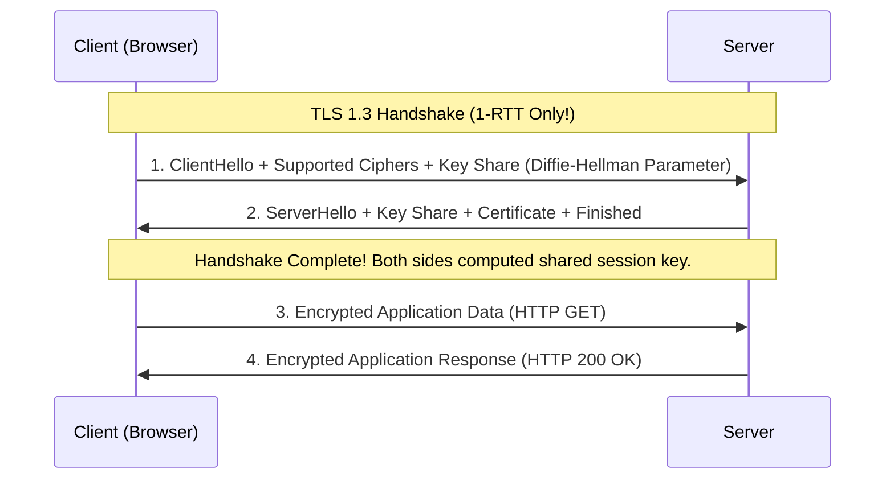

# HTTP, HTTPS & Modern Network Protocols Deep-Dive Guide

## Module Overview
This module covers **HTTP/1.1**, **HTTP/2 Multiplexing**, **HTTP/3 (QUIC / UDP)**, **Head-of-Line (HoL) Blocking**, and **TLS 1.3 Handshake** mechanics.

---

## Visual Evolution: HTTP/1.1 vs HTTP/2 Multiplexing vs HTTP/3 QUIC

---

## Questions & Comprehensive Solutions

### HTTP-BAS-001: HTTP/1.1 vs HTTP/2 vs HTTP/3 Comparison

**Comprehensive Architectural Comparison:**

| Feature | HTTP/1.1 | HTTP/2 | HTTP/3 |
| :--- | :--- | :--- | :--- |
| **Transport Protocol** | TCP | TCP | **QUIC (built on UDP)** |
| **Data Format** | Plaintext ASCII | Binary Frames | Binary Frames |
| **Connection Model** | Multiple TCP connections (max 6 per domain) | Single TCP connection per domain | Single UDP connection with Connection IDs |
| **Multiplexing** | ❌ No (requires connection pooling) | :white_check_mark: Yes (Streams within single TCP) | :white_check_mark: Yes (Native per-stream flow control) |
| **Head-of-Line Blocking**| Severe at **Application layer** | Fixed at Application; exists at **TCP layer** | **Completely Eliminated** |
| **Header Compression** | None (wastes bandwidth) | HPACK (Static & dynamic tables) | QPACK (Out-of-order decompression) |
| **Handshake Latency** | 2–3 Round-Trip Times (RTT) | 2–3 RTT (TCP + TLS) | **0-RTT to 1-RTT** (Combined 1-step handshake) |
| **Network Migration** | Connection drops when switching WiFi $\rightarrow$ Cellular | Connection drops | **Zero-Downtime Migration** (Identified by 64-bit Connection ID) |

---

### HTTP-INT-002: How does TLS 1.3 encrypt HTTPS and why is it faster than TLS 1.2?

**One-Line Answer:**  
**TLS 1.3** reduces the cryptographic handshake from **2 Round-Trip Times (2-RTT)** down to **1-RTT** (and 0-RTT for resumed connections), while permanently deprecating legacy insecure ciphers (RSA key exchange, SHA-1, CBC mode).

