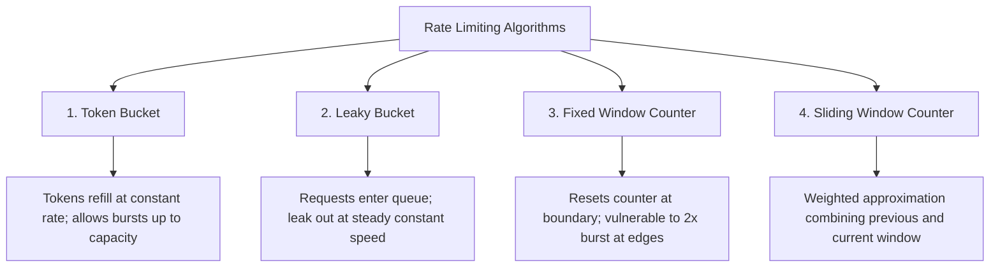

# API Rate Limiting & Throttling Interview Guide

## Module Overview
This guide covers **Rate Limiting Algorithms**, DDoS protection, client throttling, standard HTTP 429 headers, and Redis-backed distributed rate limiters.

---

## Visual Comparison: Rate Limiting Algorithms



---

## Questions & Comprehensive Solutions

### RATE-BAS-001: What is Rate Limiting and why is it essential?

**Difficulty:** Basic  
**Topic:** API Protection

#### 1. Simple Explanation
Rate limiting is a speed-governor for an API. It controls how many times a user, IP address, or application can call an endpoint within a specific time window (e.g. max 100 requests per minute).

#### 2. Why Rate Limiting is Essential:
1. **Preventing Abuse & Denial of Service (DoS):** Stops malicious bots or scrapers from overwhelming server CPU and database connections.
2. **Fair Resource Allocation:** Ensures a single greedy tenant cannot starve other customers in multi-tenant SaaS environments.
3. **Controlling Third-Party API Costs:** Prevents rogue loops from running up huge billing spikes on paid services (like LLMs or SMS gateways).

#### 3. Standard HTTP Rate Limiting Response Headers
When rate limits are enforced, the server returns **HTTP 429 Too Many Requests** accompanied by standard headers:
```http
HTTP/1.1 429 Too Many Requests
Retry-After: 35
X-RateLimit-Limit: 100
X-RateLimit-Remaining: 0
X-RateLimit-Reset: 1732185600
```

---

### RATE-INT-002: Token Bucket vs Leaky Bucket vs Sliding Window Counter

**Comparison Table:**

| Algorithm | How it Works | Handles Bursts? | Complexity | Industry Standard For |
| :--- | :--- | :---: | :---: | :--- |
| **Token Bucket** | Tokens added at steady rate. Each request costs 1 token. When empty, requests are dropped. | :white_check_mark: Yes (up to bucket capacity) | Low memory ($O(1)$) | Amazon AWS APIs, Google Cloud APIs, Stripe |
| **Leaky Bucket** | Requests enter a bounded FIFO queue and are processed at a strictly constant rate. | :x: No (smooths traffic to flat rate) | Requires queue storage | E-commerce checkout queues, video streaming encoders |
| **Fixed Window** | Counts requests in fixed time slices (e.g. 12:00–12:01). Resets to 0. | ⚠️ Flawed: 2x spike possible at window boundary | Ultra-low ($O(1)$) | Basic internal limits |
| **Sliding Window Counter** | Weights previous window's requests with current window percentage. | :white_check_mark: Yes | Low memory ($O(1)$) | Cloudflare, Nginx |

---

### RATE-ADV-003: High-Performance Distributed Rate Limiter in Redis

```python
import time
import redis

client = redis.Redis(host="localhost", port=6379, decode_responses=True)

def is_rate_limited(user_id: str, max_requests: int = 100, window_seconds: int = 60) -> bool:
    """
    Sliding Window Log Rate Limiter using Redis Sorted Sets (ZSET).
    Tracks exact timestamps of recent requests.
    """
    now = time.time()
    key = f"rate_limit:{user_id}"
    window_start = now - window_seconds

    pipe = client.pipeline()
    # 1. Remove timestamps older than the sliding window
    pipe.zremrangebyscore(key, 0, window_start)
    # 2. Add current request timestamp
    pipe.zadd(key, {str(now): now})
    # 3. Count requests remaining in the window
    pipe.zcard(key)
    # 4. Set key expiration to auto-clean memory
    pipe.expire(key, window_seconds)
    
    results = pipe.execute()
    request_count = results[2]

    return request_count > max_requests
```
