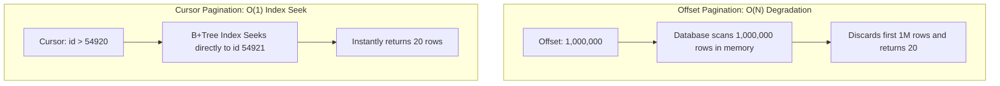

# REST API Design & Architecture Interview Guide

## Module Overview
This module covers modern **RESTful API Engineering**, HTTP protocol semantics, **HTTP Method Idempotency**, status codes, API versioning strategies, and high-performance **Cursor vs Offset Pagination**.

---

## Visual Architecture: REST Request-Response Cycle & HTTP Methods

```mermaid
flowchart LR
    Client([HTTP Client]) -->|POST /orders - Creates Resource| Server[REST API Backend]
    Client -->|GET /orders/1 - Reads (Safe & Idempotent)| Server
    Client -->|PUT /orders/1 - Full Replace (Idempotent)| Server
    Client -->|PATCH /orders/1 - Partial Update (Non-Idempotent)| Server
    Client -->|DELETE /orders/1 - Removes Resource (Idempotent)| Server
    
    Server -->|201 Created / 200 OK / 204 No Content| Client
```

---

## Questions & Comprehensive Solutions

### API-BAS-001: What is REST and what are its 6 Architectural Constraints?

**Difficulty:** Basic  
**Topic:** REST Principles

#### 1. Simple Explanation
**REST (Representational State Transfer)** is not a language or tool; it is a set of design rules for building web services that communicate over HTTP in a clean, predictable, and scalable way.

#### 2. The 6 Architectural Constraints of REST:
1. **Client-Server Architecture:** Complete separation of concerns between user interface (client) and data storage (server).
2. **Statelessness:** Every request must contain all information required to understand and process it. The server stores zero session context about the client between requests.
3. **Cacheability:** Responses must explicitly declare whether they can be cached by browsers or CDNs to reduce redundant server load.
4. **Uniform Interface:** Resources are identified by standard URIs (`/users/12`), manipulated through representations (JSON), self-descriptive messages, and hypermedia (HATEOAS).
5. **Layered System:** The client cannot tell whether it is connected directly to the end application server or through intermediate load balancers, CDNs, or API gateways.
6. **Code on Demand (Optional):** Servers can temporarily extend client functionality by sending executable code (e.g. JavaScript).

---

### API-BAS-002: What is HTTP Method Idempotency and why is it critical?

**Difficulty:** Intermediate  
**Topic:** HTTP Protocol Semantics

#### 1. Simple Explanation
An operation is **Idempotent** if making the same request 1 time or 100 times produces the exact same end state on the server.

#### 2. Easy Real-World Example
- Pressing an elevator call button: Pressing the "Up" button once calls the elevator. Pressing it 10 more times does not call 10 elevators; it leaves the elevator in the exact same state (**Idempotent**).
- Withdrawing \$500 from an ATM: Doing it once withdraws \$500. Doing it 5 times withdraws \$2,500 (**Non-Idempotent**).

#### 3. HTTP Methods Idempotency & Safety Matrix

| HTTP Method | Safe? (Read-Only, no state changes) | Idempotent? ($f(f(x)) = f(x)$) | Typical Success Status Code |
| :--- | :---: | :---: | :--- |
| **GET** | :white_check_mark: Yes | :white_check_mark: Yes | `200 OK` |
| **HEAD** | :white_check_mark: Yes | :white_check_mark: Yes | `200 OK` (No body) |
| **OPTIONS** | :white_check_mark: Yes | :white_check_mark: Yes | `204 No Content` |
| **PUT** | :x: No (Modifies state) | :white_check_mark: Yes (Full replace) | `200 OK` / `204 No Content` |
| **DELETE** | :x: No (Modifies state) | :white_check_mark: Yes (Deleting once or 5 times leaves it deleted) | `204 No Content` / `404` |
| **POST** | :x: No | :x: **No** (Creates new records each time) | `201 Created` |
| **PATCH** | :x: No | :x: **No** (e.g. `{"age": age + 1}`) | `200 OK` |

<u>Interview Tip:</u> Explain why network retries require idempotency: If a mobile phone drops connection during a payment confirmation, an idempotent API allows the mobile app to safely retry without double-charging the customer.

---

### API-INT-003: Offset-Based Pagination vs Keyset (Cursor-Based) Pagination

**Comparison Table:**

| Feature | Offset Pagination (`?limit=20&offset=100000`) | Cursor Pagination (`?limit=20&after_cursor=TXN_9918`) |
| :--- | :--- | :--- |
| **SQL Mechanism** | `LIMIT 20 OFFSET 100000` | `WHERE id > 9918 ORDER BY id ASC LIMIT 20` |
| **Performance on Large Tables**| 🔴 Terrible ($O(N)$ scan): Scans & discards 100,000 disk rows | ⚡ Constant Time ($O(1)$ index seek lookup) |
| **Data Drift (Page Shift)** | High risk: Adding a new item shifts pages, causing duplicates | Zero drift: New items do not shift the cursor |
| **Jump to Specific Page** | Supports direct page jumping (`page=15`) | Infinite scroll / sequential next page only |
| **Best Used For** | Small admin dashboards with search filters | Social media feeds (Instagram, Twitter), high-volume transactional APIs (Razorpay) |


