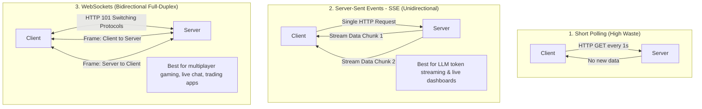
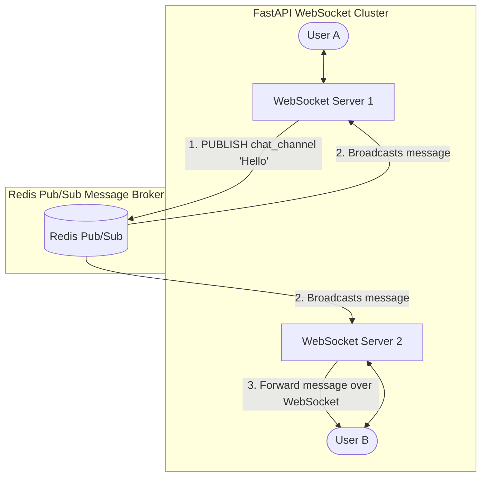

# WebSockets & Real-Time Communication Interview Guide

## Module Overview
This module covers **WebSockets**, the WebSocket protocol handshake (`Upgrade: websocket`), **WebSockets vs SSE vs Long Polling**, and **Horizontal Scaling using Redis Pub/Sub**.

---

## Visual Comparison: Real-Time Protocols



---

## Questions & Comprehensive Solutions

### WS-BAS-001: WebSockets vs Server-Sent Events (SSE) vs Long Polling

**Comparison Matrix:**

| Feature | Long Polling | Server-Sent Events (SSE) | WebSockets |
| :--- | :--- | :--- | :--- |
| **Protocol** | Standard HTTP | Standard HTTP (`text/event-stream`) | **`ws://` / `wss://` (TCP-based)** |
| **Direction** | Client $\rightarrow$ Server | **Server $\rightarrow$ Client Only (Unidirectional)** | **Full-Duplex (Bidirectional)** |
| **Header Overhead** | Massive: Full HTTP headers sent on every request | Low: Single HTTP header at connection setup | **Minimal: 2 to 6 bytes per frame** after handshake |
| **Reconnection** | Handled manually in app logic | Built-in native browser auto-reconnect | Handled manually in client code |
| **HTTP/2 Compatibility**| Standard | Supported natively over single multiplexed TCP | Supported via RFC 8441 |
| **Best Used For** | Legacy fallback systems | **LLM token streaming, stock tickers, notification feeds** | **Live chat apps, multiplayer gaming, collaborative whiteboards** |

---

### WS-INT-002: How do you scale WebSockets horizontally across multiple server instances?

**Difficulty:** Advanced  
**Topic:** Real-Time Distributed Systems

#### The Problem:
WebSockets maintain a **persistent, stateful TCP connection** to a specific server instance. If User A is connected to Server 1 and User B is connected to Server 2, Server 1 cannot directly send a message to User B because the socket connection lives on Server 2's memory!

#### The Solution: Redis Pub/Sub Backplane (Message Broker)



#### Fast Python Implementation with FastAPI & Redis:

```python
from fastapi import FastAPI, WebSocket, WebSocketDisconnect
import redis.asyncio as aioredis
import asyncio

app = FastAPI()
redis_client = aioredis.from_url("redis://localhost:6379", decode_responses=True)

@app.websocket("/ws/chat/{room_id}")
async def websocket_endpoint(websocket: WebSocket, room_id: str):
    await websocket.accept()
    pubsub = redis_client.pubsub()
    await pubsub.subscribe(room_id)

    async def redis_listener():
        """Listens to Redis messages and broadcasts down to client WebSocket"""
        try:
            async for message in pubsub.listen():
                if message["type"] == "message":
                    await websocket.send_text(message["data"])
        except Exception:
            pass

    listener_task = asyncio.create_task(redis_listener())

    try:
        while True:
            # Reads incoming message from client and publishes to Redis
            text = await websocket.receive_text()
            await redis_client.publish(room_id, text)
    except WebSocketDisconnect:
        listener_task.cancel()
        await pubsub.unsubscribe(room_id)
```
