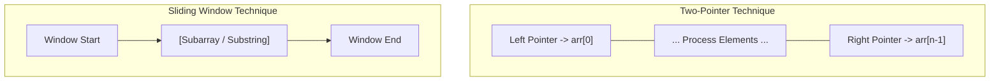

# Arrays and Strings

Fundamental algorithms, two-pointer techniques, sliding window patterns, and prefix sums for arrays and string processing in Python.

---

## Architecture: Two-Pointer & Sliding Window Mechanics



---

## Interview Questions & Answers

### ARR-BAS-001: How does the Two-Pointer technique work for array and string problems?

#### 1. Simple Explanation
The two-pointer technique uses two integer indices to traverse an array or string either:
- **Opposite directions:** One starts at the beginning (`left = 0`) moving right, and one starts at the end (`right = len(arr) - 1`) moving left (used in sorted arrays, reversing, palindrome checks).
- **Same direction:** Fast and slow pointers moving at different speeds (used in cycle detection and in-place array deduplication).

#### 2. Easy Example
To check if `"radar"` is a palindrome:
- Compare index 0 (`'r'`) with index 4 (`'r'`). Match! Move pointers inward.
- Compare index 1 (`'a'`) with index 3 (`'a'`). Match!
- Pointers meet at index 2 (`'d'`). Finished in $O(N)$ time with $O(1)$ memory.

#### 3. One-Line Interview Answer
The two-pointer technique traverses linear sequences using coordinated indices to reduce search space from quadratic $O(N^2)$ to linear $O(N)$ without extra memory allocations.

#### 4. Detailed Technical Explanation
In sorted arrays, moving a pointer provides monotonic guarantees. In Two Sum II (sorted array), if `arr[left] + arr[right] < target`, the sum can only be increased by incrementing `left`. If the sum is greater than target, it can only be decreased by decrementing `right`. This eliminates an entire row/column of candidates in $O(1)$ time per step.

#### 5. Practical Implementation
```python
def is_valid_palindrome(s: str) -> bool:
    left, right = 0, len(s) - 1
    while left < right:
        while left < right and not s[left].isalnum():
            left += 1
        while left < right and not s[right].isalnum():
            right -= 1
        if s[left].lower() != s[right].lower():
            return False
        left += 1
        right -= 1
    return True

assert is_valid_palindrome("A man, a plan, a canal: Panama") is True
assert is_valid_palindrome("race a car") is False
```

#### 6. Real-World Scenarios
- **Real-Time Log Stream Sanitization:** Filtering non-alphanumeric punctuation and matching search patterns in high-throughput network packet streams without allocating secondary memory buffers.

---

### ARR-INT-002: How does the Sliding Window pattern optimize subarray problems?

#### 1. Simple Explanation
Instead of recalculating sums or conditions for every possible contiguous subarray ($O(N^2)$), a sliding window maintains a dynamic "window" with two pointers (`start` and `end`). As `end` expands to include new elements, `start` contracts to maintain required constraints, updating state in $O(1)$ per step ($O(N)$ total).

#### 2. Easy Example
Finding the maximum sum of 3 consecutive elements in `[2, 1, 5, 1, 3, 2]`:
- Window 1: `[2, 1, 5]` = sum 8.
- Next window: subtract 2, add 1 -> `[1, 5, 1]` = sum 7.
- Next window: subtract 1, add 3 -> `[5, 1, 3]` = sum 9.

#### 3. One-Line Interview Answer
Sliding Window converts nested $O(N^2)$ brute-force subarray evaluations into $O(N)$ single-pass solutions by incrementally updating window boundaries and running state.

#### 4. Detailed Technical Explanation
Two primary window variations:
1. **Fixed-Size Window:** Window size $K$ remains constant. Shift by subtracting `arr[start]` and adding `arr[end]`.
2. **Dynamic-Size Window:** Window expands (`end += 1`) while valid, and contracts (`start += 1`) whenever invariant constraints are violated (e.g., maximum $K$ distinct characters).

#### 5. Practical Implementation
```python
def length_of_longest_substring(s: str) -> int:
    char_map = {}
    max_len = 0
    start = 0

    for end, char in enumerate(s):
        if char in char_map and char_map[char] >= start:
            start = char_map[char] + 1
        char_map[char] = end
        max_len = max(max_len, end - start + 1)

    return max_len

assert length_of_longest_substring("abcabcbb") == 3
assert length_of_longest_substring("bbbbb") == 1
```

#### 6. Real-World Scenarios
- **API Sliding-Window Rate Limiting:** Tracking the number of requests per client in a sliding 60-second time window by evicting timestamps older than `now - 60`.

---

### ARR-ADV-003: How do Prefix Sums and Difference Arrays optimize range queries?

#### 1. Simple Explanation
- **Prefix Sum:** Precalculates cumulative sums so that any range sum query `sum(arr[L...R])` can be answered in instant $O(1)$ time rather than looping through elements in $O(N)$.
- **Difference Array:** Allows updating all elements in a range `[L, R]` with a value `+V` in $O(1)$ time, rather than updating every element individually.

#### 2. Easy Example
Array: `[3, 1, 4, 2]`
Prefix Sum: `[0, 3, 4, 8, 10]`
Sum of elements from index 1 to 2: `prefix[3] - prefix[1] = 8 - 3 = 5` (`1 + 4 = 5`).

#### 3. One-Line Interview Answer
Prefix sums precompute cumulative totals for $O(1)$ static range queries, while difference arrays record boundary delta markers for $O(1)$ range updates reconstructed in $O(N)$.

#### 4. Detailed Technical Explanation
Formula: $	ext{sum}(L, R) = 	ext{prefix}[R + 1] - 	ext{prefix}[L]$ where $	ext{prefix}[0] = 0$.
For difference array $D$, an update to range $[L, R]$ with value $V$:
$D[L] += V$ and $D[R + 1] -= V$. Computing prefix sum of array $D$ reconstructs the final updated values in a single linear pass.

#### 5. Practical Implementation
```python
class PrefixSumArray:
    def __init__(self, nums: list[int]):
        self.prefix = [0] * (len(nums) + 1)
        for i, num in enumerate(nums):
            self.prefix[i + 1] = self.prefix[i] + num

    def query_range(self, left: int, right: int) -> int:
        return self.prefix[right + 1] - self.prefix[left]

ps = PrefixSumArray([3, 1, 4, 2])
assert ps.query_range(1, 2) == 5
assert ps.query_range(0, 3) == 10
```

#### 6. Real-World Scenarios
- **Financial Analytics & Telemetry:** Querying total revenue or error counts between arbitrary timestamps over millions of historical transactions in constant $O(1)$ time.
