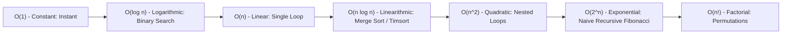

# Time & Space Complexity Analysis (Big-O) Guide

## Module Overview
This guide covers **Asymptotic Complexity Analysis**, **Big-O Notation**, **Space Complexity**, and runtime costs of all standard **Python Built-in Operations**.

---

## Visual Comparison: Common Time Complexity Growth Curves



---

## Python Built-in Operations Complexity Reference Table

### 1. Python List (`list`)
| Operation | Average Case | Worst Case | Notes |
| :--- | :---: | :---: | :--- |
| `list[i]` (Index Lookup) | $O(1)$ | $O(1)$ | Direct pointer offset calculation in dynamic array |
| `list.append(x)` | $O(1)$ | $O(n)$ | Amortized $O(1)$; occasional array resize allocation |
| `list.pop()` (from end) | $O(1)$ | $O(1)$ | Decrements length counter |
| `list.insert(0, x)` | $O(n)$ | $O(n)$ | Shifts all $n$ subsequent pointers to the right |
| `list.pop(0)` (from front)| $O(n)$ | $O(n)$ | Shifts all elements left. **Use `collections.deque` instead!** |
| `x in list` (Linear Search)| $O(n)$ | $O(n)$ | Scans elements sequentially |

### 2. Python Dictionary (`dict`) & Set (`set`)
| Operation | Average Case | Worst Case | Notes |
| :--- | :---: | :---: | :--- |
| `dict[key]` (Lookup) | $O(1)$ | $O(n)$ | $O(n)$ only under catastrophic hash collisions |
| `dict[key] = val` (Insert) | $O(1)$ | $O(n)$ | Amortized $O(1)$ |
| `key in dict` (Check) | $O(1)$ | $O(n)$ | Hash table bucket lookup |
| `del dict[key]` (Delete) | $O(1)$ | $O(n)$ | Marks bucket dummy/deleted |

---

## Understanding Space Complexity & Recursion Stack

- **Auxiliary Space:** Extra temporary space allocated by the algorithm outside the input data itself.
- **Recursion Call Stack:** Every recursive function call allocates a new stack frame on the OS call stack.
  ```python
  # Memory: O(n) space complexity due to n recursive call frames!
  def recursive_sum(n: int) -> int:
      if n <= 1: return 1
      return n + recursive_sum(n - 1)
  ```
