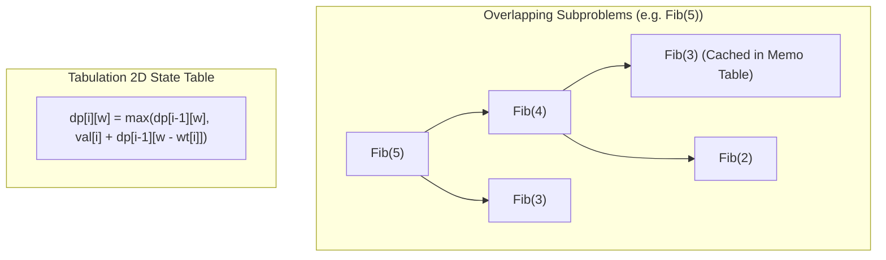

# Dynamic Programming

Memoization (Top-Down), Tabulation (Bottom-Up), 0/1 Knapsack, Coin Change, Longest Common Subsequence, and Edit Distance in Python.

---

## Architecture: Overlapping Subproblems & Tabulation Grid



---

## Interview Questions & Answers

### DPG-BAS-001: What is Dynamic Programming and Memoization vs Tabulation?

#### 1. Simple Explanation
Dynamic Programming (DP) solves complex problems by breaking them into simpler subproblems, solving each subproblem once, and remembering their answers to avoid recalculating them:
- **Memoization (Top-Down):** Write standard recursion, but check an in-memory cache (`memo` dict) before computing.
- **Tabulation (Bottom-Up):** Solve the smallest subproblems first and iteratively fill an array/table up to the target answer, avoiding recursion call stack overhead.

#### 2. Easy Example
Calculating Fibonacci: `fib(5) = fib(4) + fib(3)`. Without DP, `fib(3)` is computed multiple times independently ($O(2^N)$). With DP, save `fib(3)` the first time it is calculated, reducing runtime to linear $O(N)$.

#### 3. One-Line Interview Answer
Dynamic Programming optimizes problems with overlapping subproblems and optimal substructure by caching sub-results via Top-Down Memoization or Bottom-Up Tabulation.

#### 4. Detailed Technical Explanation
Two requirements for DP:
1. **Optimal Substructure:** An optimal solution to the problem contains optimal solutions to its subproblems.
2. **Overlapping Subproblems:** The same subproblems are solved repeatedly during execution.

#### 5. Practical Implementation
```python
from functools import lru_cache

# 1. Top-Down Memoization
@lru_cache(maxsize=None)
def fib_memo(n: int) -> int:
    if n <= 1:
        return n
    return fib_memo(n - 1) + fib_memo(n - 2)

# 2. Bottom-Up Tabulation with O(1) Space Optimization
def fib_tabulation(n: int) -> int:
    if n <= 1:
        return n
    prev2, prev1 = 0, 1
    for _ in range(2, n + 1):
        curr = prev1 + prev2
        prev2, prev1 = prev1, curr
    return prev1

assert fib_memo(10) == 55
assert fib_tabulation(10) == 55
```

#### 6. Real-World Scenarios
- **API Response Micro-Caching:** Memoizing deterministic mathematical calculations, financial interest quotes, and tax models across microservice calls.

---

### DPG-INT-002: How do you solve the 0/1 Knapsack and Coin Change problems?

#### 1. Simple Explanation
- **0/1 Knapsack:** Given items with weights and values, maximize total value inside a bag with weight capacity $W$, where each item can be taken at most once (0 or 1).
- **Coin Change (Unbounded):** Given coin denominations and a total amount, find the minimum number of coins needed to make up that amount, where each coin can be used infinitely many times.

#### 2. Easy Example
Coin denominations `[1, 2, 5]`, target amount 11:
- Pick coin 5 -> remaining 6
- Pick coin 5 -> remaining 1
- Pick coin 1 -> remaining 0
Total: 3 coins (`5 + 5 + 1 = 11`).

#### 3. One-Line Interview Answer
Knapsack and Coin Change formulate state as `dp[amount]`, updating optimal values by choosing between taking or skipping current denominations.

#### 4. Detailed Technical Explanation
- State transition for Coin Change:
  $	ext{dp}[i] = \min(	ext{dp}[i], 	ext{dp}[i - c] + 1)$ for every coin $c \le i$.
  Initialize array with $\infty$ and $	ext{dp}[0] = 0$.

#### 5. Practical Implementation
```python
def coin_change(coins: list[int], amount: int) -> int:
    dp = [float('inf')] * (amount + 1)
    dp[0] = 0

    for coin in coins:
        for i in range(coin, amount + 1):
            dp[i] = min(dp[i], dp[i - coin] + 1)

    return dp[amount] if dp[amount] != float('inf') else -1

assert coin_change([1, 2, 5], 11) == 3
assert coin_change([2], 3) == -1
```

#### 6. Real-World Scenarios
- **AWS Server Packing & Cloud Billing:** Packing virtual machines into bare-metal servers to maximize CPU/RAM utilization while minimizing physical server rental costs.

---

### DPG-ADV-003: How do you solve Longest Common Subsequence (LCS) and Edit Distance?

#### 1. Simple Explanation
- **LCS:** Finds the length of the longest sequence that appears in both strings in the same relative order (e.g. `"abcde"` and `"ace"` have LCS `"ace"` of length 3).
- **Edit Distance (Levenshtein Distance):** Finds the minimum number of single-character operations (Insert, Delete, Replace) required to convert string A into string B.

#### 2. Easy Example
Transform `"horse"` into `"ros"`:
1. Replace 'h' with 'r' -> `"rorse"`
2. Remove 'r' -> `"rose"`
3. Remove 'e' -> `"ros"`
Total: 3 edits.

#### 3. One-Line Interview Answer
Edit Distance and LCS use a 2D matrix matching character prefixes, comparing diagonal matches against insertions, deletions, and replacements in $O(M 	imes N)$ time.

#### 4. Detailed Technical Explanation
Edit Distance recurrence:
If $A[i-1] == B[j-1]$, $	ext{dp}[i][j] = 	ext{dp}[i-1][j-1]$.
Else:
$	ext{dp}[i][j] = 1 + \min($
  $	ext{dp}[i-1][j], \quad$ (Delete)
  $	ext{dp}[i][j-1], \quad$ (Insert)
  $	ext{dp}[i-1][j-1] \quad$ (Replace)
$)$

#### 5. Practical Implementation
```python
def min_distance_edit(word1: str, word2: str) -> int:
    m, n = len(word1), len(word2)
    dp = [[0] * (n + 1) for _ in range(m + 1)]

    for i in range(m + 1):
        dp[i][0] = i
    for j in range(n + 1):
        dp[0][j] = j

    for i in range(1, m + 1):
        for j in range(1, n + 1):
            if word1[i - 1] == word2[j - 1]:
                dp[i][j] = dp[i - 1][j - 1]
            else:
                dp[i][j] = 1 + min(
                    dp[i - 1][j],      # Delete
                    dp[i][j - 1],      # Insert
                    dp[i - 1][j - 1]   # Replace
                )

    return dp[m][n]

assert min_distance_edit("horse", "ros") == 3
assert min_distance_edit("intention", "execution") == 5
```

#### 6. Real-World Scenarios
- **Git Diff & DNA Sequence Alignment:** `git diff` computes the longest common subsequence of code lines between two commits; bioinformatics engines compute genome similarity using Levenshtein distance.
