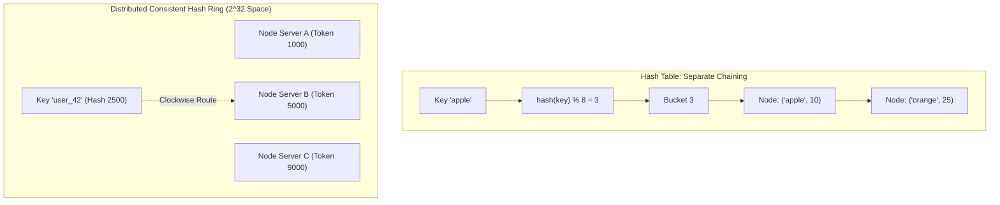

# Hash Tables & Consistent Hashing

Hash functions, collision resolution (Chaining vs Open Addressing), CPython dict internals, and distributed Consistent Hashing.

---

## Architecture: Separate Chaining vs Consistent Hash Ring



---

## Interview Questions & Answers

### HT-BAS-001: How do Hash Tables work and what are their time complexities?

#### 1. Simple Explanation
A hash table maps keys to values using a mathematical **hash function**. The hash function converts a key (like string `"alice"`) into an integer index in an underlying array. This allows insertion, lookup, and deletion to run in instant average $O(1)$ time.

#### 2. Easy Example
A library where books are filed by the author's initials. To find a book by "Tolkien", you go straight to cabinet "T" instead of scanning all 100,000 books from page one.

#### 3. One-Line Interview Answer
Hash tables achieve average $O(1)$ read/write/delete operations by indexing an array via hash function mapping, degrading to $O(N)$ when severe collisions occur.

#### 4. Detailed Technical Explanation
- **Average Time:** $O(1)$ for Insert, Lookup, Delete.
- **Worst-Case Time:** $O(N)$ if all keys hash to the same bucket.
- **Load Factor ($lpha$):** $lpha = rac{N}{K}$ where $N$ is number of items and $K$ is array bucket capacity. When $lpha > 0.75$, the hash table dynamically reallocates a larger array (doubling size) and rehashes all elements to maintain $O(1)$ speed.

#### 5. Practical Implementation
```python
class SimpleHashTable:
    def __init__(self, size: int = 16):
        self.size = size
        self.buckets = [[] for _ in range(size)]

    def _hash(self, key: str) -> int:
        return hash(key) % self.size

    def put(self, key: str, value: any):
        index = self._hash(key)
        for i, (k, v) in enumerate(self.buckets[index]):
            if k == key:
                self.buckets[index][i] = (key, value)
                return
        self.buckets[index].append((key, value))

    def get(self, key: str):
        index = self._hash(key)
        for k, v in enumerate(self.buckets[index]):
            if k == key:
                return v
        return None

ht = SimpleHashTable()
ht.put("username", "alice")
assert ht.get("username") == "alice"
```

#### 6. Real-World Scenarios
- **Database Indexing:** In-memory hash indexes in PostgreSQL or Redis for instant point lookups by primary key.

---

### HT-INT-002: What is the difference between Separate Chaining and Open Addressing?

#### 1. Simple Explanation
When two different keys produce the exact same array index, a **collision** occurs.
- **Separate Chaining:** Each array slot points to a linked list. Colliding items are simply added to the list.
- **Open Addressing:** All items live directly in the array. If a slot is occupied, the algorithm probes forward (linearly or quadratically) to find the next available empty slot.

#### 2. Easy Example
- Chaining: A coat check closet where multiple coats can hang on hook #3.
- Open Addressing: Assigned movie theater seats: if someone is sitting in seat #3, you look for the next empty seat (#4, #5).

#### 3. One-Line Interview Answer
Separate chaining stores colliding entries in linked lists per bucket, while open addressing resolves collisions by probing for alternative vacant slots within the primary table array.

#### 4. Detailed Technical Explanation
Python's `dict` implementation uses **Open Addressing** with pseudo-random perturbation probing to avoid clustering:
$i = (5 	imes i + 1 + 	ext{perturb}) \pmod{	ext{size}}$.
Since Python 3.6, `dict` uses a compact array layout (indices array + entries array) preserving insertion order while reducing memory consumption by ~25%.

#### 5. Practical Implementation
```python
# Linear Probing Open Addressing
class LinearProbingHashMap:
    def __init__(self, capacity: int = 8):
        self.capacity = capacity
        self.keys = [None] * capacity
        self.values = [None] * capacity

    def put(self, key: str, val: int):
        idx = hash(key) % self.capacity
        while self.keys[idx] is not None and self.keys[idx] != key:
            idx = (idx + 1) % self.capacity  # probe forward
        self.keys[idx] = key
        self.values[idx] = val

    def get(self, key: str):
        idx = hash(key) % self.capacity
        while self.keys[idx] is not None:
            if self.keys[idx] == key:
                return self.values[idx]
            idx = (idx + 1) % self.capacity
        return None

lpm = LinearProbingHashMap()
lpm.put("cat", 10)
assert lpm.get("cat") == 10
```

#### 6. Real-World Scenarios
- **High-Performance Memory Constraints:** Open addressing provides superior CPU cache locality compared to pointer-chasing in linked lists, which is why systems programming languages and Python dictionaries favor open addressing.

---

### HT-ADV-003: How does Consistent Hashing work in distributed caching and databases?

#### 1. Simple Explanation
In standard modulo hashing (`hash(key) % N`), when the number of servers $N$ changes (a server crashes or a new server is added), almost all keys map to different servers, causing a catastrophic cache stampede. **Consistent Hashing** maps both servers and data keys onto a circular ring ($0$ to $2^{32} - 1$). When a server is added or removed, only $rac{K}{N}$ keys need to be remapped on average.

#### 2. Easy Example
A circular running track with 4 water stations. Runners run clockwise to the next closest station. If one station closes, only runners heading to that specific station need to run to the next station; everyone else is unaffected.

#### 3. One-Line Interview Answer
Consistent Hashing maps servers and keys onto a virtual token ring, ensuring node additions or failures only migrate $O(K/N)$ keys rather than reorganizing the entire cluster.

#### 4. Detailed Technical Explanation
1. **Virtual Nodes:** To prevent hotspot clustering and uneven load distribution, each physical server is assigned multiple virtual tokens (e.g. 100-250 virtual nodes) spread across the hash ring.
2. **Lookup:** To route a key, compute `hash(key)`, then use binary search (`bisect`) to find the next server node located clockwise on the ring.

#### 5. Practical Implementation
```python
import hashlib
import bisect

class ConsistentHashRing:
    def __init__(self, nodes=None, replicas=3):
        self.replicas = replicas
        self.ring = []
        self.node_map = {}
        if nodes:
            for node in nodes:
                self.add_node(node)

    def _hash(self, key: str) -> int:
        return int(hashlib.md5(key.encode('utf-8')).hexdigest(), 16)

    def add_node(self, node: str):
        for i in range(self.replicas):
            token = self._hash(f"{node}#replica{i}")
            bisect.insort(self.ring, token)
            self.node_map[token] = node

    def get_node(self, key: str) -> str:
        if not self.ring:
            return None
        token = self._hash(key)
        idx = bisect.bisect_right(self.ring, token)
        if idx == len(self.ring):
            idx = 0  # wrap around to start of ring
        return self.node_map[self.ring[idx]]

ch = ConsistentHashRing(["server-1", "server-2", "server-3"])
target_node = ch.get_node("user_session_9921")
assert target_node in ["server-1", "server-2", "server-3"]
```

#### 6. Real-World Scenarios
- **Amazon DynamoDB & Apache Cassandra:** Distributing billions of rows across thousands of database partitions and handling dynamic node scale-out without cluster-wide downtime.
