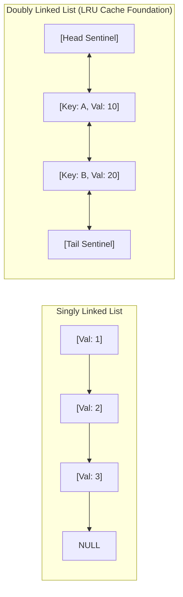

# Linked Lists

Single, Doubly, and Circular Linked Lists: pointer manipulation, fast & slow pointer algorithms, cycle detection, and building an LRU Cache.

---

## Architecture: Singly Linked List vs Doubly Linked List



---

## Interview Questions & Answers

### LL-BAS-001: How do you reverse a Singly Linked List iteratively and recursively?

#### 1. Simple Explanation
Reversing a singly linked list means flipping every node's `next` pointer so it points to its predecessor instead of its successor, turning the former tail into the new head.

#### 2. Easy Example
`1 -> 2 -> 3 -> NULL` becomes `3 -> 2 -> 1 -> NULL`.

#### 3. One-Line Interview Answer
Iterative reversal uses three pointers (`prev`, `curr`, `next_node`) to redirect links in $O(N)$ time and $O(1)$ space.

#### 4. Detailed Technical Explanation
In the iterative approach:
1. Save `next_node = curr.next`.
2. Flip current node's link: `curr.next = prev`.
3. Advance `prev = curr`.
4. Advance `curr = next_node`.
Repeat until `curr` becomes `None`. Return `prev` as the new head.

#### 5. Practical Implementation
```python
from typing import Optional

class ListNode:
    def __init__(self, val: int = 0, next: Optional["ListNode"] = None):
        self.val = val
        self.next = next

def reverse_list(head: Optional[ListNode]) -> Optional[ListNode]:
    prev = None
    curr = head
    while curr:
        next_temp = curr.next
        curr.next = prev
        prev = curr
        curr = next_temp
    return prev

# Verification
node3 = ListNode(3)
node2 = ListNode(2, node3)
node1 = ListNode(1, node2)
rev_head = reverse_list(node1)
assert rev_head.val == 3
assert rev_head.next.val == 2
```

#### 6. Real-World Scenarios
- **Undo / Redo Buffer Inversion:** Reversing navigation history stacks or reordering single-linked event transaction streams during database rollbacks.

---

### LL-INT-002: How do Fast & Slow pointers detect cycles and find the middle node?

#### 1. Simple Explanation
Floyd's Tortoise and Hare algorithm uses two pointers:
- **Slow pointer:** Moves 1 step at a time.
- **Fast pointer:** Moves 2 steps at a time.
If there is a cycle, the fast pointer will eventually lap the slow pointer and they will meet. If there is no cycle, the fast pointer reaches the end (`None`).

#### 2. Easy Example
Two runners on a circular running track: even if the faster runner starts behind, they will inevitably overtake and meet the slower runner.

#### 3. One-Line Interview Answer
Floyd's Cycle-Finding Algorithm guarantees two pointers moving at speeds 1 and 2 will intersect within a loop in $O(N)$ time and $O(1)$ space.

#### 4. Detailed Technical Explanation
To find the **entry point** of the cycle:
When fast and slow meet, reset slow to `head` while leaving fast at the intersection. Advance both pointers 1 step at a time. The node where they meet again is the exact cycle entrance.

#### 5. Practical Implementation
```python
def has_cycle(head: Optional[ListNode]) -> bool:
    slow = head
    fast = head
    while fast and fast.next:
        slow = slow.next
        fast = fast.next.next
        if slow == fast:
            return True
    return False

def find_middle_node(head: Optional[ListNode]) -> Optional[ListNode]:
    slow = head
    fast = head
    while fast and fast.next:
        slow = slow.next
        fast = fast.next.next
    return slow
```

#### 6. Real-World Scenarios
- **Deadlock & Graph Loop Detection:** Validating resource dependency chains in task schedulers to ensure workflows contain no circular dependencies.

---

### LL-ADV-003: How do you design an LRU Cache with $O(1)$ Get and Put operations?

#### 1. Simple Explanation
A Least Recently Used (LRU) Cache evicts the item that hasn't been accessed for the longest time when capacity is reached. To achieve $O(1)$ for both `get` and `put`, combine:
1. **Hash Map:** Maps keys to doubly-linked list nodes ($O(1)$ search).
2. **Doubly Linked List:** Maintains recency order. Moving a node to the front or removing the least recently used node from the back takes $O(1)$ time.

#### 2. Easy Example
A desk with space for 3 books. Whenever you read a book, you place it on top of the pile. When the desk is full and a new book arrives, you discard the book at the very bottom.

#### 3. One-Line Interview Answer
An LRU Cache pairs a hash map for $O(1)$ key-to-node lookups with a doubly linked list with dummy head and tail sentinels for $O(1)$ node insertion and removal.

#### 4. Detailed Technical Explanation
Dummy `head` and `tail` sentinel nodes eliminate edge-case checks for empty lists or single-element updates. When a node is accessed via `get()`, remove it from its current position and insert right after `head`. When capacity overflows on `put()`, remove the node before `tail` and delete its key from the hash map.

#### 5. Practical Implementation
```python
class DNode:
    def __init__(self, key: int = 0, val: int = 0):
        self.key = key
        self.val = val
        self.prev = None
        self.next = None

class LRUCache:
    def __init__(self, capacity: int):
        self.capacity = capacity
        self.cache = {}
        self.head = DNode()
        self.tail = DNode()
        self.head.next = self.tail
        self.tail.prev = self.head

    def _remove(self, node: DNode):
        node.prev.next = node.next
        node.next.prev = node.prev

    def _add_to_front(self, node: DNode):
        node.next = self.head.next
        node.prev = self.head
        self.head.next.prev = node
        self.head.next = node

    def get(self, key: int) -> int:
        if key not in self.cache:
            return -1
        node = self.cache[key]
        self._remove(node)
        self._add_to_front(node)
        return node.val

    def put(self, key: int, value: int) -> None:
        if key in self.cache:
            self._remove(self.cache[key])
        node = DNode(key, value)
        self._add_to_front(node)
        self.cache[key] = node

        if len(self.cache) > self.capacity:
            lru = self.tail.prev
            self._remove(lru)
            del self.cache[lru.key]

lru = LRUCache(2)
lru.put(1, 100)
lru.put(2, 200)
assert lru.get(1) == 100
lru.put(3, 300)  # Evicts key 2
assert lru.get(2) == -1
```

#### 6. Real-World Scenarios
- **Database Query Buffer & In-Memory Application Caches:** Implementing high-performance in-memory caching layers (like Redis or Python's `functools.lru_cache`) to prevent disk access for frequent hot keys.
