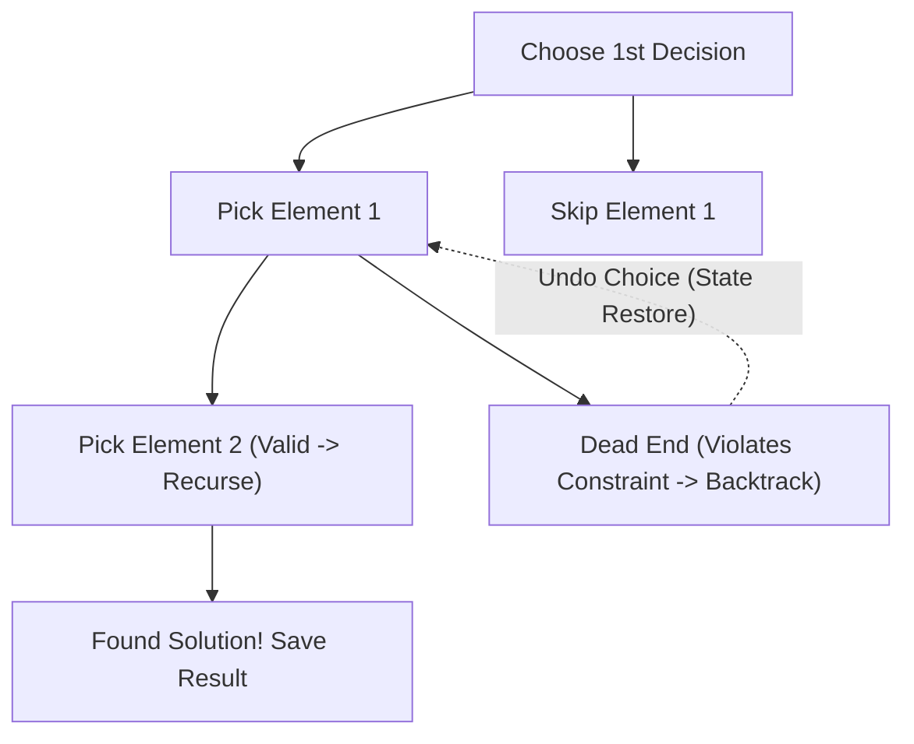

# Recursion and Backtracking

Recursive foundations, backtracking blueprints, Subsets, Permutations, Combinations, and N-Queens constraint satisfaction.

---

## Architecture: Backtracking State Exploration Tree



---

## Interview Questions & Answers

### REC-BAS-001: What are Recursion fundamentals, Base Cases, and the Call Stack?

#### 1. Simple Explanation
Recursion is when a function calls itself to solve a smaller subproblem. Every recursive function must have two components:
1. **Base Case:** The stopping condition that returns a value directly without making further calls.
2. **Recursive Step:** Dividing the problem into smaller subproblems and calling itself.

#### 2. Easy Example
Russian Matryoshka nesting dolls: opening a doll reveals a smaller doll inside. Opening continues until you reach the smallest solid doll that cannot be opened (the base case).

#### 3. One-Line Interview Answer
Recursion solves problems by delegating subproblems down the OS call stack until reaching a base condition, unwinding stack frames during return.

#### 4. Detailed Technical Explanation
Each recursive call allocates a stack frame in RAM storing local variables and return addresses.
- If the base case is missing or unreachable, infinite recursion exhausts the stack, raising `RecursionError: maximum recursion depth exceeded` in Python (default limit is 1,000, inspectable via `sys.getrecursionlimit()`).

#### 5. Practical Implementation
```python
def factorial(n: int) -> int:
    # 1. Base case
    if n <= 1:
        return 1
    # 2. Recursive step
    return n * factorial(n - 1)

assert factorial(5) == 120
assert factorial(1) == 1
```

#### 6. Real-World Scenarios
- **Directory Tree Traversal:** Walking nested file system folders (`os.walk`) where each folder may contain subfolders of unknown depth.

---

### REC-INT-002: How does the Standard Backtracking Template solve Subsets and Permutations?

#### 1. Simple Explanation
Backtracking is an exhaustive search method that builds a candidate solution step by step:
1. **Choose:** Make a choice and add it to the current path.
2. **Explore:** Call the function recursively to explore further decisions.
3. **Unchoose (Backtrack):** Remove the choice to reset state before trying the next alternative.

#### 2. Easy Example
Navigating a maze: walk forward until you hit a dead end. Step back to the last intersection, mark the dead end as invalid, and try the alternate path.

#### 3. One-Line Interview Answer
The backtracking blueprint uses a 3-step pattern: Choose candidate, Explore recursively, and Unchoose (Backtrack) to prune the search space.

#### 4. Detailed Technical Explanation
- **Subsets ($2^N$):** At each index, decide whether to include or exclude `nums[i]`.
- **Permutations ($N!$):** Order matters. Use a `used` boolean array or swap elements in-place to generate all $N!$ orderings.

#### 5. Practical Implementation
```python
def subsets(nums: list[int]) -> list[list[int]]:
    result = []
    
    def backtrack(start_index: int, current_path: list[int]):
        # Add a copy of current valid subset
        result.append(list(current_path))
        
        for i in range(start_index, len(nums)):
            # 1. Choose
            current_path.append(nums[i])
            # 2. Explore
            backtrack(i + 1, current_path)
            # 3. Unchoose (Backtrack)
            current_path.pop()

    backtrack(0, [])
    return result

res = subsets([1, 2])
assert res == [[], [1], [1, 2], [2]]
```

#### 6. Real-World Scenarios
- **Access Control & Permissions Combinations:** Generating all possible permission combinations or test case matrices in QA automation suites.

---

### REC-ADV-003: How do you solve Constraint Satisfaction Problems like N-Queens with Pruning?

#### 1. Simple Explanation
The N-Queens puzzle requires placing $N$ chess queens on an $N 	imes N$ chessboard such that no two queens attack each other (no two queens share the same row, column, or diagonal). Instead of testing all possible board layouts ($N^{N}$), **pruning** immediately abandons any row placement that attacks an existing queen, shrinking execution time drastically.

#### 2. Easy Example
Placing queens row by row. If placing a queen in row 2 at column 1 collides with row 1, stop immediately and do not evaluate rows 3 and 4 for that branch.

#### 3. One-Line Interview Answer
N-Queens places queens row-by-row, pruning attacking branches using hash sets tracking occupied columns and positive/negative diagonals in $O(N!)$ time.

#### 4. Detailed Technical Explanation
To check diagonal attacks in $O(1)$ time:
- **Positive Diagonals ($/$):** All cells on the same positive diagonal have a constant sum: `row + col`.
- **Negative Diagonals ($ackslash$):** All cells on the same negative diagonal have a constant difference: `row - col`.
Using three sets (`cols`, `pos_diag`, `neg_diag`) reduces conflict checks to $O(1)$.

#### 5. Practical Implementation
```python
def solve_n_queens(n: int) -> int:
    cols = set()
    pos_diag = set()  # (row + col)
    neg_diag = set()  # (row - col)
    solution_count = 0

    def backtrack(row: int):
        nonlocal solution_count
        if row == n:
            solution_count += 1
            return

        for col in range(n):
            if col in cols or (row + col) in pos_diag or (row - col) in neg_diag:
                continue  # Prune invalid placement

            cols.add(col)
            pos_diag.add(row + col)
            neg_diag.add(row - col)

            backtrack(row + 1)

            cols.remove(col)
            pos_diag.remove(row + col)
            neg_diag.remove(row - col)

    backtrack(0)
    return solution_count

assert solve_n_queens(4) == 2
assert solve_n_queens(8) == 92
```

#### 6. Real-World Scenarios
- **Cloud Resource Scheduling & Register Allocation:** Scheduling computing jobs with non-overlapping constraints, and allocating CPU registers in compiler optimization passes.
