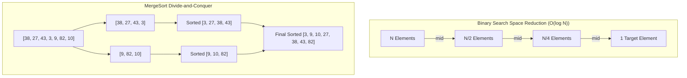

# Sorting and Searching Algorithms

Binary Search templates, MergeSort, QuickSort, and Python's hybrid Timsort internals.

---

## Architecture: Binary Search Space Reduction & MergeSort Tree



---

## Interview Questions & Answers

### SRT-BAS-001: How does the Binary Search Master Template find values and boundaries?

#### 1. Simple Explanation
Binary search finds a target value within a sorted array by repeatedly dividing the search interval in half. Instead of checking every item one by one ($O(N)$), it checks the middle element: if the target is smaller, search the left half; if larger, search the right half ($O(\log N)$).

#### 2. Easy Example
Finding a name in a 1,000-page phone book: open directly to page 500. If your target starts with 'M' and page 500 is 'S', eliminate pages 501-1000 in one single second.

#### 3. One-Line Interview Answer
Binary search achieves $O(\log N)$ search time on sorted or monotonic spaces by eliminating half the remaining candidate elements at each comparison step.

#### 4. Detailed Technical Explanation
- Preventing Integer Overflow: Calculate `mid = left + (right - left) // 2` rather than `(left + right) // 2`.
- Boundary Templates:
  - `bisect_left`: Finds the first index where `arr[i] >= target` (lower bound).
  - `bisect_right`: Finds the first index where `arr[i] > target` (upper bound).

#### 5. Practical Implementation
```python
def binary_search_leftmost(nums: list[int], target: int) -> int:
    left, right = 0, len(nums)
    while left < right:
        mid = left + (right - left) // 2
        if nums[mid] < target:
            left = mid + 1
        else:
            right = mid
    return left

nums = [1, 2, 4, 4, 4, 6, 7]
idx = binary_search_leftmost(nums, 4)
assert idx == 2  # First occurrence of 4 is at index 2
```

#### 6. Real-World Scenarios
- **Database B-Tree Search:** Database index lookups inside 4KB B-Tree disk pages use binary search to locate the target key within microseconds.

---

### SRT-INT-002: What are the differences between MergeSort and QuickSort?

#### 1. Simple Explanation
- **MergeSort:** Divide and conquer. Recursively splits array into halves, sorts each half, and merges them back together. **Stable** and guarantees $O(N \log N)$ in all cases, but requires $O(N)$ extra memory.
- **QuickSort:** Picks a **pivot** element and partitions the array so smaller elements go left and larger go right. In-place ($O(1)$ auxiliary space), average $O(N \log N)$, but worst-case $O(N^2)$ if pivot selection is poor.

#### 2. Easy Example
- MergeSort: Dealing cards into two equal piles, sorting each pile separately, and zipping them back together in order.
- QuickSort: Picking a middle student by height and telling shorter students to stand on the left and taller students on the right.

#### 3. One-Line Interview Answer
MergeSort guarantees $O(N \log N)$ worst-case stability at the cost of $O(N)$ extra memory, while QuickSort sorts in-place with lower cache-locality overhead and $O(1)$ memory.

#### 4. Detailed Technical Explanation
| Feature | MergeSort | QuickSort |
| :--- | :--- | :--- |
| **Best Case** | $O(N \log N)$ | $O(N \log N)$ |
| **Average Case** | $O(N \log N)$ | $O(N \log N)$ |
| **Worst Case** | $O(N \log N)$ | $O(N^2)$ (sorted array with naive pivot) |
| **Space** | $O(N)$ auxiliary buffer | $O(\log N)$ call stack (in-place) |
| **Stability** | **Stable** (preserves equal order) | **Unstable** |

#### 5. Practical Implementation
```python
def mergesort(arr: list[int]) -> list[int]:
    if len(arr) <= 1:
        return arr
    mid = len(arr) // 2
    left = mergesort(arr[:mid])
    right = mergesort(arr[mid:])
    return merge(left, right)

def merge(left: list[int], right: list[int]) -> list[int]:
    result = []
    i = j = 0
    while i < len(left) and j < len(right):
        if left[i] <= right[j]:
            result.append(left[i])
            i += 1
        else:
            result.append(right[j])
            j += 1
    result.extend(left[i:])
    result.extend(right[j:])
    return result

assert mergesort([38, 27, 43, 3, 9, 82, 10]) == [3, 9, 10, 27, 38, 43, 82]
```

#### 6. Real-World Scenarios
- **External Sorting:** When sorting 1TB of data that does not fit in RAM, **External MergeSort** chunks data into disk blocks, sorts each chunk, and streams them through a multi-way merge.

---

### SRT-ADV-003: How does Python's Timsort algorithm achieve adaptive $O(N)$ best-case sorting?

#### 1. Simple Explanation
Real-world data is rarely completely random; it often contains already sorted sequences ("natural runs"). **Timsort** (created by Tim Peters in 2002 for Python) is a hybrid sorting algorithm derived from MergeSort and Insertion Sort. It identifies existing runs in the data and merges them using galloping mode, achieving $O(N)$ best case on partially sorted data.

#### 2. Easy Example
Sorting a list of user transactions where 90% are already sorted by timestamp: Timsort detects the sorted runs and merges them in a single linear pass instead of re-sorting everything from scratch.

#### 3. One-Line Interview Answer
Timsort is an adaptive, stable hybrid of MergeSort and Insertion Sort that identifies natural runs and merges them using balanced stack invariants in $O(N)$ best and $O(N \log N)$ worst-case time.

#### 4. Detailed Technical Explanation
1. **Minrun:** Timsort chooses a `minrun` size (typically 32 to 64) such that $rac{N}{	ext{minrun}}$ is slightly less than a power of 2.
2. **Binary Insertion Sort:** Short chunks smaller than `minrun` are extended and sorted using Binary Insertion Sort (blazing fast for small arrays due to cache locality).
3. **Galloping Mode:** When merging two runs, if one run wins consistently 7 times in a row, Timsort switches to exponential search ("gallop") to skip large chunks of data with binary search instead of linear comparisons.

#### 5. Practical Implementation
```python
# Demonstrating Timsort efficiency on nearly sorted data in Python
import time
import random

# Pre-sorted list with slight perturbation
ordered_data = list(range(100_000))
ordered_data[-1] = 0

start = time.perf_counter()
ordered_data.sort()  # Python's built-in Timsort
duration = time.perf_counter() - start

print(f"Timsort completed 100k nearly sorted items in: {duration*1000:.2f}ms")
```

#### 6. Real-World Scenarios
- **Standard Library Foundation:** Timsort is the default sorting algorithm of Python (`list.sort()`), Java (`Arrays.sort()`), Android, and V8 JavaScript engine for stability and real-world efficiency.
