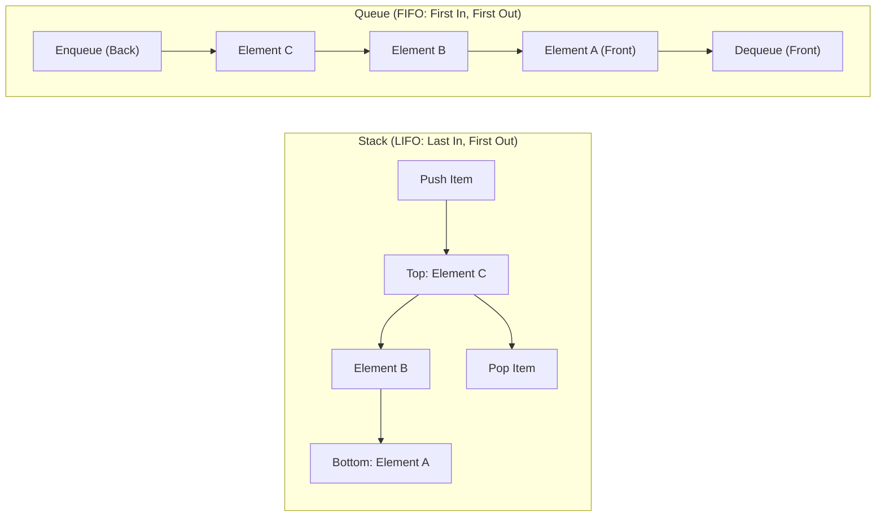

# Stacks and Queues

LIFO Stacks, FIFO Queues, Deques, Monotonic Stacks, and priority queue implementations in Python.

---

## Architecture: LIFO Stack vs FIFO Queue



---

## Interview Questions & Answers

### STK-BAS-001: How do you solve the Valid Parentheses problem using a Stack?

#### 1. Simple Explanation
A stack operates on Last-In, First-Out (LIFO) order. When validating bracket strings containing `()[]{}`:
- Every time you encounter an opening bracket (`(`, `[`, `{`), push it onto the stack.
- Every time you encounter a closing bracket (`)`, `]`, `}`), the top of the stack must match that closing type. If not, the string is invalid.
- At the end, the stack must be completely empty.

#### 2. Easy Example
String: `"{[]}"`
1. Read `{` -> push `{`
2. Read `[` -> push `[`
3. Read `]` -> matches `[` on top -> pop `[`
4. Read `}` -> matches `{` on top -> pop `{`
Stack is empty -> Valid!

#### 3. One-Line Interview Answer
Valid parentheses evaluation pushes opening brackets onto a LIFO stack and pops to verify against matching closing brackets in $O(N)$ time and $O(N)$ space.

#### 4. Detailed Technical Explanation
Using a hash map matching closing brackets to opening brackets allows $O(1)$ lookup:
If closing bracket is seen, check if stack is non-empty and `stack.pop() == map[char]`. If stack is empty when a closing bracket appears, return `False`.

#### 5. Practical Implementation
```python
def is_valid_parentheses(s: str) -> bool:
    stack = []
    mapping = {")": "(", "}": "{", "]": "["}

    for char in s:
        if char in mapping:
            top_element = stack.pop() if stack else "#"
            if mapping[char] != top_element:
                return False
        else:
            stack.append(char)

    return len(stack) == 0

assert is_valid_parentheses("()[]{}") is True
assert is_valid_parentheses("(]") is False
assert is_valid_parentheses("([)]") is False
```

#### 6. Real-World Scenarios
- **Syntax Parsing & Compiler AST Construction:** Python AST parsers and HTML/XML parsers use stacks to ensure tags and code blocks balance before compilation.

---

### STK-INT-002: How do you implement a Queue using two Stacks?

#### 1. Simple Explanation
A stack is LIFO and a queue is FIFO. By transferring elements from one stack to another, the order of elements is reversed. Reversing an already reversed order restores the original First-In, First-Out (FIFO) sequence.

#### 2. Easy Example
Stack 1 has `[A, B, C]` (top is C). Pop all and push into Stack 2:
Stack 2 has `[C, B, A]` (top is A). Popping from Stack 2 yields A, which was the first element entered!

#### 3. One-Line Interview Answer
Implement a queue using two stacks (in-stack for enqueue, out-stack for dequeue) achieving amortized $O(1)$ operations per element.

#### 4. Detailed Technical Explanation
- `push(x)`: Append to `in_stack` in $O(1)$.
- `pop()`: If `out_stack` is empty, pop all elements from `in_stack` and push into `out_stack`. Then pop from `out_stack`. Each element is pushed and popped at most twice, yielding **amortized $O(1)$** time complexity.

#### 5. Practical Implementation
```python
class MyQueue:
    def __init__(self):
        self.in_stack = []
        self.out_stack = []

    def push(self, x: int) -> None:
        self.in_stack.append(x)

    def pop(self) -> int:
        self.peek()
        return self.out_stack.pop()

    def peek(self) -> int:
        if not self.out_stack:
            while self.in_stack:
                self.out_stack.append(self.in_stack.pop())
        return self.out_stack[-1]

    def empty(self) -> bool:
        return not self.in_stack and not self.out_stack

q = MyQueue()
q.push(1)
q.push(2)
assert q.peek() == 1
assert q.pop() == 1
assert q.empty() is False
```

#### 6. Real-World Scenarios
- **Hardware Architecture & Constraint Systems:** Simulating pipeline buffers on legacy or embedded systems that provide native hardware stack memory instructions but lack FIFO queues.

---

### STK-ADV-003: How does a Monotonic Stack solve Next Greater Element problems?

#### 1. Simple Explanation
A Monotonic Stack maintains its elements in strictly increasing or decreasing order. As you iterate through an array, you pop elements from the stack that violate the monotonic property. This lets you find the next greater or smaller element for every item in an array in linear $O(N)$ time instead of nested $O(N^2)$ loops.

#### 2. Easy Example
Temperatures: `[73, 74, 75, 71, 69, 72, 76, 73]`.
For day 71, the next warmer day is 72. A monotonic decreasing stack finds the next warmer day for every single index in one single pass.

#### 3. One-Line Interview Answer
A Monotonic Stack maintains monotonically sorted indices, processing each element at most once for an optimal $O(N)$ Next Greater Element resolution.

#### 4. Detailed Technical Explanation
Each index is pushed onto the stack exactly once and popped at most once, making overall complexity $O(N)$ despite the inner `while` loop. The top of the stack always represents the boundary condition for the current element.

#### 5. Practical Implementation
```python
def daily_temperatures(temperatures: list[int]) -> list[int]:
    n = len(temperatures)
    answer = [0] * n
    stack = []  # stores indices

    for i, temp in enumerate(temperatures):
        while stack and temperatures[stack[-1]] < temp:
            prev_index = stack.pop()
            answer[prev_index] = i - prev_index
        stack.append(i)

    return answer

assert daily_temperatures([73, 74, 75, 71, 69, 72, 76, 73]) == [1, 1, 4, 2, 1, 1, 0, 0]
```

#### 6. Real-World Scenarios
- **Stock Market Analytics & Financial Indicators:** Calculating Real-Time Relative Strength Index (RSI), span of stock prices, and maximal rectangle histograms in financial charting engines.
