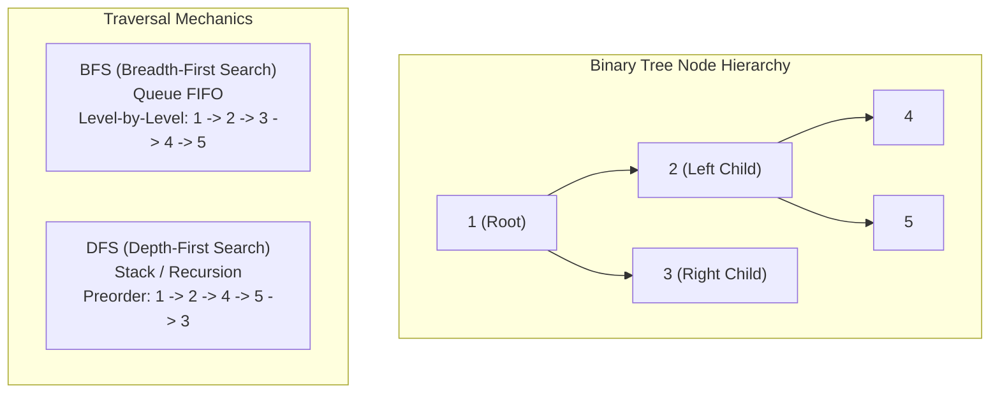

# Trees and Graphs

Binary Trees, Binary Search Trees, BFS, DFS, Dijkstra's Shortest Path, and Topological Sorting in Python.

---

## Architecture: BFS (Level Order) vs DFS Traversal



---

## Interview Questions & Answers

### TRG-BAS-001: How do Tree Traversals (Inorder, Preorder, Postorder, BFS) work?

#### 1. Simple Explanation
Tree traversal means visiting every node in a tree exactly once:
- **Preorder (Root, Left, Right):** Used for copying trees and serialization.
- **Inorder (Left, Root, Right):** On a Binary Search Tree (BST), visits nodes in ascending sorted order.
- **Postorder (Left, Right, Root):** Used for tree deletion and bottom-up calculations.
- **Level Order (BFS):** Visits nodes level by level using a queue.

#### 2. Easy Example
For tree with Root 2, Left 1, Right 3:
- Inorder: `1 -> 2 -> 3` (Sorted!)
- Preorder: `2 -> 1 -> 3`
- Postorder: `1 -> 3 -> 2`

#### 3. One-Line Interview Answer
DFS traversals explore subtree depths via recursion or stack, while BFS explores neighborhood breadths level-by-level via a FIFO queue.

#### 4. Detailed Technical Explanation
- **Time Complexity:** $O(N)$ for all traversals where $N$ is total nodes.
- **Space Complexity:** $O(H)$ for DFS where $H$ is tree height ($O(\log N)$ balanced, $O(N)$ worst-case skewed tree); $O(W)$ for BFS where $W$ is maximum level width ($O(N)$ for leaf tier).

#### 5. Practical Implementation
```python
from collections import deque

class TreeNode:
    def __init__(self, val=0, left=None, right=None):
        self.val = val
        self.left = left
        self.right = right

def level_order_bfs(root: TreeNode) -> list[list[int]]:
    if not root:
        return []
    result = []
    queue = deque([root])
    while queue:
        level_size = len(queue)
        current_level = []
        for _ in range(level_size):
            node = queue.popleft()
            current_level.append(node.val)
            if node.left:
                queue.append(node.left)
            if node.right:
                queue.append(node.right)
        result.append(current_level)
    return result

root = TreeNode(1, TreeNode(2), TreeNode(3))
assert level_order_bfs(root) == [[1], [2, 3]]
```

#### 6. Real-World Scenarios
- **DOM / JSON Serialization:** Level-order and preorder traversals are used to serialize nested HTML DOM trees and nested JSON configuration files.

---

### TRG-INT-002: How do you detect cycles in directed and undirected graphs?

#### 1. Simple Explanation
- **Undirected Graph:** A cycle exists if during DFS you encounter an adjacent visited node that is NOT the immediate parent of the current node.
- **Directed Graph:** A cycle exists if during DFS you encounter a node that is currently in the active recursion call stack (**Back Edge**).

#### 2. Easy Example
A directed round-trip flight: `City A -> City B -> City C -> City A`. Walking from A to B to C brings you back to A while A is still waiting for the route to finish.

#### 3. One-Line Interview Answer
Undirected cycle detection checks for visited non-parent neighbors, while directed cycle detection uses three-color state tracking (unvisited, visiting, visited) to detect back edges.

#### 4. Detailed Technical Explanation
Three-state coloring algorithm for Directed Graphs:
- State 0 (`WHITE`): Node has not been discovered.
- State 1 (`GRAY`): Node is currently in the DFS recursion stack (active exploration).
- State 2 (`BLACK`): Node and all its descendants have been fully processed.
If a DFS transition touches a `GRAY` node, a directed cycle is confirmed.

#### 5. Practical Implementation
```python
def has_cycle_directed(num_courses: int, prerequisites: list[list[int]]) -> bool:
    adj = {i: [] for i in range(num_courses)}
    for dest, src in prerequisites:
        adj[src].append(dest)

    visited = [0] * num_courses  # 0: white, 1: gray, 2: black

    def dfs(node):
        visited[node] = 1  # Mark in-progress (gray)
        for neighbor in adj[node]:
            if visited[neighbor] == 1:
                return True  # Found back-edge (cycle)
            if visited[neighbor] == 0:
                if dfs(neighbor):
                    return True
        visited[node] = 2  # Mark finished (black)
        return False

    for i in range(num_courses):
        if visited[i] == 0:
            if dfs(i):
                return True
    return False

assert has_cycle_directed(2, [[1, 0], [0, 1]]) is True  # Cycle: 0 <-> 1
assert has_cycle_directed(2, [[1, 0]]) is False
```

#### 6. Real-World Scenarios
- **Package Dependency Deadlock:** Detecting circular imports in Python (`module_a` imports `module_b` which imports `module_a`) or circular build targets in Bazel and Make.

---

### TRG-ADV-003: How do Dijkstra's Algorithm and Topological Sort (Kahn's Algorithm) work?

#### 1. Simple Explanation
- **Topological Sort:** Orders nodes in a Directed Acyclic Graph (DAG) linearly such that for every directed edge $U 	o V$, $U$ appears before $V$ (task scheduling).
- **Dijkstra's Algorithm:** Finds the shortest path from a starting source node to all other nodes in a weighted graph with non-negative edge weights using a min-heap priority queue.

#### 2. Easy Example
- Topological Sort: Course prerequisites: you must take CS101 before CS201 before CS301.
- Dijkstra: Google Maps finding the fastest driving route from your home to work avoiding traffic delays.

#### 3. One-Line Interview Answer
Topological sort resolves DAG task sequences via in-degree queues (Kahn's) in $O(V + E)$, while Dijkstra uses a min-priority heap to greedily expand shortest weighted paths in $O((V + E) \log V)$.

#### 4. Detailed Technical Explanation
1. **Kahn's Algorithm (Topological Sort):**
   - Calculate in-degree for all vertices.
   - Enqueue all vertices with in-degree 0 into a queue.
   - While queue is not empty, dequeue node $U$, append to result, decrement in-degree of all its neighbors $V$. If $V$'s in-degree becomes 0, enqueue it.
   - If output length $< V$, a cycle exists.
2. **Dijkstra's Greedy Invariant:**
   - Always extracts the unvisited vertex with the minimum known distance from the min-heap. Guarantees optimal path because all edge weights are $\ge 0$.

#### 5. Practical Implementation
```python
from collections import deque
import heapq

def topological_sort_kahn(num_nodes: int, edges: list[list[int]]) -> list[int]:
    in_degree = [0] * num_nodes
    adj = {i: [] for i in range(num_nodes)}
    for u, v in edges:
        adj[u].append(v)
        in_degree[v] += 1

    queue = deque([i for i in range(num_nodes) if in_degree[i] == 0])
    order = []
    while queue:
        node = queue.popleft()
        order.append(node)
        for neighbor in adj[node]:
            in_degree[neighbor] -= 1
            if in_degree[neighbor] == 0:
                queue.append(neighbor)

    return order if len(order) == num_nodes else []

def dijkstra(num_nodes: int, edges: list[tuple[int, int, int]], start: int) -> dict[int, int]:
    adj = {i: [] for i in range(num_nodes)}
    for u, v, weight in edges:
        adj[u].append((v, weight))

    distances = {i: float('inf') for i in range(num_nodes)}
    distances[start] = 0
    min_heap = [(0, start)]

    while min_heap:
        curr_dist, u = heapq.heappop(min_heap)
        if curr_dist > distances[u]:
            continue
        for v, weight in adj[u]:
            dist = curr_dist + weight
            if dist < distances[v]:
                distances[v] = dist
                heapq.heappush(min_heap, (dist, v))

    return distances
```

#### 6. Real-World Scenarios
- **Build Systems & CI/CD Pipelines:** GitHub Actions and Airflow DAGs use topological sorting to determine the exact execution order of dependent workflow jobs.
