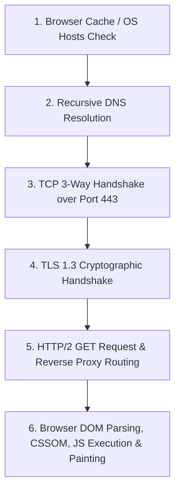

# Computer Networks & Internet Protocols Interview Guide

## Module Overview
This module covers the **OSI vs TCP/IP Models**, the **TCP 3-Way Handshake & 4-Way Teardown**, **TCP vs UDP**, and the **DNS Resolution Lifecycle**.

---

## Visual Flow: The TCP 3-Way Handshake & 4-Way Termination

```mermaid
sequenceDiagram
    autonumber
    participant C as Client
    participant S as Server

    Note over C,S: 1. TCP 3-Way Handshake (Connection Establishment)
    C->>S: SYN (Seq = X)
    S->>C: SYN-ACK (Seq = Y, Ack = X + 1)
    C->>S: ACK (Seq = X + 1, Ack = Y + 1)
    Note over C,S: CONNECTION ESTABLISHED (Data Transfer Begins)

    Note over C,S: 2. TCP 4-Way Teardown (Connection Termination)
    C->>S: FIN (Client has no more data to send)
    S->>C: ACK (Acknowledged; server may still finish sending data)
    S->>C: FIN (Server is now finished sending)
    C->>S: ACK (Acknowledged; Client enters TIME_WAIT for 2*MSL)
    Note over C,S: CONNECTION CLOSED
```

---

## Questions & Comprehensive Solutions

### NET-BAS-001: TCP vs UDP Comparison

**Comparison Table:**

| Feature | TCP (Transmission Control Protocol) | UDP (User Datagram Protocol) |
| :--- | :--- | :--- |
| **Connection Model** | Connection-Oriented (Requires 3-Way Handshake) | **Connectionless** (Fire and forget) |
| **Reliability** | **100% Guaranteed Delivery**: Retransmits lost packets | Unreliable: Packets may drop without notice |
| **Packet Ordering** | **Guaranteed in-order delivery** via sequence numbers | Packets may arrive out-of-order |
| **Header Size** | 20 to 60 bytes | **8 bytes** (Minimal overhead) |
| **Congestion Control**| Sophisticated flow & congestion control algorithms | None |
| **Speed & Latency** | Slower (overhead of ACKs, ordering, retransmits) | **Ultra-Fast & Low Latency** |
| **Best Used For** | Web browsing (HTTP), File transfers, Email, Databases | Live Video Streaming, Voice (VoIP), Online Gaming, DNS |

---

### NET-INT-002: What happens step-by-step when you type `https://www.google.com` into your browser?

**The 6 Step Technical Walkthrough:**



1. **DNS Resolution:**
   - Browser checks local memory cache $\rightarrow$ OS hosts file $\rightarrow$ Local ISP Recursive Resolver $\rightarrow$ **Root DNS Server** $\rightarrow$ **`.com` TLD Server** $\rightarrow$ **Google Authoritative Name Server** $\rightarrow$ Returns IPv4/IPv6 address.
2. **TCP Handshake:**
   - Browser sends `SYN`, receives `SYN-ACK`, and replies with `ACK` to port 443.
3. **TLS Cryptographic Handshake:**
   - Client and server exchange Diffie-Hellman keys to establish an encrypted symmetric session.
4. **HTTP Request & Server Response:**
   - Browser sends `GET / HTTP/2`. The origin Nginx reverse proxy routes request to internal microservices, which query databases/caches and return HTML.
5. **Browser Rendering Engine:**
   - Browser parses HTML into the **DOM Tree**, parses CSS into the **CSSOM Tree**, executes JavaScript, computes layout geometry, and paints pixels to screen.
