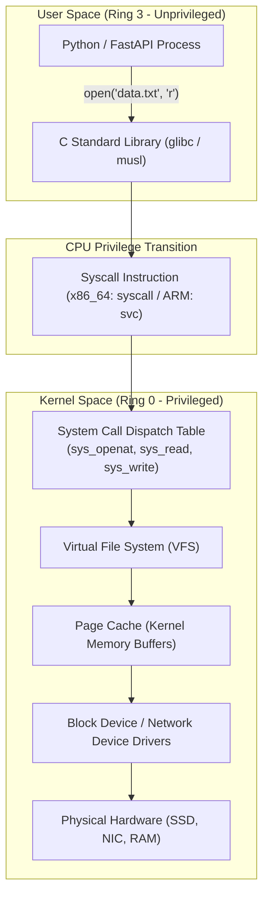
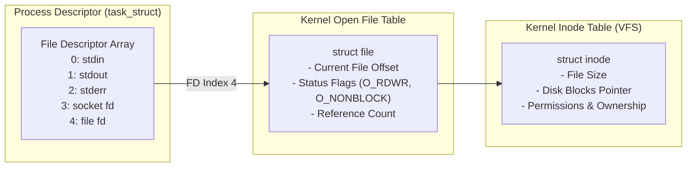

# Linux Fundamentals & Operating System Internals

A deep architectural dive into the Linux kernel, User Space vs Kernel Space, System Calls, File Descriptors, Process Execution (`fork`, `execve`), and Virtual Memory (`mmap`).

---

## Architecture: User Space vs Kernel Space & System Call Flow



---

## Interview Questions & Answers

### KLX-BAS-001: What is the fundamental difference between Kernel Space and User Space?

#### 1. Simple Explanation
Modern computer CPUs operate in different protection rings:
- **User Space (Ring 3):** Where your applications (Python, Nginx, Node.js, databases) run. Code here is isolated and restricted. An application cannot directly touch physical RAM, hard disks, or network interfaces.
- **Kernel Space (Ring 0):** Where the core operating system (the Linux Kernel) runs. It has direct, unrestricted access to the CPU, RAM, registers, and physical hardware.

To access hardware, an application in User Space must ask the Kernel for permission via a **System Call** (`syscall`).

#### 2. Easy Example
Think of a bank:
- User Space = Bank customers standing in the lobby. They cannot walk into the vault and grab cash directly.
- Kernel Space = Bank tellers behind bulletproof glass with access to the vault.
- System Call = Filling out a withdrawal slip and handing it through the teller window.

#### 3. One-Line Interview Answer
User Space (Ring 3) isolates application processes in private virtual memory without direct hardware access, whereas Kernel Space (Ring 0) executes privileged operating system code with full hardware control accessed via system calls.

#### 4. Detailed Technical Explanation
1. **CPU Protection Rings (x86 Architecture):**
   - Ring 0: Kernel mode (supervisor privileges). Can execute privileged instructions (`cli`, `sti`, page table manipulation).
   - Rings 1 & 2: Historically for device drivers, rarely used in modern Linux.
   - Ring 3: User mode. Unprivileged. Any attempt to execute privileged CPU instructions triggers a General Protection Fault (`SIGSEGV`).
2. **Context Switching Cost:**
   Transitioning between User Space and Kernel Space requires saving CPU registers, changing the stack pointer to the kernel stack, switching CPU privilege levels, and invalidating Translation Lookaside Buffer (TLB) caches. This overhead is why high-performance network frameworks try to avoid unnecessary syscalls.
3. **Memory Isolation:**
   Each User Space process has its own virtual address space managed by Page Tables. A crash or memory corruption in one user application (`Segmentation fault`) cannot corrupt other applications or the kernel.

#### 5. Practical Implementation
```python
# Tracing System Calls from User Space to Kernel Space using strace
# Command: strace -c python -c "with open('/tmp/test.txt', 'w') as f: f.write('hello')"
# Output summary shows system calls invoked:
"""
% time     seconds  usecs/call     calls    errors syscall
------ ----------- ----------- --------- --------- ----------------
 35.12    0.000142          71         2           openat
 22.03    0.000089          44         2           write
 15.10    0.000061          61         1           close
 ...
"""

import os

# Direct syscall invocation in Python
def direct_syscall_demo():
    message = b"Direct User-to-Kernel Space write\n"
    # File descriptor 1 is stdout
    # os.write directly triggers the 'write' syscall (sys_write)
    bytes_written = os.write(1, message)
    return bytes_written

if __name__ == "__main__":
    direct_syscall_demo()
```

#### 6. Real-World Scenarios
- **Segmentation Fault (Signal 11):** A Python C-extension attempts to dereference a null pointer `0x0` or write to a memory address outside its User Space page table allocation. The CPU MMU (Memory Management Unit) hardware detects an illegal memory access and traps to the Linux kernel, which immediately kills the process with `SIGSEGV` to safeguard system integrity.

---

### KLX-INT-002: How do Linux File Descriptors and standard streams work under the hood?

#### 1. Simple Explanation
In Linux, "everything is a file": regular files, directories, network sockets, pipes, and terminal devices are all accessed through an integer index called a **File Descriptor (FD)**. When a process starts, it automatically inherits three standard file descriptors:
- `0`: Standard Input (`stdin`)
- `1`: Standard Output (`stdout`)
- `2`: Standard Error (`stderr`)

#### 2. Easy Example
`python script.py > output.log 2>&1`
- `> output.log`: Redirects FD 1 (`stdout`) to `output.log`.
- `2>&1`: Redirects FD 2 (`stderr`) to wherever FD 1 is pointing (`output.log`), merging standard output and errors into one file.

#### 3. One-Line Interview Answer
A File Descriptor is a non-negative integer serving as an index into a per-process open file table, which points to the kernel's global file description table and underlying inode data structures.

#### 4. Detailed Technical Explanation

1. **Limits:**
   - Soft Limit (`ulimit -n`): Default is often 1024. If an application opens more files/sockets, it fails with `OSError: [Errno 24] Too many open files`.
   - Hard Limit: Maximum ceiling set by root in `/etc/security/limits.conf`.
   - System-wide Limit: `/proc/sys/fs/file-max`.
2. **Duplication & Redirection:**
   The `dup2(oldfd, newfd)` system call duplicates an existing file descriptor, overwriting `newfd`. This is how shells implement `>` and `|` piping.

#### 5. Practical Implementation
```python
# Inspecting file descriptors of the current running process
import os
import socket

def inspect_process_file_descriptors():
    pid = os.getpid()
    print(f"Current Process PID: {pid}")

    # Open a network socket
    s = socket.socket(socket.AF_INET, socket.SOCK_STREAM)
    socket_fd = s.fileno()
    print(f"Opened TCP Socket assigned File Descriptor: {socket_fd}")

    # Inspect the open file descriptors in Linux /proc filesystem
    proc_fd_path = f"/proc/{pid}/fd"
    if os.path.exists(proc_fd_path):
        print("\nActive File Descriptors in /proc:")
        for fd in os.listdir(proc_fd_path):
            target = os.readlink(os.path.join(proc_fd_path, fd))
            print(f"  FD {fd} -> {target}")

    s.close()

if __name__ == "__main__":
    inspect_process_file_descriptors()
```

#### 6. Real-World Scenarios
- **High Concurrency Server Crashing Under Load:** A FastAPI or Node.js server handles 2,000 concurrent WebSocket connections. Suddenly, all new connections fail with `Accept error: Too many open files`. The default Linux user limit was set to 1024. Increasing `ulimit -n 65535` in the systemd service file allows the service to scale across tens of thousands of concurrent connections.

---

### KLX-ADV-003: What is the difference between `fork()`, `execve()`, and `mmap()`?

#### 1. Simple Explanation
- **`fork()`:** Clones the current process. Creates an exact child copy of the parent process (same memory, same open file descriptors).
- **`execve()`:** Replaces the current process image with a brand new executable program.
- **`mmap()`:** Maps a file or device directly into the process's virtual memory address space, allowing reading and writing to files directly via memory pointers without calling `read()` or `write()`.

#### 2. Easy Example
- When you type `ls` in Bash:
  1. Bash calls `fork()` to create an identical child copy of itself.
  2. The child process calls `execve('/bin/ls')`, wiping out the Bash image and running `ls`.
- When loading a large 50GB database file: Instead of reading 50GB into RAM with `read()`, `mmap()` tells the OS to map file chunks into memory only when those specific bytes are touched (demand paging).

#### 3. One-Line Interview Answer
`fork()` creates an exact duplicate child process via Copy-On-Write (COW); `execve()` replaces the calling process image with a new binary; and `mmap()` maps files directly into virtual memory pages for high-throughput zero-copy I/O.

#### 4. Detailed Technical Explanation
1. **Copy-On-Write (COW) in `fork()`:**
   - In modern Linux, `fork()` does NOT duplicate physical RAM. It duplicates page tables and marks all pages as **read-only**.
   - As long as parent and child only read memory, they share the exact same physical RAM.
   - When either process writes to a page, the CPU traps, the kernel allocates a new physical page, copies only that 4KB page, and marks it writable. This makes `fork()` blazing fast.
2. **`execve()` Lifecycle:**
   - Replaces the current process heap, stack, and text segments with the ELF binary specified.
   - File descriptors marked with `FD_CLOEXEC` are closed; others remain open across `execve()`.
3. **`mmap()` and Zero-Copy I/O:**
   - Standard `read()` syscall: Disk -> Kernel Page Cache -> User Space Buffer (2 context switches + 1 memory copy).
   - `mmap()` syscall: Maps kernel page cache directly into user virtual memory pointers. Avoids redundant copying between kernel space and user space.

#### 5. Practical Implementation
```python
# Demonstrating mmap for ultra-fast, zero-copy file searching in Python
import mmap
import os

def demo_mmap_file_search(filepath: str, search_term: bytes):
    # Ensure file exists
    with open(filepath, "wb") as f:
        f.write(b"Line 1: System architecture\nLine 2: Zero-copy mmap execution\nLine 3: End\n")

    # Open file and map into memory
    with open(filepath, "r+b") as f:
        # mmap.mmap maps the file descriptor into process memory
        with mmap.mmap(f.fileno(), length=0, access=mmap.ACCESS_READ) as mm:
            print(f"Memory mapped file size: {mm.size()} bytes")
            
            # Find substring directly in memory without read() copying
            pos = mm.find(search_term)
            if pos != -1:
                mm.seek(pos)
                line = mm.readline()
                print(f"Found match at byte {pos}: {line.decode().strip()}")

if __name__ == "__main__":
    demo_mmap_file_search("/tmp/mmap_test.dat", b"Zero-copy")
```

#### 6. Real-World Scenarios
- **Gunicorn Pre-Fork Model:** Gunicorn loads the entire Django/FastAPI application into memory in the master process, and then calls `fork()` to spawn 8 worker processes. Thanks to Linux Copy-On-Write, all 8 workers share the loaded Python libraries in physical memory, saving gigabytes of server RAM until individual workers modify state.
