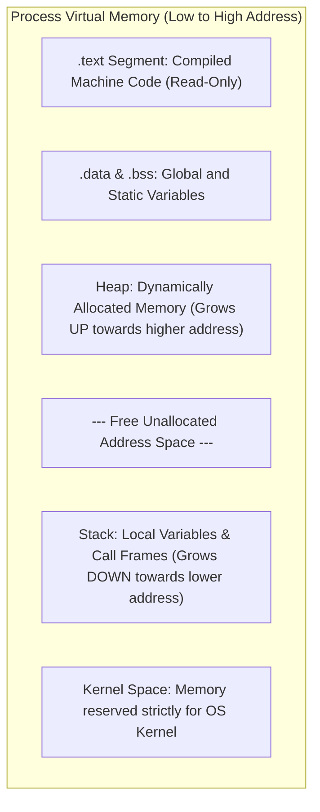
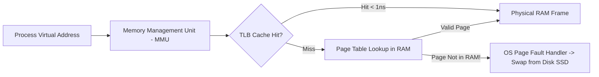

# Operating Systems Fundamentals & Kernel Internals Guide

## Module Overview
This module covers **Operating Systems Concepts**, **Process vs Thread Anatomy**, **Virtual Memory & Paging**, **CPU Scheduling**, and **Inter-Process Communication (IPC)**.

---

## Visual Architecture: Process Memory Layout (Linux Virtual Address Space)

---

## Questions & Comprehensive Solutions

### OS-BAS-001: Process vs Thread Comparison

**Comparison Table:**

| Dimension | Process | Thread |
| :--- | :--- | :--- |
| **Definition** | An independent executing program instance with its own private address space | A lightweight unit of execution within a parent process |
| **Address Space** | Isolated private address space (processes cannot see each other's memory) | **Shares the parent process's memory space, code, and heap** |
| **Creation Cost** | High (allocates new PCB, page tables, memory mappings via `fork()`) | Low (creates lightweight TCB, shares existing process resources) |
| **Context Switching**| Slow: Must flush and reload CPU Page Tables (TLB shootdown) | Fast: Does not invalidate Virtual Memory page tables |
| **Crash Impact** | Process crash does not affect other processes | An unhandled fatal segmentation fault in one thread **crashes the entire process** |
| **Communication** | Requires **IPC** (Unix Domain Sockets, Pipes, Shared Memory) | Shares memory directly (requires thread locks / mutexes to prevent race conditions) |

---

### OS-INT-002: How does Virtual Memory and Paging work?

**One-Line Answer:**  
**Virtual Memory** gives each process the illusion of having a vast, contiguous block of private physical RAM, mapped to actual physical RAM (or disk swap) in fixed-size blocks called **Pages (typically 4 KB)** via the hardware **Memory Management Unit (MMU)**.

1. **Page Fault:** Occurs when a process accesses a virtual memory page that is currently not loaded into physical RAM. The CPU freezes the process, issues a disk read to load the page into RAM, updates the Page Table, and resumes the process.
2. **Translation Lookaside Buffer (TLB):** A small, ultra-fast hardware cache on the CPU that stores recent virtual-to-physical address translations.

---

### OS-INT-003: The 4 Necessary Coffman Conditions for Deadlocks

A deadlock can occur **if and only if all 4 conditions are met simultaneously**:
1. **Mutual Exclusion:** At least one resource must be non-shareable (only one thread can hold it at a time).
2. **Hold and Wait:** A process is holding at least one resource and waiting to acquire additional resources held by other processes.
3. **No Preemption:** Resources cannot be forcibly taken away; they can only be released voluntarily by the holding process.
4. **Circular Wait:** A closed chain of processes exists where $P_0$ waits for $P_1$, $P_1$ waits for $P_2$, ..., and $P_n$ waits for $P_0$.

<u>Interview Tip:</u> To prevent deadlocks, the easiest condition to break in software is **Circular Wait** by enforcing a **strict global lock acquisition order**.
