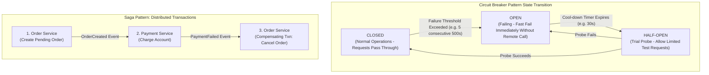

# Software Design Patterns in Python Backend Systems

A comprehensive guide to Creational, Structural, and Behavioral design patterns in Python, including Singleton, Factory, Strategy, Dependency Injection, Circuit Breaker, and Saga.

---

## Architecture: Circuit Breaker State Machine & Saga Pattern



---

## Interview Questions & Answers

### DP-BAS-001: How do Factory Method and Singleton patterns work in Python?

#### 1. Simple Explanation
- **Factory Method:** A creational pattern providing an interface for creating objects without specifying the exact class of object that will be created.
- **Singleton:** Ensures a class has only one instance throughout the application lifecycle and provides a global access point to it (e.g., database connection pool or config manager).

#### 2. Easy Example
- **Factory:** Going to a restaurant and ordering "Breakfast". The kitchen decides whether to prepare pancakes or eggs depending on the time of day, without you needing to assemble the ingredients.
- **Singleton:** The President of a country: there can only be one active office holder at any given time.

#### 3. One-Line Interview Answer
Factory Method encapsulates object instantiation behind a parameterized creation interface, while Singleton restricts class instantiation to a single object via `__new__` overrides or module-level caching.

#### 4. Detailed Technical Explanation
In Python, modules are cached in `sys.modules` upon first import, making Python modules natural thread-safe singletons. When implementing via a class, override `__new__` and use a threading lock to prevent race conditions during concurrent initialization.

#### 5. Practical Implementation
```python
import threading
from typing import Protocol

# 1. Singleton with Thread-Safe Double-Checked Locking
class DatabasePool:
    _instance = None
    _lock = threading.Lock()

    def __new__(cls):
        if not cls._instance:
            with cls._lock:
                if not cls._instance:
                    cls._instance = super().__new__(cls)
                    cls._instance.connections = 10
        return cls._instance

# 2. Factory Method
class NotificationService(Protocol):
    def send(self, message: str) -> None: ...

class EmailNotifier:
    def send(self, message: str) -> None:
        print(f"Sending Email: {message}")

class SMSNotifier:
    def send(self, message: str) -> None:
        print(f"Sending SMS: {message}")

class NotificationFactory:
    @staticmethod
    def create(channel: str) -> NotificationService:
        if channel == "email":
            return EmailNotifier()
        elif channel == "sms":
            return SMSNotifier()
        raise ValueError(f"Unknown notification channel: {channel}")

db1 = DatabasePool()
db2 = DatabasePool()
assert db1 is db2

notifier = NotificationFactory.create("email")
notifier.send("Your order is confirmed!")
```

#### 6. Real-World Scenarios
- **Cloud Storage Client Factory:** An application needs to store files in AWS S3 in production, Google Cloud Storage for EU clients, and local disk for integration testing. A StorageFactory abstracts cloud SDK dependencies from the business logic.

---

### DP-INT-002: How do Dependency Injection and Strategy patterns improve testability?

#### 1. Simple Explanation
- **Dependency Injection (DI):** Instead of an object constructing its own dependencies inside its `__init__`, dependencies are passed (injected) into it from the outside.
- **Strategy Pattern:** Defines a family of interchangeable algorithms, encapsulates each one, and allows clients to switch algorithms dynamically at runtime.

#### 2. Easy Example
A lamp doesn't generate its own electricity inside the bulb; it provides a plug. You can plug it into a wall outlet (production) or a backup battery (testing). That is Dependency Injection.

#### 3. One-Line Interview Answer
Dependency Injection passes collaborators into consumers to invert control and facilitate mocking, while Strategy encapsulates interchangeable behavioral variants behind a common interface.

#### 4. Detailed Technical Explanation
Hardcoded instantiation (`self.db = PostgresDB()`) creates rigid coupling, making unit testing impossible without hitting a live database. By accepting an abstract protocol or interface (`db: DatabaseProtocol`), unit tests can inject an in-memory test double (`MockDatabase()`).

#### 5. Practical Implementation
```python
from typing import Protocol

class PaymentStrategy(Protocol):
    def process_payment(self, amount_cents: int) -> bool: ...

class StripePayment:
    def process_payment(self, amount_cents: int) -> bool:
        print(f"Charging ${amount_cents/100:.2f} via Stripe API")
        return True

class MockPaymentForTesting:
    def process_payment(self, amount_cents: int) -> bool:
        print("Mock payment: always succeeds without network calls")
        return True

class OrderCheckoutService:
    def __init__(self, payment_processor: PaymentStrategy):
        self.payment_processor = payment_processor

    def checkout(self, cart_total: int) -> bool:
        if cart_total <= 0:
            return False
        return self.payment_processor.process_payment(cart_total)

order_service = OrderCheckoutService(payment_processor=StripePayment())
order_service.checkout(5000)

test_service = OrderCheckoutService(payment_processor=MockPaymentForTesting())
assert test_service.checkout(1000) is True
```

#### 6. Real-World Scenarios
- **FastAPI `Depends()` System:** FastAPI's dependency injection system allows injecting database sessions, current user authentication, and rate limiters directly into endpoint signatures. During pytest test runs, `app.dependency_overrides[get_db] = get_test_db` replaces production Postgres with SQLite in memory.

---

### DP-ADV-003: What are Circuit Breaker and Saga patterns in distributed microservices?

#### 1. Simple Explanation
- **Circuit Breaker:** Prevents cascading failures when a downstream service is down. If calls fail repeatedly, the breaker "trips" and immediately returns an error or fallback response without wasting network resources making doomed requests.
- **Saga Pattern:** Coordinates distributed transactions across multiple microservices without locking databases. If one step fails, the Saga executes **compensating transactions** in reverse order to undo previous actions.

#### 2. Easy Example
- **Circuit Breaker:** Electrical fuse box in your home: if a wire shorts out, the breaker flips to cut power before your house catches fire.
- **Saga:** Booking a vacation: 1. Book flight, 2. Book hotel, 3. Book rental car. If the rental car is unavailable, cancel the hotel and refund the flight.

#### 3. One-Line Interview Answer
Circuit Breaker provides fault tolerance by failing fast during downstream outages, while Saga maintains distributed data consistency through sequenced local transactions paired with compensating undo actions.

#### 4. Detailed Technical Explanation
1. **Circuit Breaker States:**
   - **Closed:** Normal operation. Requests flow to downstream service.
   - **Open:** Error threshold reached. Requests fail immediately with fallback without calling remote service.
   - **Half-Open:** Timeout expires. Limited test requests are allowed through to evaluate service health. If successful, reset to Closed; if failing, return to Open.
2. **Saga Orchestration vs Choreography:**
   - **Choreography:** Services react to domain events emitted over a message broker (RabbitMQ/Kafka).
   - **Orchestration:** A central coordinator service directs participants on what local transactions and compensating rollbacks to execute.

#### 5. Practical Implementation
```python
import time

class CircuitBreakerOpenException(Exception):
    pass

class CircuitBreaker:
    def __init__(self, failure_threshold: int = 3, recovery_time: float = 10.0):
        self.failure_threshold = failure_threshold
        self.recovery_time = recovery_time
        self.failure_count = 0
        self.state = "CLOSED"
        self.last_failure_time = 0.0

    def call(self, func, *args, **kwargs):
        current_time = time.time()
        
        if self.state == "OPEN":
            if current_time - self.last_failure_time > self.recovery_time:
                self.state = "HALF-OPEN"
            else:
                raise CircuitBreakerOpenException("Circuit is OPEN. Fast-failing remote call.")

        try:
            result = func(*args, **kwargs)
            if self.state == "HALF-OPEN":
                self.state = "CLOSED"
                self.failure_count = 0
            return result
        except Exception as e:
            self.failure_count += 1
            self.last_failure_time = current_time
            if self.failure_count >= self.failure_threshold:
                self.state = "OPEN"
            raise e
```

#### 6. Real-World Scenarios
- **E-Commerce Black Friday Outage:** A 3rd-party tax calculation API went down. Without a circuit breaker, every checkout request waited 30s before timing out, exhausting the web server's thread pool and taking down the entire website. With a circuit breaker, calls fast-failed in 1ms and defaulted to standard flat-rate tax estimation.
