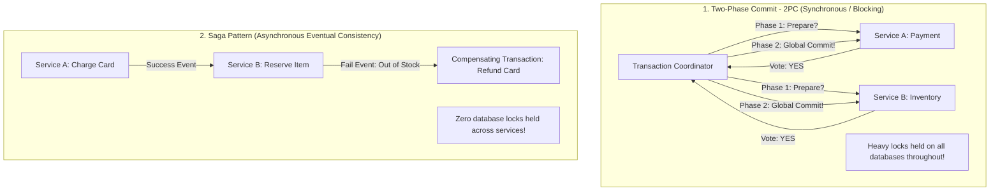

# Distributed Systems Architecture & Consensus Interview Guide

## Module Overview
This guide covers core **Distributed Systems Engineering**, including the **Saga Pattern vs Two-Phase Commit (2PC)**, **Consensus Algorithms (Raft)**, and **Distributed Locking**.

---

## Visual Architecture: Two-Phase Commit (2PC) vs Saga Pattern

---

## Questions & Comprehensive Solutions

### DIST-ADV-001: Two-Phase Commit (2PC) vs Saga Pattern for Distributed Transactions

**Comparison Table:**

| Dimension | Two-Phase Commit (2PC) | Saga Pattern |
| :--- | :--- | :--- |
| **Consistency Model** | **Strong ACID Consistency** | **Eventual Consistency (BASE)** |
| **Locking Mechanism** | Pessimistic locking (locks rows across multiple DBs during prepare) | **Zero distributed locks**; each service commits locally |
| **Failure Handling** | Immediate rollback across all participants | **Compensating Transactions** (e.g. issuing a refund if shipping fails) |
| **Throughput & Latency**| 🔴 Low throughput (slowest node determines transaction time) | ⚡ High throughput (decoupled async event pipelines) |
| **Single Point of Failure**| Coordinator crash can leave databases locked indefinitely | Resilient via event queues and state machine orchestrators |
| **Best Used For** | Core banking ledgers within a single datacenter | **Microservice architectures, e-commerce checkouts** |

---

### DIST-ADV-002: Saga Orchestration vs Saga Choreography

**Comparison Table:**

| Dimension | Saga Choreography (Event-Driven) | Saga Orchestration (Central Controller) |
| :--- | :--- | :--- |
| **How it Works** | Services publish domain events and listen to each other directly | A dedicated **Orchestrator** (e.g. Temporal / AWS Step Functions) commands each service |
| **Coupling** | Decentralized, loose coupling | Centralized control logic |
| **Complexity at Scale** | Hard to track: cyclical dependencies ("event pinball" anti-pattern) | **Easy to monitor, trace, and audit** in a single visual workflow |
| **Best Used For** | Simple workflows (2 to 3 microservices) | Complex enterprise business processes (5+ steps with rollbacks) |
