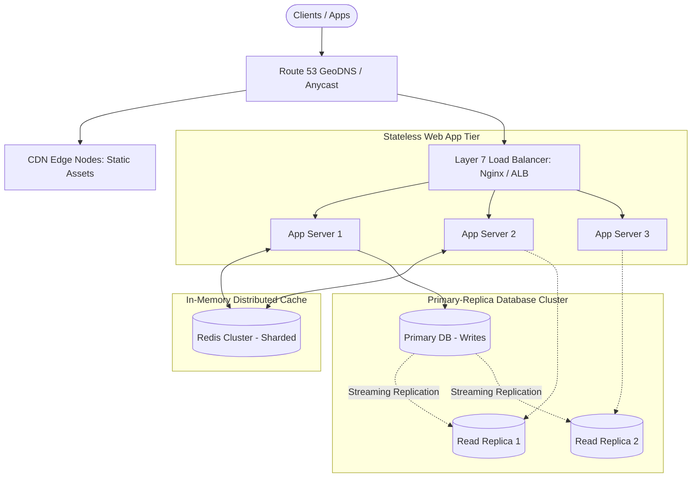
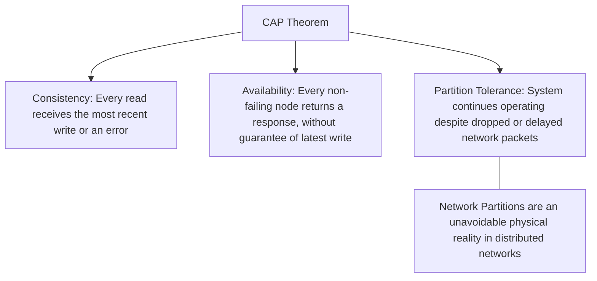

# System Design Fundamentals & Architectural Trade-offs

## Module Overview
This module covers foundational system design principles, including **Vertical vs Horizontal Scaling**, **Load Balancing**, the **CAP & PACELC Theorems**, **Database Sharding**, and **Consistent Hashing**.

---

## Visual Architecture: Distributed Scalable System Anatomy

---

## Core Questions & Comprehensive Solutions

### SD-BAS-001: Vertical Scaling (Scale Up) vs Horizontal Scaling (Scale Out)

**Comparison Table:**

| Dimension | Vertical Scaling (Scale Up) | Horizontal Scaling (Scale Out) |
| :--- | :--- | :--- |
| **How it Works** | Add more CPU, RAM, or faster NVMe SSDs to an existing single server | Add more independent commodity server nodes to a distributed cluster |
| **Downtime** | Typically requires reboot/downtime to resize instances | Zero downtime; nodes can be added/removed dynamically behind load balancers |
| **Hard Physical Limit**| Hits hardware capacity ceiling (e.g. max 128 cores, 2TB RAM on a single motherboard) | Theoretically limitless scale by adding thousands of nodes |
| **Fault Tolerance** | Single Point of Failure (SPOF): If the server dies, the entire application is down | High Resilience: If Node 3 crashes, the load balancer routes traffic to remaining healthy nodes |
| **Cost Curve** | Becomes exponentially expensive at high-end enterprise server tiers | Linear, cost-effective commodity cloud compute |

---

### SD-BAS-002: What is the CAP Theorem and how do you navigate it?

**One-Line Answer:**  
The **CAP Theorem** (Brewer's Theorem) states that in any distributed data store, when a **Network Partition ($P$)** inevitably occurs, the system must choose between **Consistency ($C$)** or **Availability ($A$)**; it cannot guarantee both.

#### Real-World Trade-Off Choices:
1. **CP Systems (Consistency over Availability):**
   - If a network partition occurs between data center A and data center B, the system blocks or rejects writes to prevent data drift until the network heals.
   - *Examples:* PostgreSQL with synchronous replication, Google Spanner, Apache HBase, ZooKeeper.
   - *Best Used For:* Banking balances, flight seat reservations, payment ledgers.
2. **AP Systems (Availability over Consistency):**
   - If a network partition occurs, both sides accept writes and serve reads, accepting that data will be temporarily out-of-sync and eventually converge (**Eventual Consistency**).
   - *Examples:* Apache Cassandra, AWS DynamoDB, Couchbase.
   - *Best Used For:* Social media feeds, YouTube comments, shopping cart browsing.

---

### SD-INT-003: What is Database Sharding and Consistent Hashing?

#### 1. Database Sharding:
**Sharding** partitions a massive database horizontally across multiple physical database servers based on a **Shard Key** (e.g. `user_id % 4` routes users across 4 database shards).

#### 2. The Problem with Naive Modulo Hashing (`hash(key) % N`):
If you have 4 database nodes and add a 5th node (`N = 5`), the modulo calculation changes for almost 100% of existing keys (`key % 4 != key % 5`), forcing a catastrophic migration of almost all database data across the cluster.

#### 3. The Solution: Consistent Hashing Ring
- The hash range is represented as an abstract circular ring ($0$ to $2^{32}-1$).
- Database servers and data keys are mapped to positions on the ring using a standard hash function.
- A key is stored on the **first server encountered by moving clockwise** on the ring.
- **When a new server is added or removed, only $K/N$ keys need to be remapped** on average (where $K$ is total keys and $N$ is number of servers), preventing mass data reshuffling!
