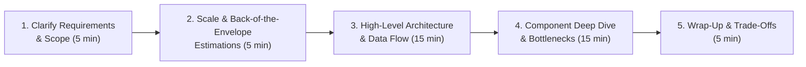

# High-Level System Design (HLD) Interview Framework Guide

## Module Overview
This module covers the **45-Minute System Design Interview Framework**, **Monolith vs Microservices**, the **API Gateway Pattern**, and **Database Selection Decision Frameworks**.

---

## The 45-Minute System Design Interview Framework

1. **Step 1: Clarify Requirements & Scope (5 Minutes):**
   - Functional requirements (top 3 features).
   - Non-functional requirements (Availability, Latency, Consistency, Scale).
   - What is explicitly *out of scope*?
2. **Step 2: Capacity Estimations (5 Minutes):**
   - DAU / MAU, Read QPS, Write QPS.
   - Storage growth over 5 years.
   - Memory cache sizing (80/20 Pareto rule).
3. **Step 3: High-Level Architecture (15 Minutes):**
   - Draw boxes: Client $\rightarrow$ CDN $\rightarrow$ Load Balancer $\rightarrow$ Stateless Web Nodes $\rightarrow$ Cache $\rightarrow$ Primary DB + Replicas.
   - Trace the request-response data flow.
4. **Step 4: Deep Dive & Bottlenecks (15 Minutes):**
   - Data partitioning (sharding), caching invalidation, race conditions, failover mechanisms.
5. **Step 5: Retrospective & Trade-Offs (5 Minutes):**
   - Review CAP theorem choices and monitoring metrics.

---

## Database Selection Decision Framework

| Data Category | Primary Characteristics | Top Technology | When to Choose |
| :--- | :--- | :--- | :--- |
| **Relational (RDBMS)** | Strict ACID transactions, complex `JOIN`s, schema validation | **PostgreSQL**, MySQL | Banking, e-commerce checkout, user auth |
| **Key-Value** | Sub-millisecond $O(1)$ lookups in RAM | **Redis** | In-memory caching, sessions, rate limits |
| **Document Store** | Flexible nested JSON, polymorphic schemas | **MongoDB**, DynamoDB | Catalogs, user profiles, CMS |
| **Columnar / OLAP** | Fast aggregations across billions of rows (`SUM`, `AVG`) | **ClickHouse**, BigQuery | Analytics, data warehousing, BI |
| **Vector DB** | Approximate Nearest Neighbor search on high-D floats | **Qdrant**, pgvector | GenAI, semantic search, RAG |
| **Graph DB** | Traversal of deeply interconnected relationships | **Neo4j** | Fraud detection, social networks |
