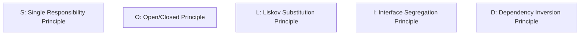

# Low-Level Design (LLD), SOLID Principles & Design Patterns Guide

## Module Overview
This module covers **Low-Level Design (LLD)**, **SOLID Principles in Python**, and the most critical **Creational, Structural, and Behavioral Design Patterns** asked in machine coding rounds.

---

## 1. The 5 SOLID Principles in Python



### A. Single Responsibility Principle (SRP)
*A class should have one, and only one, reason to change.*

```python
# BAD: Class handles BOTH business calculation AND database persistence
class Invoice:
    def calculate_total(self): pass
    def save_to_database(self): pass

# GOOD: Split into distinct single-responsibility classes
class Invoice:
    def calculate_total(self): pass

class InvoiceRepository:
    def save(self, invoice: Invoice): pass
```

### B. Open/Closed Principle (OCP)
*Software entities should be open for extension, but closed for modification.*

```python
from abc import ABC, abstractmethod

class PaymentProcessor(ABC):
    @abstractmethod
    def process_payment(self, amount: float): pass

class UPIPaymentProcessor(PaymentProcessor):
    def process_payment(self, amount: float):
        print(f"Processing UPI payment of INR {amount}")

class CreditCardPaymentProcessor(PaymentProcessor):
    def process_payment(self, amount: float):
        print(f"Processing Credit Card payment of INR {amount}")
# Adding Crypto payments requires adding a new class WITHOUT modifying existing classes!
```

### C. Liskov Substitution Principle (LSP)
*Subtypes must be substitutable for their base types without altering program correctness.*

### D. Interface Segregation Principle (ISP)
*Clients should not be forced to depend on interfaces they do not use.* Use multiple small, focused interfaces (`Protocol` or `ABC`) rather than one bloated general-purpose interface.

### E. Dependency Inversion Principle (DIP)
*High-level modules should not depend on low-level modules; both should depend on abstractions.* Use Dependency Injection!

---

## 2. Essential Design Patterns in Python

### Pattern 1: Factory Method (Creational)
```python
class NotificationFactory:
    @staticmethod
    def get_notifier(channel: str):
        if channel == "email": return EmailNotifier()
        elif channel == "sms": return SMSNotifier()
        elif channel == "push": return PushNotifier()
        raise ValueError(f"Unknown channel: {channel}")
```

### Pattern 2: Strategy Pattern (Behavioral)
Enables swapping algorithms at runtime (e.g. changing discount calculation strategy for Black Friday sales).

```python
from abc import ABC, abstractmethod

class DiscountStrategy(ABC):
    @abstractmethod
    def apply_discount(self, total: float) -> float: pass

class FlatFestivalDiscount(DiscountStrategy):
    def apply_discount(self, total: float) -> float:
        return total * 0.85 # 15% off

class VIPCustomerDiscount(DiscountStrategy):
    def apply_discount(self, total: float) -> float:
        return total * 0.70 # 30% off

class ShoppingCart:
    def __init__(self, discount_strategy: DiscountStrategy):
        self.strategy = discount_strategy

    def checkout(self, total: float) -> float:
        return self.strategy.apply_discount(total)
```
