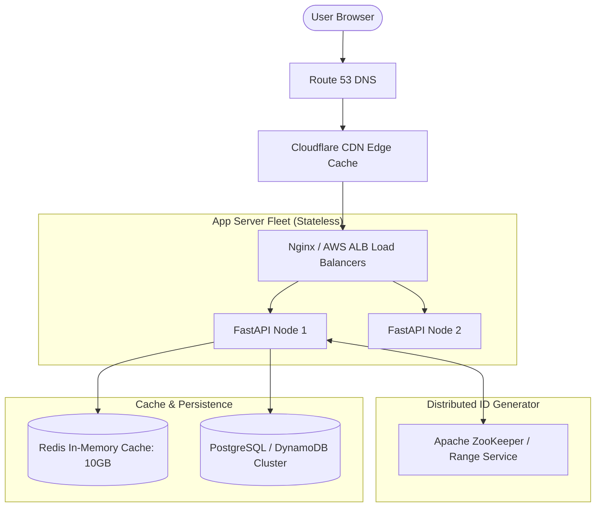
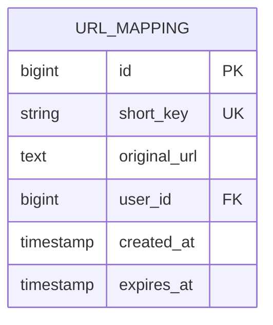
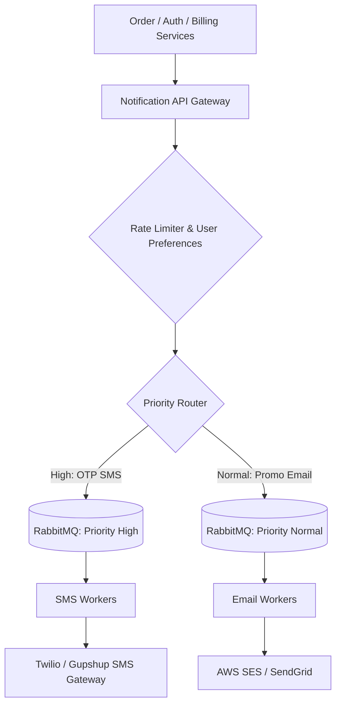

# System Design Real-World Case Studies

## Module Overview
This module provides end-to-end **System Design Case Studies** frequently asked in Senior and Staff Software Engineer interviews at Tier-1 product firms and engineering MNCs.

---

## Case Study 1: Design a Distributed URL Shortener (e.g. TinyURL)

### 1. Requirements

#### Functional Requirements:
- Given a long URL (e.g. `https://example.com/very/long/path/document.pdf`), generate a unique short URL (e.g. `https://tiny.url/aZ9k2L`).
- When a user accesses the short URL, redirect them via HTTP 301/302 to the original destination.
- Support custom short aliases and expiration dates (default 5 years).

#### Non-Functional Requirements:
- **Ultra-Low Latency:** Redirection must complete in $< 15\text{ ms}$.
- **High Availability:** 99.99% uptime (read-heavy system).
- **Scale:** 100 Million new URLs generated per month; 10 Billion redirections per month ($100:1$ Read-to-Write ratio).

---

### 2. Capacity Estimations & Math
- **Write QPS:** $\frac{100,000,000}{30 \times 86400} \approx 40\text{ writes/sec}$
- **Read QPS:** $40 \times 100 \approx 4,000\text{ reads/sec}$ (peaks of $8,000\text{ QPS}$)
- **Storage for 5 years:** $100\text{M} \times 12 \times 5 = 6\text{ Billion URLs}$. At 500 bytes per URL record $\approx 3\text{ Terabytes}$ total storage.
- **Cache Size (80-20 Rule):** Cache 20% of daily read traffic in Redis RAM $\approx 10\text{ GB}$ RAM required.

---

### 3. Architecture Diagram

---

### 4. Database Schema & ER Diagram

---

### 5. Step-by-Step Data Flow

#### A. Generating Short URL (Write Path):
1. User sends `POST /api/v1/shorten` with `{"long_url": "..."}`.
2. Web server requests a unique integer range from **ZooKeeper** (e.g. Node 1 gets IDs `1,000,000` to `2,000,000`).
3. Web server takes the next integer and encodes it using **Base62** (`[a-z, A-Z, 0-9]`):
   - A 7-character Base62 string yields $62^7 \approx 3.5\text{ Trillion}$ unique short URLs!
4. Web server writes `(short_key, original_url)` to the database and populates Redis cache.
5. Returns `https://tiny.url/aZ9k2L` to client.

#### B. Redirection (Read Path):
1. User requests `GET /aZ9k2L`.
2. CDN Edge checks cache. If hit, redirects immediately.
3. If miss, load balancer routes to FastAPI.
4. FastAPI checks Redis RAM:
   - **Cache Hit:** Returns `HTTP 301 Permanent Redirect` or `HTTP 302 Found` with header `Location: https://example.com/...` in $< 2\text{ ms}$.
   - **Cache Miss:** Queries PostgreSQL by unique index on `short_key`, populates Redis, and redirects.

---

### 6. Deep Technical Trade-Off: HTTP 301 vs HTTP 302 Redirect
- **HTTP 301 (Permanent Redirect):** The browser permanently caches the redirect. Subsequent visits do not touch your backend servers at all (lowest latency). *Downside:* You cannot track analytics (click counts, user agent, country).
- **HTTP 302 (Temporary Redirect):** The browser requests your server every single time. *Advantage:* Enables 100% accurate click analytics and fraud detection at the cost of slightly higher server traffic.

---

## Case Study 2: Design an Enterprise Notification System (SMS, Email, Push)

### Key Architectural Safeguards:
1. **User Opt-Out & Quiet Hours:** Check user preferences in Redis before sending non-urgent promotional alerts.
2. **Vendor Multi-Provider Fallback:** If primary SMS gateway (Twilio) fails, the worker immediately switches to a secondary vendor (Gupshup) to maintain 99.99% OTP delivery rates.
3. **Idempotency Keys:** Every notification message has a unique `event_id` to prevent sending duplicate SMS alerts during network retries.
