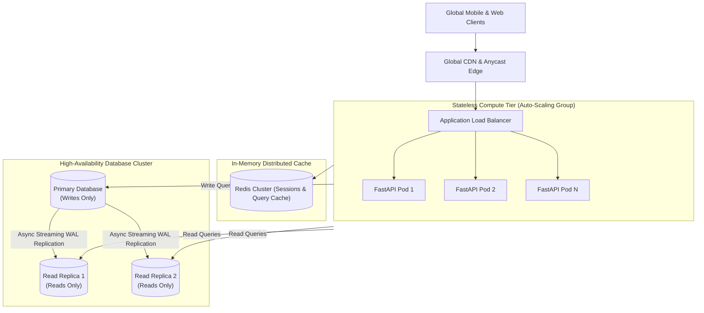

# Scalability, Performance & High-Throughput Architectures

Architectural principles for scaling Python backend services from 1,000 to 1,000,000+ daily active users, including database read/write splitting, horizontal scaling, sharding, and edge CDNs.

---

## Architecture: Scalable Multi-Tier Architecture



---

## Interview Questions & Answers

### SCALE-BAS-001: What is the difference between Vertical Scaling and Horizontal Scaling?

#### 1. Simple Explanation
- **Vertical Scaling (Scale-Up):** Adding more CPU, RAM, or faster NVMe SSD disks to a single server instance.
- **Horizontal Scaling (Scale-Out):** Adding more server instances (machines/containers) running in parallel behind a load balancer.

#### 2. Easy Example
- Vertical: Upgrading from a bicycle to a sports car to carry luggage faster.
- Horizontal: Adding 10 delivery vans running in parallel to transport 10 times more packages at the same time.

#### 3. One-Line Interview Answer
Vertical scaling increases the computational capacity of a single machine but hits physical and cost ceilings; horizontal scaling adds independent stateless nodes to achieve near-infinite elasticity.

#### 4. Detailed Technical Explanation
1. **Vertical Scaling Limits:**
   - Hardware limits: High-end servers (e.g. 128 cores, 4TB RAM) become exponentially expensive.
   - Single Point of Failure (SPOF): When the single massive machine reboots for maintenance, the entire system experiences 100% downtime.
2. **Horizontal Scaling Requirements:**
   - **Stateless Applications:** The application server must not store session state or user files in local memory or local disks. All state must be offloaded to external distributed stores (Redis for sessions, S3 for media, PostgreSQL for relational state).
   - **Load Balancer:** Distributes traffic via Round-Robin, Least Connections, or IP Hash.

#### 5. Practical Implementation
```python
# Stateless FastAPI pattern: offloading session tokens to Redis instead of local memory
import json
import uuid
from fastapi import FastAPI, Depends, Header, HTTPException
import redis

app = FastAPI()
redis_client = redis.Redis(host="redis-cluster", port=6379, db=0, decode_responses=True)

def get_current_user(session_token: str = Header(...)):
    user_json = redis_client.get(f"session:{session_token}")
    if not user_json:
        raise HTTPException(status_code=401, detail="Session expired")
    return json.loads(user_json)

@app.get("/profile")
def profile(user = Depends(get_current_user)):
    return {"user_id": user["id"], "username": user["username"]}
```

#### 6. Real-World Scenarios
- **Flash Sale Traffic Spike:** An e-commerce platform handles 2,000 requests/sec normally, but spikes to 100,000 requests/sec during a Diwali sale. With horizontal auto-scaling, Kubernetes Horizontal Pod Autoscaler (HPA) scales pods from 5 to 150 instances based on CPU utilization and terminates them when traffic subsides.

---

### SCALE-INT-002: How do Database Read Replicas, Connection Pooling, and Sharding work?

#### 1. Simple Explanation
Most web applications are read-heavy (90% reads, 10% writes). A single database server handling all queries will quickly saturate its CPU and disk I/O.
- **Read Replicas:** The Primary database handles writes and replicates data to multiple Read Replicas. All read queries (`SELECT`) are routed to replicas.
- **Connection Pooling:** Keeps a warm pool of database connections open to eliminate the expensive cost of establishing a new TCP/TLS connection per request.
- **Sharding:** Splitting a single massive table across multiple independent database servers based on a shard key (e.g., `user_id % num_shards`).

#### 2. Easy Example
Think of a popular newspaper:
- Primary DB = The editor writing and printing the daily edition.
- Read Replicas = Newsstands across the city distributing copies so millions can read simultaneously without crowding the printing press.
- Sharding = Splitting an encyclopedia into 26 alphabetical volumes across 26 different bookshelves.

#### 3. One-Line Interview Answer
Read replicas distribute read query load via asynchronous streaming replication; connection pooling eliminates TCP connection churn; and sharding partitions rows across physical databases by hash or range.

#### 4. Detailed Technical Explanation
1. **Replication Lag:**
   - In asynchronous replication, changes committed on the Primary take milliseconds to reach replicas.
   - Hazard: **Read-Your-Own-Writes Inconsistency**. A user updates their profile, the app writes to Primary, and immediately redirects the user to the profile page which reads from a replica before the update arrived.
   - Solution: Route reads for the updating user to Primary for 5 seconds after a write (Pinned Read Session).
2. **Database Sharding Strategies:**
   - *Hash-Based Sharding:* `Shard_ID = Hash(user_id) % Total_Shards`. Excellent data distribution, but resharding when adding new nodes requires consistent hashing.
   - *Range-Based Sharding:* Sharding by date or geographic region (e.g. US customers in Shard 1, EU customers in Shard 2). Can produce hot spots.

#### 5. Practical Implementation
```python
# Routing database reads to replicas and writes to primary in SQLAlchemy / Python
from contextlib import contextmanager

class DatabaseRouter:
    def __init__(self, primary_engine, replica_engines):
        self.primary_engine = primary_engine
        self.replica_engines = replica_engines
        self._replica_index = 0

    def get_read_engine(self):
        # Round-robin selection across available read replicas
        engine = self.replica_engines[self._replica_index % len(self.replica_engines)]
        self._replica_index += 1
        return engine

    def get_write_engine(self):
        return self.primary_engine

# Simulating query routing
# with db_router.get_read_engine().connect() as conn:
#     results = conn.execute("SELECT * FROM products WHERE category = 'electronics'")
```

#### 6. Real-World Scenarios
- **PostgreSQL Connection Exhaustion:** 1,000 concurrent FastAPI worker threads opened 1,000 direct connections to PostgreSQL. Postgres allocates ~10MB RAM per connection and fork-processes connections, maxing out server RAM. Introducing **PgBouncer** in transaction pooling mode multiplexed 1,000 frontend connections across just 50 persistent server connections, dropping database CPU from 95% to 15%.

---

### SCALE-ADV-003: How do Global CDNs, Edge Invalidation, and Anycast Routing reduce latency?

#### 1. Simple Explanation
The speed of light through fiber optic cables imposes a physical latency floor: a round-trip network packet from Mumbai to San Francisco takes ~200ms. A **Content Delivery Network (CDN)** places edge servers in hundreds of cities worldwide. When a user in Mumbai visits your site, static assets (images, JS, CSS) and cached API responses are delivered from a local Mumbai edge server in 5ms.

#### 2. Easy Example
Instead of shipping every book order directly from a central publishing warehouse in Germany to customers around the world, the publisher stocks regional warehouses in every major city so local deliveries arrive in minutes.

#### 3. One-Line Interview Answer
CDNs terminate TLS at the edge via BGP Anycast routing, caching static assets and dynamic micro-cached API responses near users to minimize round-trip propagation delays.

#### 4. Detailed Technical Explanation
1. **BGP Anycast Routing:**
   - Multiple CDN edge locations announce the exact same IP address via Border Gateway Protocol (BGP).
   - Internet service providers (ISPs) automatically route client requests to the topologically closest CDN PoP (Point of Presence).
2. **Cache-Control Headers & S-MaxAge:**
   - `Cache-Control: public, max-age=3600, s-maxage=86400`: Instructs browser to cache for 1 hour, but CDN shared caches to cache for 24 hours.
   - `stale-while-revalidate=60`: Serves cached content instantly while the CDN fetches updated content in the background.
3. **Targeted Edge Invalidation (Surrogate Keys):**
   - Tagging API responses with cache tags: `Surrogate-Key: product_42 category_electronics`.
   - When product 42 price changes, send a purge request for tag `product_42` to invalidate only that item across all global edge servers within 150ms.

#### 5. Practical Implementation
```python
# Serving high-performance cached API responses with Cache-Control headers in FastAPI
from fastapi import FastAPI, Response

app = FastAPI()

@app.get("/api/v1/products/{product_id}")
def get_product(product_id: int, response: Response):
    # Simulated product lookup
    product_data = {"id": product_id, "name": "Wireless Headphones", "price": 99.99}

    # Instruct Cloudflare / Fastly CDN edge to cache for 1 hour, browser for 5 minutes
    response.headers["Cache-Control"] = "public, max-age=300, s-maxage=3600, stale-while-revalidate=60"
    response.headers["Surrogate-Key"] = f"product_{product_id}"
    return product_data
```

#### 6. Real-World Scenarios
- **The Breaking News Thundering Herd:** A breaking news story went viral, generating 2,000,000 hits per second. Without edge caching, backend database servers collapsed within 5 seconds. Enabling **Micro-Caching** on Cloudflare with `s-maxage=2` (caching dynamic responses for just 2 seconds) reduced backend hits by 99.99%, allowing the origin to service 2M RPS effortlessly with only 1 request per 2 seconds reaching the origin server.
