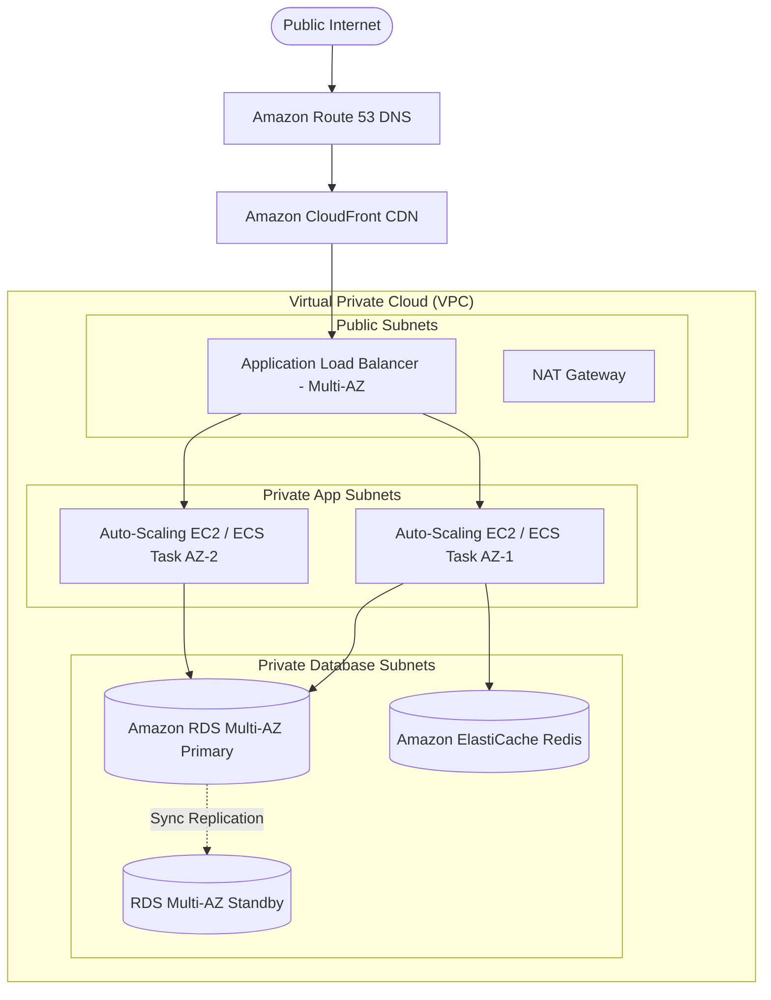

# AWS Cloud Infrastructure & Services Interview Guide

## Module Overview
This module covers **Amazon Web Services (AWS)** architecture for backend engineers: **EC2**, **S3**, **RDS**, **IAM**, and **Application Load Balancers (ALB)**.

---

## Visual Architecture: Resilient Multi-AZ AWS Web Application

---

## Questions & Comprehensive Solutions

### AWS-BAS-001: Core AWS Services Explained

1. **Amazon EC2 (Elastic Compute Cloud):** Resizable virtual machines in the cloud (IaaS).
2. **Amazon S3 (Simple Storage Service):** Highly scalable object storage with 11 9's durability.
3. **Amazon RDS (Relational Database Service):** Managed PostgreSQL/MySQL with automated failover and backups.
4. **AWS IAM (Identity & Access Management):** Controls authentication and permissions using IAM Roles (e.g. EC2 instance profiles accessing S3 without hardcoded credentials).
