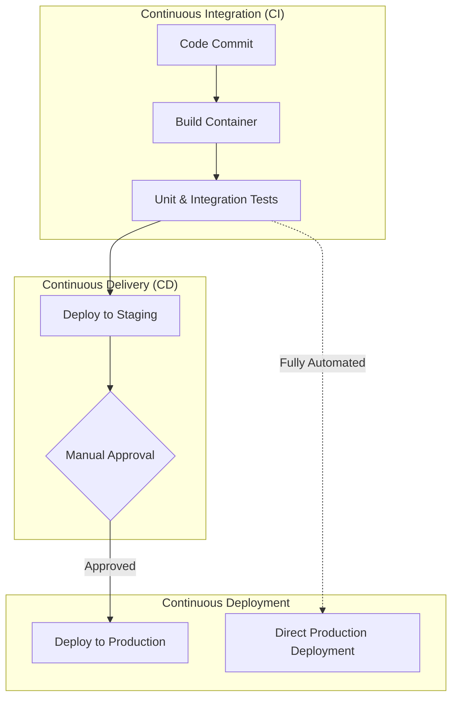

# Continuous Integration & Continuous Deployment (CI/CD) Guide

## Module Overview
This module covers the core theory and practices of **Continuous Integration (CI)**, **Continuous Delivery (CD)**, and **Continuous Deployment**, automated testing gates, and rollback strategies.

---

## CI vs CD vs Continuous Deployment

---

## Deployment Strategies Comparison

| Strategy | How it Works | Downtime | Rollback Speed | Cloud Cost |
| :--- | :--- | :---: | :---: | :--- |
| **Recreate** | Terminate all v1 instances, then launch v2 instances | 🔴 High downtime | Slow | Lowest (no extra instances) |
| **Rolling Update** | Replace v1 instances with v2 instances gradually (e.g. 25% at a time) | 🟢 Zero downtime | Moderate | Low |
| **Blue/Green** | Deploy complete v2 cluster alongside v1. Switch router traffic instantly | 🟢 Zero downtime | ⚡ Instant (flip router back) | High (requires $2\times$ compute) |
| **Canary** | Route 5% traffic to v2; monitor errors; gradually shift remaining 95% | 🟢 Zero downtime | Fast | Low |
