# Deployment Strategies & Production Troubleshooting

Production deployment strategies (Rolling, Blue-Green, Canary) and systematic debugging of high CPU, memory leaks (OOM Killer), network latency, and connection exhaustion.

---

## Architecture: Deployment Strategies & OOM Killer Flow

```mermaid
flowchart TD
    subgraph Deployments ["Zero-Downtime Deployment Strategies"]
        direction TB
        subgraph BlueGreen ["Blue-Green Deployment"]
            Router["Load Balancer / Ingress"]
            Blue["Active: Blue Fleet v1.0 (100% Traffic)"]
            Green["Staging: Green Fleet v2.0 (0% Traffic)"]
            Router -->|Switch instantly| Green
        end

        subgraph Canary ["Canary Deployment"]
            RouterCanary["Ingress Weighted Split"]
            StableFleet["Stable Fleet v1.0 (95% Traffic)"]
            CanaryFleet["Canary Fleet v2.0 (5% Traffic)"]
            RouterCanary -->|95%| StableFleet
            RouterCanary -->|5% Evaluate Error Rate| CanaryFleet
        end
    end

    subgraph OOMFlow ["Linux Kernel OOM Killer Mechanism"]
        MemGrow["Process Memory Grows (Leak)"] --> Limit["Hits cgroup memory.max / Host RAM"]
        Limit --> PageReclaim["Kernel Tries Page Cache Reclaim"]
        PageReclaim -->|Fails| OOMScore["Kernel Calculates oom_score for PIDs"]
        OOMScore --> KillProcess["Kernel sends SIGKILL to Highest oom_score PID"]
        KillProcess --> Syslog["dmesg: Out of memory: Killed process 1421 (python)"]
    end
```



---

## Interview Questions & Answers

### TRB-BAS-001: How do you diagnose high CPU utilization, memory leaks, and the Linux Out-Of-Memory (OOM) Killer?

#### 1. Simple Explanation
When a production server becomes sluggish or crashes:
- **High CPU:** A thread is caught in an infinite loop, performing CPU-intensive JSON parsing, or struggling with garbage collection.
- **Memory Leak:** An application allocates RAM (e.g., storing data in global lists) and never frees it.
- **OOM Killer:** When the operating system runs out of physical RAM and swap space, the Linux kernel invokes the Out-Of-Memory (OOM) Killer to forcibly terminate (`SIGKILL`) the process with the highest memory penalty to prevent a complete OS freeze.

#### 2. Easy Example
Imagine a boat filling with water. As the water level reaches the brim (RAM limit), the captain (Linux Kernel) throws the heaviest cargo overboard (the Python process with highest `oom_score`) so the boat doesn't sink.

#### 3. One-Line Interview Answer
Diagnose high CPU with `top -H` and `py-spy`, detect memory growth with heap profilers (`tracemalloc`, `memray`), and verify OOM terminations via `dmesg -T` or `journalctl -k` by inspecting `oom_score_adj`.

#### 4. Detailed Technical Explanation
1. **Investigating High CPU:**
   - Run `top` and press `1` to see per-core saturation. Press `H` to toggle thread-level view and identify the specific thread ID causing 100% utilization.
   - For Python services, attach an active profiler without stopping the process:
     `py-spy top --pid <PID>` or record a flame graph: `py-spy record -o profile.svg --pid <PID>`.
2. **Investigating Memory Leaks:**
   - Inspect Resident Set Size (RSS) memory: `ps aux --sort=-%mem | head -n 10`.
   - Inspect `/proc/<PID>/smaps` or `/proc/<PID>/status` to see Virtual Memory (VmSize) vs Real RAM (VmRSS).
   - In Python, use `tracemalloc` or `memray` to capture memory allocation diffs between two request intervals.
3. **Verifying OOM Killer Activity:**
   - Check kernel ring buffer: `dmesg -T | grep -i "killed process"` or `grep -i oom /var/log/syslog`.
   - Output shows: `Out of memory: Killed process 4120 (uvicorn) total-vm:4231880kB, anon-rss:2018440kB`.
   - In Kubernetes, check container termination reason: `kubectl describe pod <pod-name>` (shows `Reason: OOMKilled`, `Exit Code: 137` = 128 + 9 `SIGKILL`).

#### 5. Practical Implementation
```python
# Diagnosing memory leaks in Python using tracemalloc
import tracemalloc
import gc
from typing import List

# Start memory tracking
tracemalloc.start()

class MemoryLeakSimulator:
    def __init__(self):
        self.leak_cache: List[dict] = []

    def perform_leaky_operation(self):
        # Simulating appending to a global or long-lived collection
        for i in range(10_000):
            self.leak_cache.append({"id": i, "payload": "x" * 1024})

# Snapshot 1
snapshot1 = tracemalloc.take_snapshot()

simulator = MemoryLeakSimulator()
simulator.perform_leaky_operation()

# Snapshot 2
snapshot2 = tracemalloc.take_snapshot()

# Compare top memory allocations
top_stats = snapshot2.compare_to(snapshot1, "lineno")
print("[Top 5 Memory Allocations]")
for stat in top_stats[:5]:
    print(stat)
```

#### 6. Real-World Scenarios
- **Exit Code 137 in Kubernetes:** A backend pod restarts every 4 hours with exit code 137. The engineer inspects `kubectl describe pod` and sees `OOMKilled`. The pod limit was configured to 512Mi in YAML, while the app loaded a 600MB ML model into memory on the first search request. Increasing `resources.limits.memory` or streaming the weights resolved the incident.

---

### TRB-INT-002: How do you troubleshoot network latency, connection pool exhaustion, and DNS failures?

#### 1. Simple Explanation
When requests fail intermittently with `504 Gateway Timeout`, `Connection refused`, or `Temporary failure in name resolution`:
- The client connection pool might be exhausted (all database or HTTP connections are in use, queuing new requests).
- A DNS server might be timing out.
- Sockets might be stuck in `TIME_WAIT` due to rapid TCP connection opening and closing.

#### 2. Easy Example
A restaurant has 10 phone lines for delivery orders. If 10 callers stay on hold for 30 minutes, all new incoming calls receive a busy signal (`Connection pool exhausted`), even if the kitchen itself has plenty of capacity.

#### 3. One-Line Interview Answer
Troubleshoot network bottlenecks using `ss -s` for socket counts, `dig` / `nslookup` for DNS latency, `tcpdump` for packet analysis, and connection pool metric gauges to detect pool starvation.

#### 4. Detailed Technical Explanation
1. **Connection Pool Exhaustion:**
   - When requests outpace connection return speed, pool checkout times out (e.g., SQLAlchemy `TimeoutError: QueuePool limit of size 10 overflow 10 reached, connection timed out, timeout 30.00`).
   - Fix: Increase pool size appropriately, enable statement timeouts, and guarantee connections are released in `finally` blocks or context managers.
2. **TCP Socket Exhaustion (`TIME_WAIT`):**
   - High request volume opening new TCP connections without HTTP Keep-Alive results in thousands of sockets in `TIME_WAIT` state (lasting 60 seconds per RFC 793).
   - Check with `ss -s` or `netstat -an | grep TIME_WAIT | wc -l`.
   - Solution: Use connection pooling (`requests.Session()`, `httpx.AsyncClient()`), enable `tcp_tw_reuse` in `/etc/sysctl.conf`.
3. **DNS Failures:**
   - Measure lookup latency: `dig api.internal.company.com +stats`.
   - In Kubernetes, CoreDNS throttling is a notorious cause of 5-second connection delays due to glibc single-threaded A and AAAA record lookups. Fix with `options ndots:2` in `resolv.conf`.

#### 5. Practical Implementation
```bash
# Network & Port Troubleshooting Playbook

# 1. Check socket allocations and TCP state distribution
ss -s

# 2. Check which process is listening on port 5432 (Postgres)
ss -tulpn | grep 5432

# 3. Check for socket backlog drops (ListenOverflows / ListenDrops)
netstat -s | grep -i "listen"

# 4. Measure DNS resolution time precisely
time dig +noall +stats db.production.internal

# 5. Capture live HTTP packets on port 8000 for 50 requests
sudo tcpdump -i any -c 50 -nn -A 'tcp port 8000'
```

#### 6. Real-World Scenarios
- **FastAPI HTTPX Client Leak:** A developer wrote `response = await httpx.get("https://api.stripe.com")` inside an endpoint called 500 times per second. Each request initialized a new TCP and TLS handshake and left sockets hanging in `TIME_WAIT`. The Linux server ran out of ephemeral ports (`EADDRNOTAVAIL`). Refactoring to a singleton `httpx.AsyncClient` reused TCP connections and dropped latency from 180ms to 8ms.

---

### TRB-ADV-003: What are Blue-Green, Canary, and Rolling deployment strategies?

#### 1. Simple Explanation
When deploying a new version of software to production:
- **Rolling Update:** Gradually replace old pods/instances with new ones, one by one.
- **Blue-Green:** Run two identical environments (Blue = old live, Green = new idle). Once Green is tested and ready, switch all traffic to Green instantly.
- **Canary:** Route a tiny fraction (e.g., 2% to 5%) of real user traffic to the new version. If error rates remain normal, roll out to 100%.

#### 2. Easy Example
- **Rolling:** Replacing old light bulbs in a building one room at a time while people are working.
- **Blue-Green:** Building a brand new bridge right next to the old bridge, testing it completely, then flipping the highway signs to route all traffic to the new bridge in 1 second.
- **Canary:** Mining canary bird taken into a coal mine: test the air with a single bird before sending all miners inside.

#### 3. One-Line Interview Answer
Rolling deployments trade rollback speed for resource efficiency; Blue-Green provides instant rollback by doubling infrastructure; Canary minimizes blast radius by testing new versions on a small percentage of live traffic.

#### 4. Detailed Technical Explanation
| Strategy | Infrastructure Cost | Deployment Speed | Rollback Speed | Blast Radius | State / Schema Hazard |
| :--- | :--- | :--- | :--- | :--- | :--- |
| **Rolling Update** | Low (0% - 25% overhead) | Moderate | Moderate (must roll back pods) | Medium (affects fraction of users) | High (both versions run concurrently) |
| **Blue-Green** | High (200% capacity needed) | Fast (instant router flip) | Ultra-Fast (flip router back) | High (if bug wasn't caught in staging) | Extreme (database schema must support v1 & v2) |
| **Canary** | Low to Medium | Slow (gradual evaluation) | Fast (drop canary weight to 0%) | Minimal (only 1-5% of traffic exposed) | High (v1 and v2 coexist simultaneously) |

- **Zero-Downtime Database Migration Rule:**
  Regardless of strategy, because two versions of an application exist simultaneously at some point, **never perform breaking database changes in a single deployment**. Use the **Expand-and-Contract (Parallel Run) Pattern**:
  1. *Expand:* Add new column/table (nullable or with default).
  2. *Deploy:* Write to both old and new columns; read from old.
  3. *Backfill:* Populate historical data into new column.
  4. *Deploy:* Switch application to read from new column.
  5. *Contract:* Drop old column in a subsequent release.

#### 5. Practical Implementation
```yaml
# Kubernetes Canary Deployment using Argo Rollouts
apiVersion: argoproj.io/v1alpha1
kind: Rollout
metadata:
  name: fastapi-canary-rollout
spec:
  replicas: 10
  strategy:
    canary:
      steps:
        # Step 1: Route 5% traffic to new version and pause for human/automated analysis
        - setWeight: 5
        - pause: { duration: 10m }
        # Step 2: Scale up to 20%
        - setWeight: 20
        - pause: { duration: 30m }
        # Step 3: Scale up to 50%
        - setWeight: 50
        - pause: { duration: 15m }
        # Step 4: Complete 100% rollout
      analysis:
        templates:
          - templateName: success-rate-check
        args:
          - name: service-name
            value: fastapi-backend
```

#### 6. Real-World Scenarios
- **Bad Release Catch:** A developer introduced an integer overflow bug that only occurs when processing European currency symbols. During a 2% Canary deployment, Prometheus alerts fired because the 5xx error rate for canary pods spiked to 14%, while stable pods remained at 0.01%. The automated rollout controller aborted the rollout and reverted traffic to 0% within 45 seconds, shielding 98% of users from ever seeing the bug.
