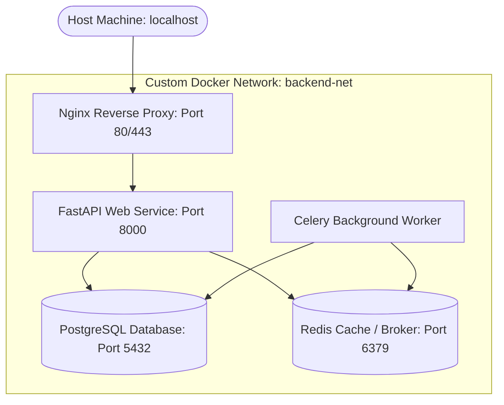

# Docker Compose & Multi-Container Orchestration Guide

## Module Overview
This guide covers **Docker Compose**, multi-container service orchestration, named volumes, custom bridge networks, container dependencies, and production health checks.

---

## Visual Architecture: Multi-Container Docker Network Topology



---

## Questions & Comprehensive Solutions

### COM-BAS-001: What is Docker Compose and why do we use it?

**Difficulty:** Basic  
**Topic:** Container Orchestration

#### 1. Simple Explanation
Running an application often requires multiple separate containers (e.g., one container for your Python app, one for PostgreSQL, and one for Redis). Typing long `docker run` commands with 15 flags for each container is tedious and error-prone.  
**Docker Compose** lets you define your entire multi-container architecture in a single, readable `docker-compose.yml` file, and start everything with one command: `docker compose up`.

#### 2. One-Line Interview Answer
**Docker Compose** is a declarative tool for defining and running multi-container Docker applications using a single YAML configuration file.

---

### COM-INT-002: Production Multi-Service `docker-compose.yml`

This production stack coordinates **FastAPI, PostgreSQL, Redis, and Celery** on a secure internal bridge network with health checks:

```yaml
version: '3.8'

services:
  # 1. Relational Database
  db:
    image: postgres:15-alpine
    restart: always
    environment:
      POSTGRES_DB: app_db
      POSTGRES_USER: postgres
      POSTGRES_PASSWORD: securepassword123
    volumes:
      - postgres_data:/var/lib/postgresql/data
    healthcheck:
      test: ["CMD-SHELL", "pg_isready -U postgres"]
      interval: 5s
      timeout: 5s
      retries: 5
    networks:
      - backend-net

  # 2. Redis Cache & Broker
  redis:
    image: redis:7-alpine
    restart: always
    volumes:
      - redis_data:/data
    networks:
      - backend-net

  # 3. FastAPI Web Application
  web:
    build: .
    restart: always
    ports:
      - "8000:8000"
    environment:
      DATABASE_URL: postgresql://postgres:securepassword123@db:5432/app_db
      REDIS_URL: redis://redis:6379/0
    depends_on:
      db:
        condition: service_healthy # Waits until PostgreSQL is fully ready!
      redis:
        condition: service_started
    networks:
      - backend-net

  # 4. Celery Background Worker
  worker:
    build: .
    command: celery -A tasks worker --loglevel=info
    environment:
      DATABASE_URL: postgresql://postgres:securepassword123@db:5432/app_db
      REDIS_URL: redis://redis:6379/0
    depends_on:
      db:
        condition: service_healthy
      redis:
        condition: service_started
    networks:
      - backend-net

volumes:
  postgres_data:
  redis_data:

networks:
  backend-net:
    driver: bridge
```
