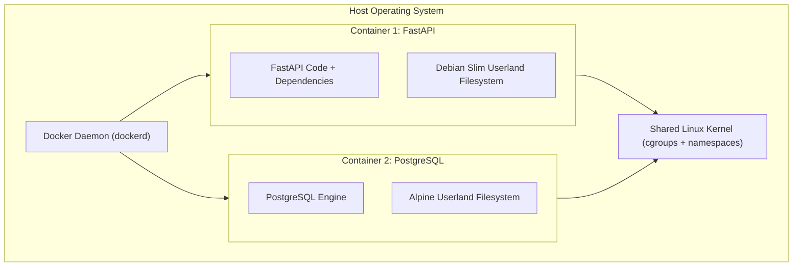
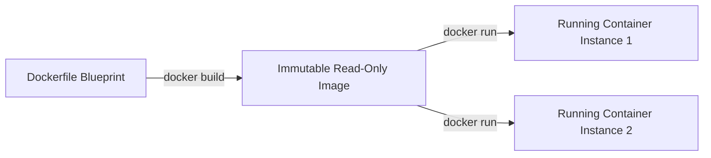

# Docker & Containerization Interview Guide

## Module Overview
This guide covers **Docker**, container internals, multi-stage Python builds, layer caching, `CMD` vs `ENTRYPOINT`, and production container optimization.

---

## Visual Architecture: Docker Architecture & Containerization Anatomy



---

## Questions & Comprehensive Solutions

### DOC-BAS-001: What is Docker and what is the difference between a Virtual Machine and a Container?

**Difficulty:** Basic  
**Topic:** Containerization Fundamentals

#### 1. Simple Explanation
Normally, an application works on your laptop, but when you send it to another developer or server, it fails because their machine has a different operating system, missing libraries, or the wrong Python version.  
**Docker** solves the famous *"It works on my machine"* problem by packaging your application code together with its exact Python version, system libraries, and configuration files into an isolated container that runs identically on any computer.

#### 2. Easy Real-World Example
- **Virtual Machine (VM):** Like buying a whole new house with its own foundation, plumbing, roof, and electricity whenever you need a new bedroom. It takes 10 minutes to build and consumes huge resources.
- **Docker Container:** Like renting an apartment inside an existing apartment building. All apartments share the building's main foundation and water pipes (the shared OS Kernel), but inside your private apartment, your furniture and door locks are completely isolated. It starts in 1 second and consumes almost zero idle RAM.

#### 3. One-Line Interview Answer
**Docker** is an open-source platform that packages applications and their dependencies into lightweight, portable, and isolated containers that share the host operating system's kernel.

#### 4. Comparison Table: Virtual Machines vs Containers

| Dimension | Virtual Machine (VM) | Docker Container |
| :--- | :--- | :--- |
| **Architecture** | Runs a complete Guest Operating System on a Hypervisor | Shares the Host OS Kernel via **cgroups** and **namespaces** |
| **Startup Time** | Minutes (boots full virtualized OS) | **Milliseconds** (starts a single isolated process) |
| **Storage Size** | Gigabytes (10GB–50GB per VM) | Megabytes (50MB–200MB per container image) |
| **Performance** | Hypervisor overhead on CPU and memory | **Near-native bare-metal speed** |
| **Isolation** | Hardware-level isolation (strictest) | OS process-level isolation |

---

### DOC-BAS-002: Docker Image vs Docker Container

**One-Line Answer:**  
A **Docker Image** is an immutable, read-only blueprint (class), while a **Docker Container** is a live, running instance of that image (object).



---

### DOC-INT-003: `CMD` vs `ENTRYPOINT` in a Dockerfile

**Comparison Matrix:**

| Directive | Purpose | Can be Overridden from CLI? |
| :--- | :--- | :--- |
| **`ENTRYPOINT`** | Defines the fixed binary executable that should always run | Hard to override (requires `--entrypoint`) |
| **`CMD`** | Defines the default arguments passed to `ENTRYPOINT` | **Easily overridden** by arguments passed to `docker run` |

**Best Practice Pattern:**
```dockerfile
# The executable is fixed:
ENTRYPOINT ["python", "manage.py"]

# Default argument (runs web server if no arguments passed):
CMD ["runserver", "0.0.0.0:8000"]
```
- Running `docker run my-app` executes: `python manage.py runserver 0.0.0.0:8000`
- Running `docker run my-app migrate` executes: `python manage.py migrate`

---

### DOC-ADV-004: Production Multi-Stage Python Dockerfile

**Why Multi-Stage Builds are Mandatory:**
A standard Python Dockerfile installs GCC compilers, build tools, and headers to compile C-extensions (like `psycopg2` or `cryptography`). If kept in the final image, image size exceeds **1.2 GB** and carries severe security vulnerabilities.  
A **Multi-Stage Build** compiles dependencies in a temporary `builder` container, then copies only the clean compiled `.local` site-packages into a clean slim image, shrinking image size to **$< 90\text{ MB}$**!

```dockerfile
# -------------------------------------------------------------
# Stage 1: Build & Compile Dependencies
# -------------------------------------------------------------
FROM python:3.11-slim as builder

WORKDIR /app

# Install build dependencies for C-extensions
RUN apt-get update && apt-get install -y --no-install-recommends \
    build-essential \
    libpq-dev \
    && rm -rf /var/lib/apt/lists/*

COPY requirements.txt .
RUN pip install --no-cache-dir --user -r requirements.txt

# -------------------------------------------------------------
# Stage 2: Final Minimal Runtime Image
# -------------------------------------------------------------
FROM python:3.11-slim

# Create a non-root security user (Security Best Practice)
RUN groupadd -r appuser && useradd -r -g appuser appuser

WORKDIR /app

# Install only runtime C-libraries (no compilers)
RUN apt-get update && apt-get install -y --no-install-recommends \
    libpq5 \
    && rm -rf /var/lib/apt/lists/*

# Copy compiled Python packages from builder stage
COPY --from=builder /root/.local /home/appuser/.local
COPY --chown=appuser:appuser . /app

ENV PATH=/home/appuser/.local/bin:$PATH
ENV PYTHONUNBUFFERED=1

USER appuser

EXPOSE 8000

CMD ["uvicorn", "main:app", "--host", "0.0.0.0", "--port", "8000", "--workers", "2"]
```
