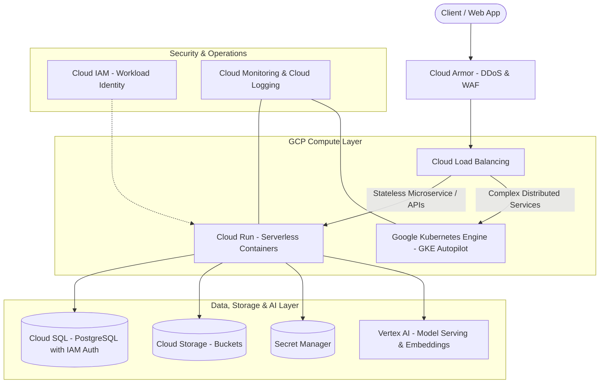
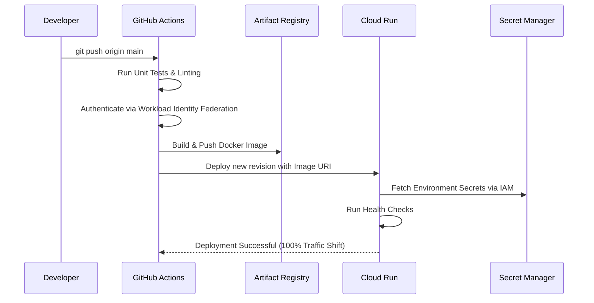

# Google Cloud Platform (GCP) & Cloud Infrastructure Interview Guide

## Module Overview
This module covers core **Google Cloud Platform (GCP)** infrastructure for backend engineers, including **Cloud Run**, **GKE**, **Cloud Storage**, **Vertex AI**, **IAM**, **Secret Management**, and **Cloud Operations Suite (Monitoring/Logging)**.

---

## Production Deployment Architecture on GCP



---

## Questions & Comprehensive Solutions

### GCP-BAS-001: What is Google Cloud Platform (GCP)?

**One-Line Answer:**  
**Google Cloud Platform (GCP)** is a comprehensive suite of cloud computing services providing high-performance compute, storage, networking, big data, machine learning, and managed enterprise databases running on Google's global private network infrastructure.

**Key Distinguishing Features:**
1. **Global Private Network:** Traffic between GCP regions travels across Google's private global fiber network rather than the public internet, offering lower latency, reduced packet loss, and enhanced security.
2. **Kubernetes Heritage:** Google originally developed Borg and open-sourced Kubernetes; GCP's Google Kubernetes Engine (GKE) is widely considered the industry benchmark for managed Kubernetes.
3. **Leading AI Infrastructure:** Native integration with **Vertex AI**, custom Tensor Processing Units (TPUs), and high-bandwidth GPU clusters for training and hosting large AI models.

---

### GCP-BAS-002: What is Cloud Run?

**One-Line Answer:**  
**Cloud Run** is a fully managed, serverless compute platform that enables developers to deploy and run stateless HTTP containers that scale automatically from zero to thousands of instances based on traffic.

**Cloud Run vs Cloud Functions vs GKE:**

| Dimension | Cloud Functions (2nd Gen) | Cloud Run | GKE (Kubernetes) |
| :--- | :--- | :--- | :--- |
| **Packaging** | Source code (zip/git) | Any OCI Container Image (`Dockerfile`) | Container Images inside Pods |
| **Scaling** | Scale-to-zero | Scale-to-zero (per-instance concurrency) | Autopilot or manual node auto-scaler |
| **Concurrency** | 1 concurrent request per instance | Up to **1,000 concurrent requests** per container instance | Unbounded (defined by container app limits) |
| **Cost Model** | Pay-per-invocation (millisecond granularity) | Pay-per-invocation or allocated CPU | Pay for provisioned CPU/RAM or node VMs |
| **Best Used For** | Event triggers (GCS uploads, Pub/Sub) | REST APIs, FastAPI/Django backends, Webhooks | Microservice meshes, complex stateful systems |

<u>Interview Tip:</u> Emphasize **concurrency**: Unlike AWS Lambda where 1 request consumes 1 instance, a single Cloud Run container can process up to 1,000 concurrent asynchronous requests (e.g., using FastAPI and `asyncio`), dramatically reducing infrastructure costs.

---

### GCP-BAS-003: What is Google Kubernetes Engine (GKE)?

**One-Line Answer:**  
**Google Kubernetes Engine (GKE)** is an enterprise-grade managed Kubernetes service for deploying, managing, and scaling containerized applications at scale.

**GKE Standard vs GKE Autopilot:**
- **GKE Standard:** You manage the underlying worker node pools (Compute Engine VMs), OS upgrades, and node sizing, while Google manages the control plane.
- **GKE Autopilot (Recommended):** Google manages both control plane AND worker nodes. You only deploy Kubernetes manifests (`Deployment`, `Service`). Billing is based strictly on the CPU/RAM requests of your running pods, eliminating idle VM costs and cluster hardening overhead.

---

### GCP-BAS-004: What is Cloud Storage (GCS)?

**One-Line Answer:**  
**Cloud Storage (GCS)** is an exabyte-scale, highly durable ($99.999999999\% = \text{11 9's}$ durability), low-latency object storage service for storing unstructured data such as images, videos, backups, document uploads, and ML datasets.

**Storage Classes:**
1. **Standard:** High-frequency access (e.g., serving website assets, active user uploads).
2. **Nearline:** Accessed less than once a month (e.g., monthly invoices, recent backups).
3. **Coldline:** Accessed less than once a quarter (e.g., quarterly audit logs).
4. **Archive:** Long-term preservation accessed less than once a year (e.g., multi-year compliance archives).

---

### GCP-BAS-005: What is Vertex AI?

**One-Line Answer:**  
**Vertex AI** is Google Cloud's unified machine learning and GenAI platform that provides infrastructure to train, tune, evaluate, deploy, and monitor predictive ML and foundation models (including Google's Gemini, Imagen, and Claude via Model Garden).

**Key Vertex AI Components for Backend & GenAI Engineers:**
- **Model Garden:** A curated catalog of 150+ first-party (Gemini 1.5 Pro/Flash) and open-source models (Llama 3, Mistral).
- **Vertex AI Search & Conversation:** Out-of-the-box managed RAG engine with enterprise semantic search and grounding.
- **Vertex Feature Store & Vector Search:** Low-latency vector search engine capable of sub-10 millisecond similarity search across billions of embeddings.
- **Gemini API on Vertex:** Enterprise-grade Gemini models with strict SLA guarantees, data privacy (data is *not* used to train foundation models), and IAM access controls.

---

### GCP-INT-006: What is Cloud Identity and Access Management (IAM)?

**One-Line Answer:**  
**Cloud IAM** authorizes *who* (identity) can do *what* (permission/role) on *which* Google Cloud resource, following the principle of least privilege.

**Core IAM Concepts:**
1. **Member / Principal:** An identity—a Google Account (`user@gmail.com`), Service Account (`app@project.iam.gserviceaccount.com`), or Google Workspace group.
2. **Role:** A collection of permissions.
   - **Primitive:** Owner, Editor, Viewer (Avoid in production).
   - **Predefined:** Curated by Google (e.g., `roles/run.invoker`, `roles/secretmanager.secretAccessor`).
   - **Custom:** User-defined list of exact granular permissions.
3. **Policy:** Binds one or more members to a specific role on a resource.
4. **Workload Identity:** Maps Kubernetes service accounts or external cloud identities directly to GCP IAM service accounts without needing to download and store static JSON private keys.

---

### GCP-INT-007: How do you deploy a Python (FastAPI/Django) application on GCP?

**Step-by-Step CI/CD Deployment Flow:**



**Production `Dockerfile`:**

```dockerfile
# Multi-stage lightweight production container
FROM python:3.11-slim as builder

WORKDIR /app
COPY requirements.txt .
RUN pip install --no-cache-dir --user -r requirements.txt

FROM python:3.11-slim
WORKDIR /app
COPY --from=builder /root/.local /root/.local
COPY . /app

ENV PATH=/root/.local/bin:$PATH
ENV PORT=8080
ENV PYTHONUNBUFFERED=1

# Cloud Run injects PORT environment variable dynamically
CMD exec uvicorn main:app --host 0.0.0.0 --port ${PORT} --workers 2
```

**Deployment CLI Command:**
```bash
gcloud run deploy interview-backend-api \
  --image us-central1-docker.pkg.dev/my-project/repo/api:v1 \
  --platform managed \
  --region us-central1 \
  --allow-unauthenticated \
  --set-secrets=DATABASE_URL=db-url-secret:latest,SECRET_KEY=app-secret-key:latest \
  --min-instances=1 \
  --max-instances=50 \
  --concurrency=80
```

---

### GCP-INT-008: How do you securely manage API keys and secrets on GCP?

**Architecture & Best Practices:**

1. **Google Cloud Secret Manager:**
   - Store sensitive values (DB credentials, Stripe keys, Gemini API tokens) as versioned secrets.
   - Secrets are encrypted at rest with customer-managed or Google-managed encryption keys (CMEK/KMS).
2. **Never Check-In Service Account JSON Keys:**
   - **Workload Identity Federation (WIF):** For CI/CD (GitHub Actions), exchange GitHub OpenID Connect (OIDC) tokens for short-lived GCP access tokens. No long-lived service account keys ever exist.
3. **Direct Cloud Run Secret Injection:**
   - Mount secrets directly as environment variables or in-memory secret volumes (`/secrets/db_password`) during container startup. The secret is fetched securely through IAM without application-level credential boilerplate.

---

### GCP-ADV-009: How would you monitor, log, and troubleshoot a Python application on GCP?

**The Cloud Operations (formerly Stackdriver) Suite:**

1. **Cloud Logging & Structured JSON Logs:**
   - Output logs to standard out (`stdout`/`stderr`) in structured JSON containing `severity`, `trace_id`, and `message`. Cloud Logging automatically aggregates these without requiring complex agent sidecars.
2. **Cloud Trace (Distributed Tracing):**
   - Propagate `X-Cloud-Trace-Context` headers across microservices to view millisecond-level waterfall diagrams of database queries, external API calls, and internal compute bottlenecks.
3. **Cloud Monitoring & Alerting:**
   - Define custom dashboards tracking Golden Signals:
     - **Latency:** 95th and 99th percentile response time.
     - **Traffic:** Requests per second (QPS).
     - **Errors:** 5xx HTTP status rate.
     - **Saturation:** Container instance count and CPU/Memory utilization.
   - Set up automated alerting policies dispatching alerts to PagerDuty or Slack when 5xx errors exceed $1\%$ over a 5-minute rolling window.
4. **Cloud Profiler:**
   - Continuous in-production CPU and heap allocation profiling with $< 1\%$ overhead, pinpointing memory leaks and unoptimized loops in live workloads.
