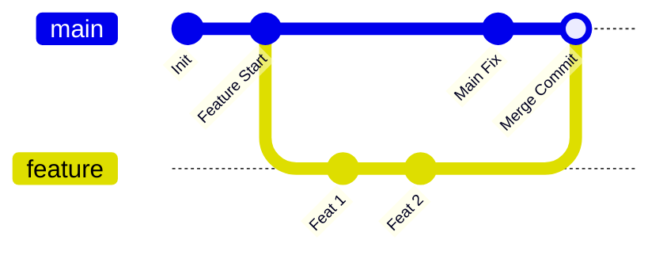

# Git & GitHub Workflows Interview Guide

## Module Overview
This guide covers **Git Internals (Blobs, Trees, Commits)**, branching strategies (Git Flow vs Trunk-Based), **Merge vs Rebase**, and fixing git merge conflicts.

---

## Git Merge vs Git Rebase

| Dimension | `git merge` | `git rebase` |
| :--- | :--- | :--- |
| **History Style** | Preserves exact chronological branch history with merge commits | Re-writes history into a **clean, linear line** |
| **Commit Hashes** | Keeps original commit hashes unchanged | Creates brand-new commit hashes |
| **Golden Rule** | Safe for public shared branches | **Never rebase a public shared branch** (violates team commit ancestry) |
