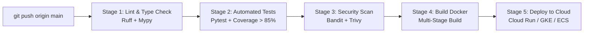

# GitHub Actions & Automated CI/CD Pipelines Guide

## Module Overview
This guide covers **GitHub Actions**, automated **CI/CD Pipelines**, testing matrixes, caching Python dependencies, and zero-downtime deployment workflows.

---

## Visual Architecture: Automated Production CI/CD Pipeline Stages



---

## Production GitHub Actions Workflow (`.github/workflows/deploy.yml`)

```yaml
name: Production CI/CD Pipeline

on:
  push:
    branches: [main]
  pull_request:
    branches: [main]

jobs:
  # -----------------------------------------------------------
  # Job 1: Linting, Type Checking, and Testing
  # -----------------------------------------------------------
  test:
    runs-on: ubuntu-latest
    steps:
      - name: Checkout Code
        uses: actions/checkout@v4

      - name: Set up Python 3.11
        uses: actions/setup-python@v5
        with:
          python-version: '3.11'
          cache: 'pip' # Caches dependencies to speed up pipeline

      - name: Install Dependencies
        run: |
          python -m pip install --upgrade pip
          pip install ruff mypy pytest pytest-cov -r requirements.txt

      - name: Run Ruff Linter
        run: ruff check .

      - name: Run Mypy Static Type Checking
        run: mypy . --ignore-missing-imports

      - name: Run Pytest with Coverage
        run: pytest --cov=. --cov-fail-under=80

  # -----------------------------------------------------------
  # Job 2: Build & Push Docker Image (Runs only after Tests Pass)
  # -----------------------------------------------------------
  deploy:
    needs: test
    if: github.ref == 'refs/heads/main' && github.event_name == 'push'
    runs-on: ubuntu-latest
    steps:
      - name: Checkout Code
        uses: actions/checkout@v4

      - name: Authenticate to Cloud Provider (Workload Identity)
        uses: google-github-actions/auth@v2
        with:
          workload_identity_provider: 'projects/123/locations/global/workloadIdentityPools/my-pool/providers/my-provider'
          service_account: 'github-deployer@my-project.iam.gserviceaccount.com'

      - name: Set up Docker Buildx
        uses: docker/setup-buildx-action@v3

      - name: Build and Push Docker Image
        uses: docker/build-push-action@v5
        with:
          context: .
          push: true
          tags: us-central1-docker.pkg.dev/my-project/repo/api:${{ github.sha }}
          cache-from: type=gha
          cache-to: type=gha,mode=max

      - name: Deploy to Cloud Run
        run: |
          gcloud run deploy api-service \
            --image us-central1-docker.pkg.dev/my-project/repo/api:${{ github.sha }} \
            --region us-central1 \
            --platform managed
```
