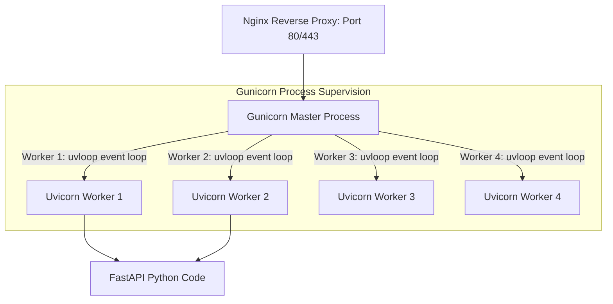

# Gunicorn, Uvicorn & ASGI/WSGI Production Server Guide

## Module Overview
This module covers **WSGI vs ASGI**, **Gunicorn Process Management**, **Uvicorn Asynchronous Concurrency**, and production worker sizing formulas.

---

## Visual Architecture: Gunicorn Master Supervising Uvicorn ASGI Workers



---

## Questions & Comprehensive Solutions

### SVR-BAS-001: WSGI vs ASGI Comparison

**Comparison Table:**

| Feature | WSGI (Web Server Gateway Interface) | ASGI (Asynchronous Server Gateway Interface) |
| :--- | :--- | :--- |
| **Standard** | PEP 3333 (Synchronous standard) | Modern Asynchronous standard |
| **Execution Model** | **Synchronous / Blocking**: 1 request consumes 1 thread/process until done | **Asynchronous / Non-blocking**: Single worker runs thousands of concurrent coroutines via event loop |
| **Supported Protocols**| HTTP/1.1 only | **HTTP/1.1, HTTP/2, WebSockets, Server-Sent Events** |
| **Frameworks** | Traditional Django, Flask | **FastAPI**, Starlette, Django Channels |
| **Servers** | Gunicorn (sync workers), uWSGI | **Uvicorn**, Hypercorn, Daphne |

---

### SVR-INT-002: Why use Gunicorn with Uvicorn Workers in Production?

**One-Line Answer:**  
Uvicorn is a high-speed ASGI web server but lacks robust multi-process management; running **Gunicorn as the master process manager supervising Uvicorn worker processes** provides the optimal combination of process clustering, graceful zero-downtime restarts, and async speed.

#### Production Startup Command:
```bash
gunicorn main:app \
  --workers 4 \
  --worker-class uvicorn.workers.UvicornWorker \
  --bind 0.0.0.0:8000 \
  --timeout 60 \
  --graceful-timeout 30 \
  --access-logfile - \
  --error-logfile -
```

#### How to Size Workers in Production:
**Official Gunicorn Sizing Formula:**
$$\text{Workers} = 2 \times \text{CPU Cores} + 1$$
- For a 4-core container/VM: $2 \times 4 + 1 = \mathbf{9\text{ workers}}$.
- *Why?* While some workers are briefly blocked on disk I/O, the remaining workers fully saturate the CPU cores without excessive context switching.
